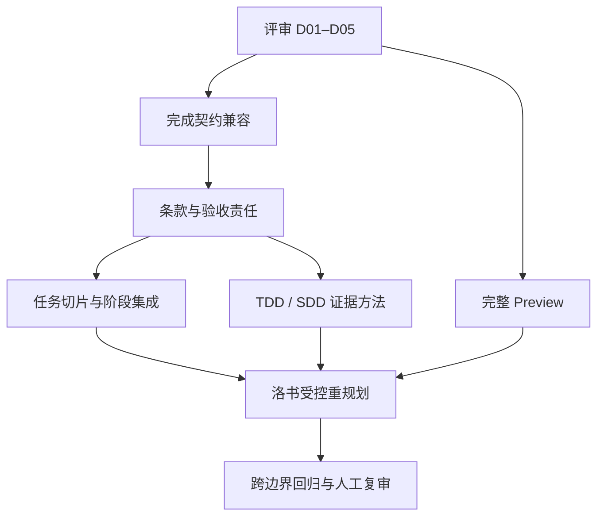

# Plan 完整预览、任务拆分与验收证据闭环

> 状态：partial — 用户已批准 B01–B07 实施，正在独立 worktree 验证。
> 日期：2026-10-20。
> 范围：以洛书 FMS 待审计划为案例，评估 ZaoFu 的 Plan 交接、Preview、任务切片、完成契约及 TDD/SDD 方法。
> 本文的 B01–B07 已获实施授权；不自动批准洛书产品 Plan、产品实现、数据库操作或部署。
> 当前实施与验证见 [实施记录](../impl/plan182-review-and-evidence-closure.md)。

## 1. 评审结论

本节及 F01–F08 保留实施前的评审基线；修复后的实际验证结果见[实施记录](../impl/plan182-review-and-evidence-closure.md)。

洛书计划的业务领域和页面清单覆盖较完整，但尚不能认定为可以直接派发的完整执行计划。
问题集中在三个连接处：完整规划产物没有进入审批正文；需求条款与验证责任没有完全对齐；
模块级工作包没有充分转化为能够独立完成、验收和返工的小切片。

建议保留已有来源追溯、领域划分、独占路径和原子业务边界，修复交接与完成契约，
再通过 Planner/Critic 重审任务粒度和阶段集成。不要通过增加一层摘要、只统计映射数量，
或把洛书业务规则写进 Kernel 来替代这些工作。

| 维度 | 当前判断 | 不能据此推出的结论 |
| --- | --- | --- |
| 范围追溯 | 62 个主页面、6 类表单、80 个 ASCII、E01–E26、Q01–Q15 均有映射 | 不等于所有字段、分支、并发和失败结果均可有效验收 |
| 原文条目 | 2,260 个行级条目全部关联到条款及 AC | 行级条目不是 2,260 个独立业务测试，也不是实现覆盖率 |
| 任务结构 | 26 个任务、13 个波次；依赖图无环，写入路径未发现跨任务重叠 | 无环、无路径重叠不证明任务大小与依赖语义合理 |
| SDD | 规格来源、哈希、条款、AC、命令和审批边界已建立 | 任务级规格及未决接口方案仍需细化；不是已完成实现 |
| TDD | 开发角色的方法明确要求 RED → GREEN → REFACTOR | 实现尚未开始，不能认证已遵循，也不能断言已经违反 |
| Preview | 当前网页正文使用 Plan Digest | 机械预检绿灯不是完整计划审查结果 |

## 2. 证据基线与可复核入口

### 2.1 当前审查对象

- 原稿：`/tmp/gm/loshu-fms-handoff.md`，2026-10-19 基线，共 5,082 行。
- 原稿内容 SHA-256：`582c21ea932e124daaa3041496f2a7064e817a24e6ec67b8b62e89716fcfc2ce`。
- 规划输入：`/home/min/workspace/loshu/docs/source/loshu-fms-handoff.md`，保留凭据脱敏后的来源关系。
- 输入内容 SHA-256：`61dd290e611fda6260b5f769cc98f4c775d038ce29f6a175222bc405a9e89b7e`。
- 项目：`loshu-033ea7f8`；配置状态目录：`/home/min/workspace/loshu/.zf-loshu`。
- 工作流：`workflow-6490add4629f32b4`；Plan：`evt-642cfd6f51d0`。
- 审批请求：`evt-a437219da5cb`，观察时状态为 `pending`。
- 产物前缀：`artifacts/fanouts/fanout-prd-plan-evt-8059b017/prd-planner/`，相对于该项目配置的状态目录。
- 完整计划：该前缀下 `docs/plans/loshu-fms/prd-plan.md`。
- 正式任务图：该前缀下 `artifacts/plan/task_map.json`，与同批 `docs/plans/loshu-fms/task_map.json` 内容一致。
- 配套文件：同批 `traceability.json`、`acceptance_matrix.json`、`test_matrix.json`、
  `product_acceptance_spec.json`、`real_e2e_matrix.json`、`source_index.json`。

入口：

- [自动展开当前 Plan Preview](http://10.9.100.141:8001/?project=loshu-033ea7f8&page=inbox&plan=evt-642cfd6f51d0)
- [只读 Preview JSON](http://10.9.100.141:8001/api/projects/loshu-033ea7f8/plans/evt-642cfd6f51d0/preview)
- [完整计划本地正文](/home/min/workspace/loshu/.zf-loshu/artifacts/fanouts/fanout-prd-plan-evt-8059b017/prd-planner/docs/plans/loshu-fms/prd-plan.md)
- [任务图本地正文](/home/min/workspace/loshu/.zf-loshu/artifacts/fanouts/fanout-prd-plan-evt-8059b017/prd-planner/artifacts/plan/task_map.json)

以上地址是本次环境的定位信息，不成为 ZaoFu 新的硬编码路径或测试依赖。
运行态产物和后续 Plan revision 可能变化；实施 backlog 前必须重新绑定当前审查对象。
本文不复制数据库凭据、完整运行日志或大体积规划产物。

### 2.2 已完成与未完成的验证

已完成只读 API、事件、源码、来源哈希、跨矩阵引用、任务依赖与路径检查，
并对完成证据冲突做了无文件写入的函数级复现。

未执行产品测试、建库、迁移、审批、writer 派发或产品实现。
原评审时 Playwright 视觉核验未完成：当时会话访问 `/var/run/docker.sock` 被拒绝，
`sudo -n` 需要密码；本次未改用主机浏览器。
预定 Docker 启动边界为：

```bash
docker run --rm -i --network host --entrypoint node \
  -v "$PWD/web:/work:ro" -w /work mcp/playwright:latest --input-type=module
```

该命令需通过标准输入传入只读浏览器核验脚本；它不是已经运行成功的证据。
后续测试必须记录实际脚本、精确页面、断言和结果，不能把 GET 成功当作视觉验证。
实施阶段已通过现有 Docker 组权限运行真实浏览器核验，结果另记于实施记录，不改写本节原始观察。

## 3. 发现、原因与影响

优先级用于候选工作排序，不表示所有问题都已造成线上故障。

### F01 · P1 · 完整 Plan 引用在审批链路丢失，Preview 优先选择摘要

**已确认缺陷。** 真实 `task_map.ready` 事件已有 `plan_artifact_ref`，指向完整正文。
`_plan_approval_satisfied()` 构造审批请求时只保留 `task_map_ref`，并新增 `digest_ref`，
没有传递完整 Plan 引用。当前 Preview JSON 的 `plan_ref` 因此为空。

即使补上传递，`build_plan_preview()` 仍按 `[digest_ref, plan_ref]` 选择首个可读文件。
`render_plan_digest()` 有意仅输出任务表和机械检查，路径只取前四项，验证命令截取前
60 个字符。前端直接渲染该正文，因此缺失首先发生在内容交接和选择阶段。

证据：[审批事件生成](../../src/zf/runtime/orchestrator_fanout.py) 的
`_plan_approval_satisfied`、[Preview 投影](../../src/zf/runtime/operator_plan_preview.py)、
[Digest 生成](../../src/zf/runtime/plan_digest.py)、
[Preview 界面](../../web/src/components/delivery-trace/PlanApprovalPanel.tsx)。

现有 [后端测试](../../tests/test_operator_inbox.py) 的
`test_plan_preview_reads_digest_and_task_map` 明确断言正文来自 digest；
[浏览器布局测试](../../web/tests/plan-preview-layout.spec.ts) 使用手写 HTML，
未证明完整计划经过真实事件、API 和页面链路仍可阅读。

### F02 · P2 · 工程前置验收包含了需要业务实现后证明的行为

**已确认验收映射缺口。** 原稿 §7.11.5–7.11.7 对应
`AC-SEC-148/149/150`，全部绑定到 `LF-FOUNDATION / AC-FOUNDATION`。
它们包含同幂等键不同请求冲突、事务重试、删除保存边界等实际行为。

但该 AC 的命令读取工程盘点 `inventory.json`，产品验收又将整个 AC 归为
`delivery_prerequisite`，其 `journey_ids` 为空。问题不是非 UI 前置工作必须做浏览器
测试，而是这些行为没有独立绑定到正确阶段的服务、数据库或集成验证。

同批计划的 `verify_rework.py` 在检查早期局部验收时豁免 FOUNDATION/CONTRACTS，
又允许这两个 AC 无产品旅程。检查证明了引用存在，没有证明内部每个条款的验证可行。
相关业务在其他章节可能另有覆盖，不能把此发现扩大为整个事务能力都没有规划。

### F03 · P2 · 原有任务图保留，完整集成验证集中到最后

**已确认安排，属于执行风险。** `LF-ASSEMBLY` 位于第 13 波，依赖其余全部 25 个任务；
计划写明最终装配时依次核对 G2、G3、G4。原稿则以读取闭环、完整作业闭环作为逐步
推进的依据。仅保留阶段名称，没有提供相应的中间集成反馈。

上一轮返工针对 E14/E23 等早期任务依赖未来行为的问题，新增局部 AC，将完整 AC
移交候选验收，但同时保留原任务 ID、波次、依赖和路径。它消除了部分验证依赖矛盾，
没有重新设计集成时点。不能因此断言 ZaoFu 架构只能在最后集成。

### F04 · P1 · 局部完成与完整候选验收尚未兼容完成证据契约

**已确认函数级冲突；实际派发路径仍需集成复现。** `LF-VEHICLES` 同时包含：

| AC | 规划归属 | 当前时点可证明的内容 |
| --- | --- | --- |
| `AC-LOCAL-VEHICLES` | task_verify | 本片与已完成前置任务的行为 |
| `AC-VEHICLES`、`E14` | candidate_verify | 包含后续设备、流程等模块参与的完整结果 |

三者均为 mandatory。`normalize_impl_self_check()` 对所有 mandatory AC 要求
`passed`，未按验收归属区分。以真实车辆 AC、合成身份和空命令注册表做内存探针，
局部 AC 为 passed、完整候选 AC 为 blocked，得到：

```text
self-check mandatory acceptance did not pass: AC-VEHICLES, E14
```

此探针仅隔离 AC 状态检查，不是一次真实 worker 完成交接，也不是伪造产品证据。
当前冻结配置的 `impl_self_check_required=false`，因此不能断言所有路径必然卡死；
但按开发角色要求提交 self-check 时，严格校验会遇到该冲突。

证据：[AC 归一化](../../src/zf/runtime/task_contract_snapshot.py)、
[self-check 校验及模板](../../src/zf/runtime/impl_self_check.py)、
[writer 实际调用](../../src/zf/runtime/writer_contract_handoff.py)、
[typed result 准入](../../src/zf/runtime/typed_result_admission.py)。

### F05 · P2 · 部分 Task 是模块工作包，顶层数量检查不能证明粒度合适

**评审判断。** 领域划分和写入隔离合理，但以下任务承担多个可独立验收的行为：

| 任务 | 当前负担 | 建议边界 |
| --- | --- | --- |
| LF-CONTRACTS | 一个 AC 包含全站接口、权限、事务恢复及附件契约 | 共享基础契约先行，业务契约随对应行为切片细化 |
| LF-VEHICLES | 生产投入、项目新增、线路、档案、保险质保、调拨、报废恢复 | 基础读写、资料管理、跨项目生命周期分开评估 |
| LF-DEVICES | 登记调入、装拆、替换、报废恢复 | 基础管理与安装生命周期拆分，复合动作仍保持原子性 |
| LF-WORK | 一次作业同时改变流程、库存、设备等 | 保持同一业务命令负责人，在内部用小步 TDD 验证正常、回滚、修正及幂等 |
| LF-ASSEMBLY | 首次正式接线、整站验收、复现与交付 | 提前建立可运行入口与中间验证，最终任务负责全量收口 |

例如 LF-VEHICLES 只有 3 个顶层 AC，却绑定 26 个子条款和 246 个原文行级条目。
数量不能单独证明任务过大，但结合多种独立行为，说明顶层 AC 数不是充分的粒度指标。

[拆分机械检查](../../src/zf/runtime/writer_fanout_admission.py) 统计顶层 AC 与路径条目；
一个 `features/vehicles/**` 只算一项。不要把这种机械检查升级为 Kernel 对业务复杂度的
推断。语义粒度应由 Planner/Critic 按可演示结果、依赖及返工边界审查。

### F06 · P2 · 取消只读行为重复规划，并被不必要地排在物理删除之后

**依赖语义风险。** LF-FLOW 已包含已取消态只读；LF-CANCEL 再次承担该行为，位于
第 12 波且依赖 LF-FLOW-DELETE。对当前未启用的新取消命令，计划没有说明为什么
“读取已取消状态”必须等待“物理删除流程”。取消与物理删除不能混为同一业务操作。

建议把已有只读行为及不暴露新命令的断言放入流程切片。新取消命令在 Q15 决定后，
按实际权限、状态、库存、设备及历史处理要求形成条件任务；不提前猜测依赖。

### F07 · P2 改进项 · TDD 已有方法要求，但任务级审计绑定不足

实际开发角色加载 [dev worker 方法](../../skills/zf-yoke-dev-worker-role-context/SKILL.md)，
其依赖 [tdd-evidence](../../yoke/tdd-evidence/SKILL.md)，要求先写失败测试、保留失败输出，
再做最小实现和重构。项目已具备该方法副本，不属于没有 TDD 指令。

当前计划主要登记最终 static/runtime/browser 命令，未把关键行为进一步对应到可识别的
测试用例和 RED/GREEN 证据。实现尚未开始，所以只能确认方法要求存在，不能认证执行。

所有任务 `expected_red=false` 不表示禁用 TDD。该字段涉及最终验证对预期失败的处理，
正常功能任务最终通过与开发中先经历失败并不冲突。缺少任务级 `tdd_ref` 或独立“测试
任务”也不能单独作为未遵循 TDD 的证据。

### F08 · 前置条件 · SDD 追溯已建立，任务规格仍需按阶段收敛

SDD 在本文指规格驱动开发。来源绑定、页面/条款映射、AC/命令关联和未决事项保留已具备。
部分子条款仍以“该章节全部规则逐项实现”表述，实施者需要再次分解成明确输入、状态变化、
拒绝条件及观察结果。Q01–Q15 保持 open 是忠实保留原稿，不应直接归类为漏需求。

进入相应实施阶段前，应关闭影响该阶段的阻塞决定，或明确条件项本期不启用。
Q05、Q08、Q15 等扩展条件未满足时，保留范围和未验证状态，不冒充通过，也不静默删除。
不要求在第一项工程盘点之前预先关闭所有后续业务决定。

## 4. 设计原则与责任边界

| 所有者 | 应承担 | 不应承担 |
| --- | --- | --- |
| Kernel / Runtime | 引用与 digest 完整性、当前代际、状态与证据 schema、按契约归属执行验证、受控副作用 | 推断车辆/库存业务语义、判断某章节天然属于前置工作 |
| Planner / Critic | 任务粒度、业务依赖、条款归属、验证时点、条件范围与风险取舍 | 直接改 canonical state、降低需求来通过机械检查 |
| Skills / Prompts | 规格细化、垂直切片、TDD 证据与语义评审方法 | 成为另一套任务状态机或独立任务 schema |
| Web / API | 完整正文及证据入口、摘要标识、状态来源、受控审批入口 | 把机械检查显示成语义完成，凭目录猜测当前计划 |
| Worker / Verify | 按当前合同实现并提供/复核对应证据 | 为结束局部任务提前宣布候选 AC 全部通过 |

继续使用唯一 `contract`、EventWriter/EventLog、canonical stores 和受控 sidecar。
不直接编辑历史审批事件、已准入 Plan Package 或洛书状态目录。

## 5. 待评审的设计选择

| 决定 | 推荐方向 | 需要评审的边界 |
| --- | --- | --- |
| D01 · Preview 正文 | 完整 Plan 为主正文，Digest 保留为摘要；相关矩阵通过受控引用可打开 | 历史 digest-only 计划明确标识；已声明但不可读的完整正文不能静默降级成“完整预览” |
| D02 · 完成证据分层 | 按当前阶段的契约归属校验必需结果，完整候选 AC 保持 mandatory 并在后续签收 | 明确 self-check 是本片实现证据还是全部 AC 声明；复用统一状态语义，不把 deferred 当 passed/waived |
| D03 · 中间集成 | 一个接线所有者、尽早可启动、G2/G3 分阶段验证 | 遵守全图写入路径唯一性；不能简单创建多个任务同时编辑相同入口 |
| D04 · TDD 审计 | 方法负责判定失败是否有意义，现有证据工件记录规格、测试、RED/GREEN 与提交关系 | 纯文档/配置等无行为变更不强制造失败测试；不新增通用 TDD 状态机 |
| D05 · 洛书重规划范围 | 允许修改受影响任务、依赖、AC 归属及路径，保留原始需求分母与来源 | 不再把保留任务图当作修复的绝对约束；原子事务不能为凑小任务而拆成部分提交 |

D02 的备选方案是只修改计划，把完整候选 AC 放到集成任务，本片只持有局部 AC，
同时保留行为生产者与需求映射。它改动 Runtime 较少，但可能把所有语义责任集中到装配。
实施前应比较两种方案的真实调用链与兼容性；不能仅凭本次函数探针决定修改公共 schema。

## 6. 候选 backlog

以下 ID 是设计内的工作项标识。用户已批准实施，已先生成 backlog 再转入 `tasks/active/`；
它们不是洛书 canonical 产品 Task。完成与验证状态以任务记录和实施记录为准。

### B01 · P1 · 完整 Plan 到审批 Preview 的受控交接

- 对应：F01、D01；所有者：Runtime/Web；依赖：D01 确认。
- 变更面：审批事件、Preview 投影、必要的 UI/产物阅读入口及相关测试。
- 新请求携带已有正式 Plan 引用；完整正文优先，摘要单独保留。
- 对缺少完整引用的旧 pending 请求，只沿已绑定因果事件/正式 Package 解析，不扫描目录猜测，
  不重写历史事件；无可靠来源时明确显示不可用并走受控重新交接。
- 先构造含完整正文、Digest、矩阵和长文末尾标记的真实审批链测试 → verify: 当前能复现引用丢失或错误选择。
- 修复正式引用传播与正文选择 → verify: API 正文与绑定来源一致，正文末尾、待决事项和矩阵入口可核对。
- 覆盖旧请求、缺文件、失效引用、跨项目路径与切换 Plan → verify: 无误读、无静默降级、无审批副作用。
- 覆盖真实 React/API 链路 → verify: Docker Playwright 打开深链接后显示完整正文及摘要身份；布局测试仅作补充。
- 测试入口：`test_operator_inbox.py`、`test_writer_fanout_runtime.py` 中审批场景，补齐实际 API/页面调用者。

### B02 · P1 · 局部实现完成与候选验收的契约兼容

- 对应：F04、D02；所有者：Runtime/契约；依赖：D02 确认。
- 先用混合 task_verify/candidate_verify/human AC 经实际 snapshot 与 handoff 路径复现 → verify: 明确哪些入口要求 self-check、哪些合法结果被拒绝。
- 对齐模板、schema、校验、角色提示和 Verify 消费语义 → verify: 本片局部通过可完成自身阶段，后续 AC 仍保持未完成且不可计入产品通过。
- 保留失败边界 → verify: 本阶段失败/缺证据仍拒绝；不能借另一阶段归属绕过本片验证。
- 覆盖单一 owner 的旧合同、可选 self-check、严格 typed result 及恢复重放 → verify: 原行为兼容，陈旧代际和错误目标仍拒绝。
- 覆盖最后候选检查 → verify: 缺少完整 AC 证据时，局部任务通过不能推导产品完成。
- 测试入口：`test_impl_self_check.py`、`test_writer_contract_handoff.py`、`test_typed_result_admission.py` 及相关 task pipeline 调用者。
- 不以关闭全局校验、把 mandatory 改成 false 或伪填 passed 作为修复。

### B03 · P2 · 条款级验收责任与规格充分性审查

- 对应：F02、F08；所有者：Planner/Critic 方法；依赖：与 B02 对齐完成语义。
- 审查每个混合 AC 的子条款 → verify: 盘点决定、真实行为、条件扩展分别有明确生产者、验证方法和最早可验证时点。
- 去除按任务名字整体豁免的审查方法 → verify: “工程盘点 AC 内夹入真实事务要求”的反例在语义评审中被指出。
- 重建行为条款到实际测试边界的映射 → verify: 例如同 key 不同请求冲突、回滚及保存边界能定位到服务/数据库测试责任，而非仅 inventory 检查。
- 保留非 UI 前置工作的合理验证 → verify: 不强迫仓库盘点、架构决定等生成无意义浏览器旅程。
- 自动检查只验证 ID、引用、归属及依赖闭包；语义充分性由 Critic 给出可引用判断。
- 方法变更应包含一个正确示例和一个混合职责反例；验证技能注入/产物契约，不用关键词出现次数冒充语义通过。

### B04 · P2 · 可独立交付的任务切片与阶段集成

- 对应：F03、F05、F06、D03、D05；所有者：Planner/Critic 方法；依赖：B03。
- 为每片写出完成后可演示的行为、合法调用入口、前置和返工边界 → verify: 领域工作包与可执行切片不再混用。
- 重审过大工作包与冗余条件任务 → verify: 车辆、设备、全站契约等有可说明的拆分依据；取消只读不无故等待物理删除。
- 给出 G2 读取、G3 作业、G4 全量交付的接线/验证方案 → verify: 各阶段真实入口可达，早期任务不承担未来行为，最终验证消费已有证据。
- 核对同一入口及共享文件所有权 → verify: 中间集成不会引入跨任务写入重叠或兄弟目录越权。
- 检查事务边界 → verify: 单次作业、设备替换、车辆调拨不会被拆成对外可见的部分提交。
- 不预设“必须增加到多少个任务”；任务数量由行为、依赖和验证成本推导。

### B05 · P2 · TDD 与规格到测试的证据绑定

- 对应：F07、F08、D04；所有者：开发/Verify 方法；依赖：B03。
- 选取一个纯规则、一个数据库事务、一个 UI 行为示例 → verify: 每例均能从规格定位测试名、预期结果和适当测试层级。
- 使用现有证据工件记录 RED/GREEN → verify: 相同测试在实现前因目标行为缺失失败、实现后通过，并绑定可复核的基线/测试变更与实现版本。
- 区分行为失败与环境失败 → verify: 缺依赖、命令拼错、服务不可达不能被当作功能 RED 的充分证据。
- 保持最终正常功能任务为通过要求 → verify: 不批量设置 expected_red=true，不为 TDD 把测试交给另一独立任务。
- 明确合理例外 → verify: 无行为变化的文档/配置工作说明适用性，不制造失败测试。
- 角色方法及 Verify 评审消费这些证据；如需新增机器字段，先证明现有 sidecar/receipt 无法表达，再评审兼容性。

### B06 · P2 · 洛书 Plan 受控重规划与人工复审

- 对应：F01–F08 的案例落地；所有者：洛书 Planner/Critic/operator。
- 依赖：B02–B05 的选定方案；最终网页复审依赖 B01。
- 先重新读取当前规范、Plan、事件与决定 → verify: 记录当前引用，旧问题已解决则不重复修改。
- 按受影响阶段澄清 Q 项并重排任务 → verify: 原页面、条款、E 场景和条件范围保留，所有修改有理由及旧新任务/AC 对照。
- 同步 Plan、task_map、source_index 和相关矩阵 → verify: 正式生产者一致，命令身份/路径/证据归属闭合，依赖可行且无写入重叠。
- 通过既有受控工作流提交新 revision → verify: Kernel 生成新绑定，旧事件和 Package 保留，不手改 `.zf-loshu`。
- 人工打开完整 Preview 复审 → verify: 审查者可定位全文、覆盖、条件、风险与变更；未批准前没有产品 writer、业务或数据库操作。
- 本项是规划修订，不因生成新计划而宣称产品已验收。

### B07 · P1 验收 · 从规划交接到分层验收的回归闭环

- 对应：公共修复是否实际串通；所有者：Runtime/Web 验证；依赖：B01、B02，以及 B06 的重规划样例。
- 使用最小、无秘密、与本机路径无关的 fixture 重放审批链 → verify: 完整正文和同一版本的矩阵可读，人工门未被绕过。
- 模拟局部任务完成及后续候选验收 → verify: 允许正确阶段前进，后续缺证据仍阻止完整完成，旧目标证据不可复用。
- 运行相关确定性 mock E2E → verify: 使用真实 Runtime 入口和受控 writer；清楚标记 mock，不替代产品数据库或真实 provider 证明。
- 补一次 Docker 浏览器验证 → verify: 真页面展示与 API 一致，长文可读，无因打开 Preview 触发的写操作。
- 各实现 backlog 自带测试；本项负责跨边界回归，不是前面任务延后补测试的理由。

## 7. 实施顺序与验证层级



推荐先完成公共缺陷 B01/B02，再修订方法和案例。方法分析可并行推进，
但不要在完成契约尚未明确时反复重写洛书任务图。

| 变更域 | 所需验证 |
| --- | --- |
| Runtime / Event / contract | 直接模块、调用者和共享合同测试；适用的 `dev-premerge-gate.sh` 与确定性 mock E2E |
| Web / API Preview | 后端投影及 API 合同、前端 build/typecheck、相关 Docker 浏览器测试 |
| Skills / prompts | canonical 方法与分发副本一致、依赖注入及产物合同检查、带证据的语义反例评审 |
| 洛书 Plan | 来源及当前性、跨矩阵闭包、写入所有权、行为可验性和人工完整预览；不运行规划中的产品命令 |
| 本文评审稿 | 文档编号、索引、链接、差异与状态检查 |

具体命令与测试范围在实施时根据当前源码和 `scripts/dev-verify.py plan --base dev` 确认。
不因文档涉及多个领域就运行全量 pytest；不将未执行的 host/provider/browser 层写成通过。

## 8. 评审通过条件与后续流程

本稿希望评审明确：

1. 是否认可 F01/F04 优先修复；F04 先补实际 handoff 集成复现。
2. D02 采用 Runtime 按阶段校验，还是先调整计划 AC 放置；是否需要统一延后验证状态。
3. D03 的早期接线与阶段集成如何保持单一写入所有权。
4. 是否允许 B06 修改既有任务 ID/依赖/路径，并保留明确的来源与替换关系。
5. TDD 证据如何由开发角色生产、Verify 核对，哪些例外需要说明。

批准实现后按仓库流程操作：候选进入有时间戳的 `backlogs/`；批准的条目移入 `tasks/`
并标 active；实施前复现当前 HEAD；每项带聚焦验证；完成后记录实现提交并更新状态。
尚未批准的候选不提交为活动任务，不由本文触发实现或自动批准产品 Plan。

本设计完成的标志是：操作者能阅读同一版本的完整计划；每个任务可在其依赖范围内
诚实完成；完整业务验收没有因分层而丢失；阶段集成与 TDD/SDD 证据可由实际调用链复核。
