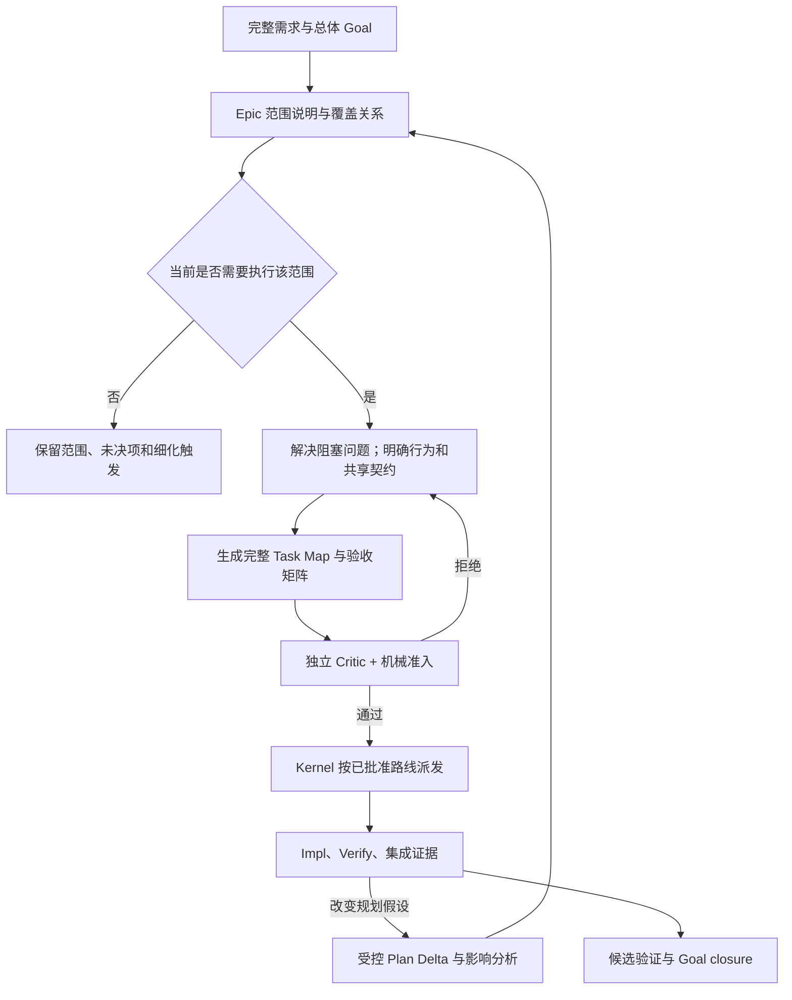
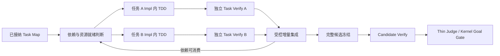
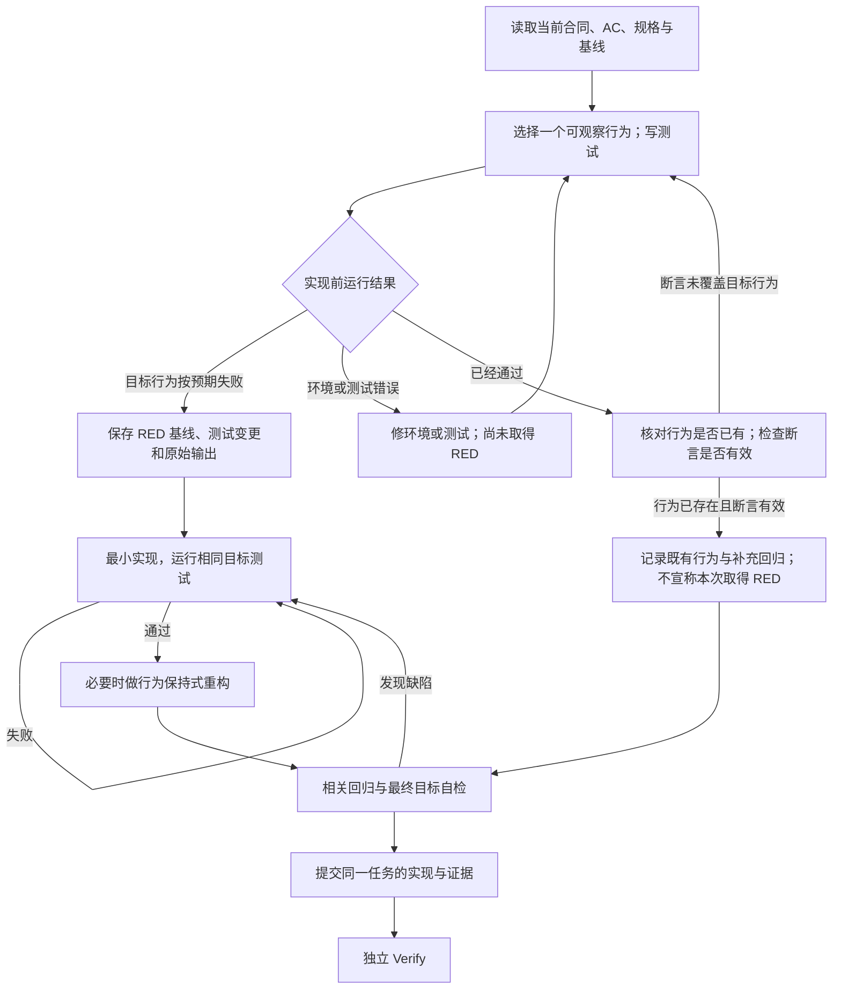

# 188 — 借鉴 BMAD 的需求闭环、Epic 渐进细化、任务调度与 TDD

> 状态: partial — 方法与诊断已实施，12 次真实模型评审对照已完成；长程产品交付和调度吞吐收益尚未验证。
> 日期: 2026-10-25；实施更新: 2026-10-26 UTC。
> 范围: 需求 → PRD/规格 → Epic → Task Map → Impl → Verify → Judge。
> 基线: `~/workspace/public/zaofu` 与 `~/workspace/gm/BMAD-METHOD`；BMAD checkout 自述为 V7 Preview Alpha。
> 实施: 用户已授权拆分并执行 6 项任务；见[实施说明](../impl/bmad-187-methods-and-validation.md)与[评估记录](../records/2026-10-26-0336-187-delivery-validation.md)。
> 效果: [真实模型对照](../records/2026-10-26-0431-187-model-effect-evaluation.md)显示质量基本持平、方法表达更明确，本次输入 token 与平均耗时略增；不扩大默认 rollout。

## 1. 设计决定与关联

吸收 BMAD 的五种方法：原始输入与 PRD 对账、分层处理未决问题、渐进细化、以具体
回归证明测试缺口、跨任务最终检查。在需求与可执行 Task 之间引入可审阅的 Epic
规划层，增强切片和并行理由；保留 ZaoFu 的 canonical Task 合同、确定性调度、
独立 Verify、Thin Judge 和 Kernel 完成门禁。

SDD 在本文指规格驱动开发，贯穿交付链；TDD 是 Impl 内部循环。若 SDD 指软件设计
文档，该文档归入规划产物，不构成一个必须早于 PRD 的固定阶段。

本文承接：

- [182：Plan 完整预览、任务拆分与验收证据闭环](182-plan-review-task-slicing-and-evidence-closure.md)。
- 183：SDD/TDD 任务图、并行实现与持续验证演进（先前本地讨论文档，当前分支未收录）。
- 184：Intake、阶段能力与 Task Map（先前本地讨论文档，当前分支未收录）。
- [186：Kanban、Graph 与 Loop 关联](186-unified-delivery-kanban-graph-and-loop.md)。

182 已记录的方法和修复不重新列为缺失；183 继续拥有 Task Pipeline 演进路线。
本文补充 BMAD 的方法来源、Epic 的最小落点、调度借鉴边界及 TDD 证据标准。

## 2. 当前实现、启用配置与方法执行

### 2.1 不把能力存在等同于运行保证

| 层次 | 本次已核对的事实 | 不能据此推出的结论 |
| --- | --- | --- |
| ZaoFu 标准 PrdFlow | 已有 `prdRef` → 双路 Scan → Planner → 独立 plan-critic → Task Map | 标准流程自动从零编写 PRD，或自动增加 PRD author/critic 角色 |
| 需求到 PRD | Channel synthesis、独立评估、readiness 和 PRD→Task 编译有实现 | 任意聊天回复或本地 Markdown 都已成为正式 PRD |
| 角色方法 | profile 绑定 wrapper，dependencies 展开并物化 | 每个方法正文已经被模型读取并正确执行 |
| 默认配置解析 | 2 lanes，`stage_barrier`，未配置 v4 Task Pipeline | 每个任务完成 Impl 后立即独立进入 Verify |
| 默认门禁配置 | Plan Artifact Package、Product Acceptance 均为 `shadow` | 这两项已按 blocking 强制执行；其他既有门禁因此也被关闭 |
| v4 示例 | 独立 Impl/Verify pools、背压、增量集成、候选冻结已有配置和代码 | canary/shadow 已默认发布，或本文已完成真实 Provider 的 v4 产品交付验证 |

上述配置结论来自本次只读调用 `load_config(zf.yaml)`；描述仓库默认配置，不代表任意
真跑项目的有效配置。后续判断必须绑定项目、配置版本和 Run。

源码入口：
[默认配置](../../zf.yaml)、[角色 bundles](../../examples/prod/controller/common/profiles.yaml)、
[流程编译](../../src/zf/core/config/workflow_profiles.py)、
[PRD 阶段合同](../../skills/zf-prd-plan-synth/SKILL.md)、
[Channel PRD 编译](../../src/zf/runtime/channel_prd_task_contract.py)、
[v4 canary](../../examples/prod/controller/prd-task-pipeline-v4-canary.yaml)。

### 2.2 方法、判断与准入的归属

| 事项 | Skill / Agent | Kernel / 确定性服务 |
| --- | --- | --- |
| 需求与范围 | 澄清、对账、识别歧义、提出取舍 | 来源、版本、授权与不可变产物绑定 |
| Epic / Task 切片 | 交付边界、真实依赖、验证时点、返工影响 | schema、引用、路径所有权、DAG、代际接纳 |
| 并行建议 | 说明独立性、风险与反馈收益 | 已批准容量、租约、预算、背压及工作区约束 |
| TDD | 选择行为断言，取得有效 RED/GREEN，审查测试意义 | 命令与目标身份、结果证据、作用域和提交接纳 |
| Verify / Judge | 判断证据是否支持产品行为和原始目标 | 接纳 verdict，路由缺口，执行完成条件与状态迁移 |

Skill 加载链为 `profile → role.skills → dependencies → 物化 → briefing → 调用观察`。
`auto_inject` 的 briefing 要求先调用或读取正文；按需依赖可供读取，不代表正文已进上下文。
调用投影分别记录 `loaded`、`invoked`、`loaded_unobserved`；即使观察到读取，仍需
检查方法要求的产物。不得通过统计 Skill 名称证明 SDD、TDD 或评审已经执行。

来源：[依赖展开](../../src/zf/core/skills/provenance.py)、
[物化](../../src/zf/core/skills/materialize.py)、[briefing](../../src/zf/runtime/skill_briefing.py)、
[调用投影](../../src/zf/runtime/skill_invocation_projection.py)、
[依赖物化测试](../../tests/test_plan_readiness_skills.py)。

## 3. 五个值得借鉴的方法

### 3.1 原始输入与 PRD 逐项对账

BMAD 在 PRD Finalize 中检查 memlog，并对每份用户输入进行 reconciliation；特别
关注被 FR 结构遗漏的定性要求、约束和用户原意。来源见附录 B1。

ZaoFu 应在现有 Channel synthesis / PRD review 方法中保留以下对账信息：

| 来源条款 | PRD 中的落点 | 处置 | 需要的证据 |
| --- | --- | --- | --- |
| 已确认行为 | 稳定需求/AC ID 与正文位置 | 保留或等义转化 | 原始 ref/段落及含义一致的解释 |
| 技术细节 | 规格或设计 companion | 移入下游文档 | 主文到完整细节的引用 |
| 冲突输入 | 明确冲突与待定决定 | 等待有权者处理 | 两份来源，不能静默择一 |
| 不实施范围 | Non-goal 或后续范围 | 经确认排除/延期 | 决定来源、影响与重新讨论条件 |

这些信息复用现有覆盖、来源和决定工件，不建立第二份需求真相。Kernel 检查绑定和
必需证据；是否忠实保留原意由独立 reviewer 判断。

验收：混合输入中加入异常流程、权限限制和定性要求 → verify: PRD 或 companion
逐项可定位；被排除项有有效决定；只保留功能标题、丢失约束的稿件被指出具体遗漏。

### 3.2 区分阻塞问题与可延期问题

BMAD 将使下一阶段不安全的 phase blocker 与可延期事项分开处理；延期事项需要 owner
和 revisit condition。不是所有未知都应阻塞当前工程盘点，也不是所有未知都能带入实现。

在 ZaoFu 的已有 Plan/readiness 产物中，每个未决问题说明：影响哪个行为、最迟在哪个
动作前解决、谁决定、暂不解决时哪些任务可以继续。以下是阅读结构，不是新 runtime schema。

| 问题 | 合理处理 |
| --- | --- |
| 当前写入命令的事务边界未定 | 阻塞该命令切片；允许不依赖它的只读调查 |
| 后续可选通知渠道未定 | 保留问题和受影响 Epic；不得把通知标为已实现 |
| 验收环境不可用 | 记录环境恢复责任；不能将其改写为产品已通过 |

验收：保留一个未来 Epic 未决项和一个当前任务阻塞项 → verify: 当前无关工作可推进，
依赖未定行为的任务不被派发；延期不会从原始 mandatory 范围中消失。

### 3.3 渐进细化

BMAD 先形成薄 Epic 范围，临近执行时再完善 Requirements 和 Stories；叶子文件也可
等到拉取任务时创建。ZaoFu 借鉴其细化时机，不把不完整执行合同直接接纳为 Task。

全局保留目标、范围及覆盖关系；下一批要派发的任务必须有完整验收、输入、输出、
路径所有权和验证责任。已接纳图的改变经过受控 replan，不原地修改冻结产物。
具体映射见第 4 节。

验收：上游契约改变 → verify: 找到受影响 Epic、Task、AC 和证据；未受影响且证据
仍有效的工作保留，受影响部分生成可审阅修订，不从头重写整套需求。

### 3.4 用具体回归证明测试缺口

BMAD verification-gap lens 要求指出一项实际可能发生的回归，并解释现有断言为什么
不会失败；先检查消费者和测试，再提出补测。来源见 B5。

在 ZaoFu 的 `verify-review` / Verify 评审产物中，一条缺口至少回答：

1. 改变了哪个可观察行为，对应哪个 AC？
2. 最小现实回归是什么，例如错误接受冲突请求、丢失字段、漏发必要事件？
3. 读过哪些测试，其 setup 和断言为什么捕获不了这个回归？
4. 应补哪个行为断言，在哪一层运行，失败时由谁返工？

不要以覆盖率、测试数量或强制 finding 数量替代判断。也不机械照搬 BMAD 对某类测试
形式的一概排除；ZaoFu 的事件/调用本身可能就是公共合同，关键是断言是否观察到合同结果。

验收：提供一个全绿但没有检查拒绝结果的测试 → verify: reviewer 指出具体漏检；
补断言后注入该回归会失败；无行为影响的改动不被要求编造测试缺口。

### 3.5 跨任务最终检查

BMAD Retrospective 检查整个 Epic 的规格、累计 diff 和实际行为，能发现单 ticket
审查看不到的问题。它兼有调查、行为验证和最终裁决，不能整体塞进 ZaoFu Thin Judge。

ZaoFu 按现有责任拆分：

- Candidate Verify：跨任务契约、组合行为、真实入口、异常旅程及最终回归。
- Judge：根据已接纳、同目标版本的证据，判断原始 Goal 是否闭合。
- Kernel：检查完成条件并推进状态；子任务全部 done 不自动证明产品完成。

验收：两个任务各自通过，组合后接口字段不一致 → verify: 候选验证发现问题并定位
返工范围；Judge 不凭子任务通过数签收，也不另起一轮无界测试。

## 4. 引入薄 Epic 规划层

### 4.1 Epic 是交付范围，不是 Worker 或 lane

建议用 Epic 表达一个可解释的业务能力或紧密耦合的交付范围。一个 Epic 可有多个 Task，
一个 Task 可跨技术层；Epic 数量不决定 lane 数量，也不要求每个 Epic 新建 Workflow。
一个小需求可直接形成一个 Task，Epic 层不得成为强制文书负担。

BMAD 默认把可共同交付部署的能力作为 Epic 边界，并允许团队修改切法。ZaoFu 应按
产品的可观察结果、事务边界和交付方式选择，不把“必须独立部署”硬编码为通用规则。

### 4.2 薄 Epic 至少保留的内容

| 内容 | 要回答的问题 |
| --- | --- |
| 稳定标识与来源 | 覆盖哪些原始需求/AC，引用哪个版本？ |
| Outcome / Done when | 完成后能观察到什么，最终如何判断？ |
| Boundaries | 包含什么、排除什么、消费哪些外部能力？ |
| 已定约束 | 哪些决定不可由后续 worker 自行改写？ |
| 未决事项 | 谁决定，影响什么，最迟何时解决？ |
| 依赖和交接 | 需要其他范围提供什么，而非仅写排列顺序？ |
| 细化触发与负责人 | 何时进入详细规划，谁审查？ |

“薄”指不提前编造文件清单和测试细节，不指删除复杂需求、异常场景或验收义务。
先保留确知范围；不能把“以后再接线”“暂不考虑失败”包装成已完成的能力。

### 4.3 落在现有产物中，保留单一合同

第一阶段将 Epic 范围作为现有 `requirement_spec` / `planning_result` 的阅读章节，
或者用现有可扩展规格端口承载并由同一 Plan Package 引用。大型说明可按已有
`execution_spec` / task-scoped 输入方法组织，不给固定 schema 随意增加字段。

- Epic ID 是来源与分组锚点，不新增 `EpicStore`、独立完成状态机或第二套 Task schema。
- Task Map 继续使用 canonical `task_id`、contract、依赖和验证命令。
- Epic→需求→Task 的映射写入已有来源/规划工件；不能把 Epic ID 冒充 `blocked_by` Task ID。
- Kanban/Graph 可按 186 的投影边界展示分组；本文不宣称分组 UI 已实现。
- 工作区中的规划草稿可以修订；已接纳产物使用新版本，不原地改写。

### 4.4 从范围说明到可执行任务的门槛



细化时同时满足：当前范围的未决阻塞关闭、AC 可观察、输入足够、任务自身验证不依赖
未来实现、跨片验证有明确后续 owner、真实入口与集成时点可说明。

当前 Task Map 接纳仍要求其 Goal 的完整必需覆盖。若只准备执行一个阶段，必须通过
现有授权明确阶段 Goal 与总体 Goal 的关系；未实施范围继续保持未完成，不能从
mandatory 矩阵删除或用 `not_applicable` 宣称总体完成。自动分期编排是后续候选能力，
本文不允许以“渐进规划”为由绕过当前覆盖门禁。

### 4.5 示例：车辆管理与调拨

总体需求包含车辆查询、资料维护和跨项目调拨。先建立三个范围：

| Epic | 初期明确内容 | 详细细化时点 |
| --- | --- | --- |
| 车辆查询 | 筛选、分页、详情、权限、真实数据、异常状态 | 首批交付前完整细化，尽早打通页面→API→数据 |
| 资料维护 | 可修改字段、状态约束、审计义务 | 对应修改命令进入实现前 |
| 跨项目调拨 | 原子移动、授权、失败回滚、幂等；审批规则待定 | 调拨任务可执行前解决审批规则 |

查询不应因为尚未实现调拨而整体等待；调拨的多项状态变化不得拆成可见的部分提交。
调拨依赖实际会用到的身份、数据与接口，不能仅因排在第三个 Epic 就依赖前两个的全部任务。
只有总体范围全部按约验收，或者范围经有效决定改变后，才允许总体关闭。

## 5. Task Map 拆分与并行：可借鉴的方法

### 5.1 拆分判据

BMAD 的有用判据是“一次会话可处理的一步、准备成本合理、一个可运行检查”，以及
先交付 tracer bullet，再处理最不确定的部分。ZaoFu 应结合现有 readiness 方法评估：

1. 先从可观察行为与 AC 出发，明确本片生产的实现和证据。
2. 保留最小贯穿真实入口的路径；仅有函数或接口桩不等于业务已交付。
3. 单个原子事务由一个 owner 实现和验证；片内可有多个 TDD 小循环。
4. 共享契约和入口有唯一负责人，其余任务通过稳定扩展点接入。
5. 每片包括自身测试；候选集成检查是额外层次，不能代替片内测试。
6. 粒度根据行为、上下文、写入范围和验证成本判断，不使用固定代码行数或任务数阈值。

BMAD 的 8–12 个 Story 是可调整经验值；ZaoFu 不将它变成 schema 或硬门禁。
BMAD 允许同文件任务串行；ZaoFu 当前全图路径所有权要求更严格，即使加依赖也不能
重复声明相同写入范围。应合并相关任务、明确唯一命令 owner，或安排单一集成 owner。

### 5.2 依赖边必须解释输入与验证

| 审查维度 | 需要的解释 | 典型错误 |
| --- | --- | --- |
| 实现输入 | B 具体消费 A 的什么能力/产物？ | 用模块名称相似代替依赖 |
| 验证输入 | B 的当前检查需要哪些已存在行为和 fixture？ | 早期任务验收未来 UI 或命令 |
| 契约交接 | 两端是否引用同一已接纳契约和版本？ | 各 lane 自行猜测数据模型 |
| 共享资源 | 入口、schema、配置、数据库或测试环境有无冲突？ | 文件不同就认定独立 |
| 集成目标 | B 实际工作区是否包含其依赖的有效产物？ | 状态 ready，但依赖代码不在基线中 |

Planner 先自审，再由独立 Critic 检查遗漏依赖和过度依赖。Kernel 保持机械检查，不能
通过关键词推断业务上必需的前置关系。语义理由附着现有 Plan/评审工件，结构化执行
关系继续使用 Task Map 合同。

### 5.3 并行需要同时成立的条件

- 当前动作不消费另一并行任务尚未就绪的行为或证据。
- 写入范围、共享入口及集成方式符合当前所有权合同。
- 隔离工作区、fixture、端口、迁移和外部副作用不会互相污染。
- 验证输入已经具备；最终组合验证有 owner 和时点。
- 已批准的 worker、权限、预算、资源与 Verify 容量可承接。

语义独立但资源不足时等待资源；资源空闲但语义依赖未满足时不能派发。独立 reviewer
可以并行读同一 diff；多个 writer 不能据此获得同一路径写入权。

## 6. 调度层：借鉴 BMAD 的可解释性，保留 ZaoFu 的运行内核

### 6.1 BMAD 当前脚本实际提供什么

`tickets.py next` 返回下一步工作分类；`status` 输出阻塞关系、跨 Epic 依赖问题和
`longest_remaining_chain`。最长链按图中的节点链计算，不是带执行时长的关键路径估算。

| BMAD 输出/行为 | 可借鉴点 | 边界 |
| --- | --- | --- |
| `ready_to_refine` | 将需要细化与可直接实现的工作分开解释 | 不复制为新的 ZaoFu Task 状态 |
| `ready_to_start` / `blocked` | 清楚展示“为什么可启动/为什么等待” | 脚本分类不等于资源租约或实际派发 |
| `unknown` 阻塞 | 未决产品问题不能被模型默默补全 | 在已有问题与 readiness 工件记录 |
| 最长剩余链、下游阻塞清单 | 帮助识别反馈延迟和共享前置瓶颈 | 不声称 BMAD 已实现最短工期调度 |
| 单次 Build Auto 处理一个 ticket | 明确执行单元和外层编排责任 | 本仓库不是完整跨 ticket 常驻调度器 |
| reviewer 并行 | 相互独立的检查可同时进行 | 不代表实现者可以无约束并行改代码 |

重要差异：BMAD 普通 `after` 可由进入 review 的任务满足，`in-review`/`built` 都映射
到 review；Epic gate 仍等 done。ZaoFu 不直接采用“正在审查就解锁下游”的策略。
依赖是否可消费继续由当前路线的状态、接纳和集成条件决定；若引入更早的契约解锁，
须另行定义明确产物、版本和失效规则。

来源：B3 的 `classify`、`cmd_next`、`status_view`、`longest_remaining_chain`；B4、B8。
外部 `bmad-loop` 不在本次审阅范围，不从其介绍推导本仓库的调度保证。

### 6.2 映射到 ZaoFu

建议复用现有 Task/Operation/Attempt 与投影，展示下列判断的来源和阻塞原因：

```text
规划输入可执行
  ∧ 当前版本与执行授权有效
  ∧ 路线要求的依赖/集成条件满足
  ∧ scope、工作区与角色能力匹配
  ∧ pool、预算与背压允许
  → Kernel 可以派发
```

这是设计判断表，不是新增布尔字段或已实现的单一函数。读取现有事实能回答时，
不重复调用模型。优先级、风险和细化顺序由 Planner/OA 在允许的语义检查点提出；
Kernel 按已接纳策略执行，不自行解释产品优先级。

应持续区分三个问题：什么值得先做、什么已满足依赖、现在哪个 worker 可以做。
不能把 lane 数设成 Task 数，或把 `wave` 数字当作完整资源调度计划。

### 6.3 在已有 v4 上验证，避免另起调度器

v4 已有任务级 Impl/Verify pools、并发上限、背压和串行 CAS 集成。与 BMAD 比较后的
优先工作是验证现有路径，并增强就绪/等待理由的展示，而不是复制 `tickets.py` 建第二套状态。



该图表达 v4 候选执行形态，不替换默认 `stage_barrier`。扩大并行度前，应实测首条
可运行路径耗时、依赖等待、Verify 积压、集成冲突、返工范围和预算；降低实现耗时
但增加组合缺陷不算改进。具体 rollout 沿用 183 和已有 canary 边界。

源码：[依赖选择](../../src/zf/runtime/task_pipeline_runtime_selection.py)、
[reconciler](../../src/zf/runtime/task_pipeline_reconciler.py)、
[dispatch](../../src/zf/runtime/task_pipeline_dispatch.py)、
[调度测试](../../tests/test_task_pipeline_reconciler.py)。

## 7. Impl 内 RED / GREEN / REFACTOR 的明确约定

### 7.1 一片、一个实现 owner、多个小循环

TDD 不拆成“测试 Agent 先写全部测试 → 开发 Agent 写全部代码 → 最后补测试”三个
任务批次。实现 owner 对本片行为和测试一起负责，独立 Verify 审查它们是否充分。
最终候选验证继续承担跨片组合行为。

BMAD Dev persona 声明 test-first，但直接调用 Build 不能仅凭 persona 推出已完成
RED/GREEN 时序证明。ZaoFu 已有 `yoke/tdd-evidence`，应落实证据和独立检查，
不新增与 Task/Attempt 并行的 TDD 状态机。



图中的循环始终受当前 Operation 的预算、重试和升级约束；证据不足或预算到限时
按已有结果协议报告，不无限自循环。

### 7.2 每一步的进入、退出和证据

| 步骤 | 工作 | 退出依据 | 必须保留的证据 |
| --- | --- | --- | --- |
| 准备 | 读当前任务/attempt、AC、命令、scope、基线和依赖 | 明确本次行为及独立期望来源 | 来源条款/AC、当前输入与基线引用 |
| RED | 在实现前版本上运行新增或修正的行为测试 | 因目标行为缺失/错误而按预期失败 | 测试名、测试变更、命令、基线、失败断言、原始输出 |
| GREEN | 做满足行为的最小实现，运行目标测试 | 目标断言实际运行并通过 | 实现版本、测试身份、命令结果；测试改变时解释原因 |
| REFACTOR | 在绿色保护下消除当前必要的重复或复杂性 | 行为不变，相关检查仍通过 | 必要变更与最终版本回归结果；无需重构时说明即可 |
| 自检交接 | 运行本片合同要求的检查，整理实际 diff | 自检与最终提交目标一致 | 当前 self-check、收据及来源关联，不靠口头“全部通过” |

最小语义绑定为：

```text
需求条款 / acceptance_id
  → 行为场景 / 测试名 / 命令身份
  → RED：实现前基线 + 测试补丁 + 失败断言 + 输出 ref
  → GREEN：实现版本 + 测试版本 + 通过输出 ref
  → 最终目标：重构后版本 + 自检/回归收据
  → 独立 Verify 对该 AC 的结论
```

这些内容保存在已有实现总结和证据 sidecar，并通过当前合同支持的引用交接；上述
展示不是新增 JSON schema。不能要求实现前基线凭空包含后来才写的测试，必须保留
可安全重放的测试变更，才能在隔离环境重现 RED。不得破坏活动工作树或其他人的修改。

### 7.3 哪些情况不能认定为有效 TDD

| 现象 | 正确处理 |
| --- | --- |
| 缺依赖、命令拼错、服务未启动导致失败 | 环境/测试执行问题；修正后取得目标行为失败 |
| 首次运行即通过 | 检查行为是否已经存在、断言是否观察到结果；不能人为破坏实现制造 RED |
| 给已有正确行为补测试 | 可作为补充回归/特征测试，说明没有本次 test-first 证据 |
| 测试只断言源代码包含文字或返回不抛错 | 若目标是运行行为，不能代替实际结果断言；检查公共合同 |
| 用生产实现计算测试期望值 | 引入独立规格、字面量或手工算例，避免同义反复 |
| 为变绿删除断言、跳过用例、mock 掉被验行为 | 拒绝；修改真实实现或通过受控过程修正规格 |
| GREEN 后又重构，仍引用旧目标收据 | 旧收据仅是历史证据；最终接纳按当前目标及复用策略判断 |
| 纯文档或无行为变化的静态改动 | 记录不适用理由，采用相应文档/静态验证 |
| 配置改变运行行为 | 对改变的行为建立回归，不能一律以配置为由豁免 |

`expected_red` / `RED_expected` 的兼容机制不是普通交付终态。不能为了通过门禁把
最终命令批量标成 expected RED；本片可交付行为仍要求 GREEN 和最终验收证据。
TDD 时序的意义主要由方法与 Verify 复核，通用 schema 通过不能证明测试真的先于实现。

### 7.4 Refactor 的范围

片内 refactor 只处理当前变更需要的行为保持式整理，不扩大业务范围或写入权限。
BMAD 默认对较多 Story 的 Epic 建议收尾 Refactor sweep；ZaoFu 不将它变成每个 Epic
必需的清理任务。跨任务重复或架构问题由实际 diff/评审证据证明，再形成有授权的工作。
不能把尚未实现的需求推入“重构清理”来让原任务看似完成。

### 7.5 Verify 和返工责任

| 发现 | 责任与恢复 |
| --- | --- |
| 产品行为违反已定规格 | Impl owner 修复；补回归，提交新目标证据 |
| 测试 oracle 与规格冲突 | 对照来源修正测试；有歧义则进入规格决定，不能追随实现改期望 |
| 契约/依赖/切片错误 | Planner/OA 提出受控 Plan Delta，Kernel 接纳后执行 |
| 环境、Provider 或验证执行故障 | 现有环境恢复 / Run Manager 路径；不伪装成产品拒绝 |
| 多片组合失败 | Candidate Verify 定位生产者与最小受影响范围 |

Verify 可以复用同目标、同命令摘要且被标记可复用的确定性收据，不为独立性机械重跑。
但它必须独立判断 AC、测试有效性及必要风险探针；Judge 消费已经接纳的结论，不重新
承担完整 TDD 或测试执行。最终状态只能由受控运行路径推进。

现有方法：[TDD Evidence](../../yoke/tdd-evidence/SKILL.md)、
[Dev wrapper](../../skills/zf-yoke-dev-worker-role-context/SKILL.md)、
[Verify wrapper](../../skills/zf-yoke-test-evaluator-role-context/SKILL.md)、
[Judge 合同](../../skills/zf-goal-closure-judge-contract/SKILL.md)、
[typed admission](../../src/zf/runtime/typed_result_admission.py)。

## 8. 后续工作顺序与验收

本轮已按用户后续授权实施方法和诊断，复用现有运行能力；以下保留原始总体评估目标。
确定性测试、隔离故障注入与真实 Provider 对照分开计量，逐项结果见评估记录。
方法接线不等于所有真实交付试点完成，也不自动改变默认配置或 rollout。

| 顺序 | 工作 | step → verify |
| --- | --- | --- |
| 1 | 用真实 PRD 做五方法对照 | 同一来源分别评审 → verify: 列出遗漏、未决项、覆盖与具体回归缺口，不以文档更长判优 |
| 2 | Epic 阅读层试点 | 复用现有规划端口保存薄 Epic → verify: 完整保留需求来源；未来范围未被误判完成；不产生第二 Task 状态 |
| 3 | 切片与并行复核 | 构造共享入口、隐含数据依赖、原子事务三个反例 → verify: 独立 Critic 指出最小修订，机械校验仍通过同一合同 |
| 4 | TDD 证据试点 | 一项新行为和一个真实缺陷走 RED/GREEN/REFACTOR → verify: 隔离复现目标 RED、最终 GREEN、独立 AC 判断；环境失败被正确分类 |
| 5 | v4 有界对照 | 相同任务、模型、预算和验收比较批准的执行配置 → verify: 记录反馈时间、等待、积压、冲突和返工；不自动切换默认路线 |
| 6 | 跨任务故障注入 | 保持单任务测试通过，引入组合契约错误 → verify: Candidate Verify 捕获，Judge 不提前关闭 Goal |

评价维度：需求遗漏率、首次可运行及独立反馈耗时、被证明有效的 TDD 证据比例、
无效 finding 比例、返工任务范围、等待与验证积压、总预算、最终 mandatory AC 通过情况。
对照记录必须包含样本数、配置和未覆盖部分；单次示例成功不能证明通用收益。

## 9. 来源与验证边界

### 9.1 BMAD 本地源码索引

路径均相对于 `~/workspace/gm/BMAD-METHOD`；[上游仓库](https://github.com/bmad-code-org/BMAD-METHOD)
的主分支和文档会变化。以本次本地阅读为依据，后续可用 `git log --follow -- <path>`
追溯方法变化。未将本地工作流实际安装到产品、运行模型或测试外部 bmad-loop。

| 编号 | 路径 / 入口 | 支持的观察 |
| --- | --- | --- |
| B1 | `skills/bmad-prd/SKILL.md`、`assets/prd-validation-checklist.md` | 来源对账、问题分层、PRD 评审与完成 |
| B2 | `skills/bmad-agent-po/references/spec.md`、`slice.md`、`validate.md`、`validate-checks.md` | Requirements、薄 Epic、渐进细化、依赖语义检查 |
| B3 | `skills/bmad-agent-po/scripts/tickets.py` | 就绪分类、依赖计算、最长剩余链、文档状态操作 |
| B4 | `skills/bmad-agent-po/assets/tickets-template.toml`、`customize.toml` | covers/after/verify、tracer bullet、可调整粒度与收尾建议 |
| B5 | `skills/bmad-code-review/review-prompts/verification-gap.md` | 具体回归、消费者与真实断言审查 |
| B6 | `skills/bmad-retrospective/workflow.md`、`references/acceptance-verdict.md` | 跨 ticket 检查、真实行为和 Epic 验收裁决 |
| B7 | `skills/bmad-agent-dev/customize.toml`、`skills/bmad-build/step-03-implement.md` | test-first persona、实现交接与矩阵测试审计 |
| B8 | `skills/bmad-build-auto/workflow.md`、`docs/build/autonomous-development-loops.md` | 单 ticket 执行、同步子 Agent 与外层编排边界 |
| B9 | `tools/ticket-tree-rules.md` | built/done 区别、Plan 状态和外层关闭责任 |

### 9.2 ZaoFu 已有方法与复核入口

- [Plan readiness](../../skills/zf-plan-execution-readiness/SKILL.md)：条款责任、原子事务、阶段集成、并行配置适配。
- [执行路线方法](../../skills/zf-plan-execution-readiness/references/execution-route.md)：规格读取、任务粒度、反馈时点。
- [Task Map 合同](../../skills/zf-plan-task-map-contract/SKILL.md)：机器合同、来源、验证及产物端口。
- [Task Map 验证](../../src/zf/runtime/task_map.py)与[证据依赖](../../src/zf/runtime/task_map_evidence.py)：机械准入。
- [任务物化](../../src/zf/runtime/task_map_materialization.py)：canonical Stores 与恢复安全的落地路径。
- [验证结果](../../src/zf/runtime/verification_result.py)：结构化验收及返工信息。
- [Goal closure](../../src/zf/runtime/goal_closure_runtime.py)：已接纳 Judge 结果的路由。

原始设计阶段确认范围为上述源码、配置、Skill 和相关测试源码，配置做了只读解析。
实施阶段增加实际方法物化、CLI、依赖/证据边界、调度和确定性 mock E2E 验证，
结果见关联记录。后续追加了真实模型的方法评审对照；完整 Provider 产品交付、
浏览器与调度吞吐收益仍不能由这些检查推出。
