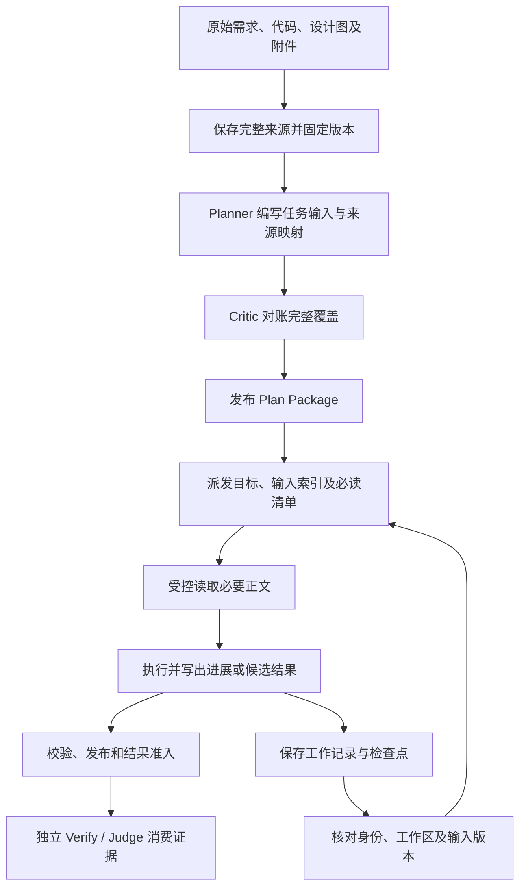

# 上下文索引、写后读取与恢复闭环

> 状态: partial
>
> 日期: 2026-11-02。本文记录设计建议，不表示全部能力已实施或完成运行验收。
> 后续已授权基于本文在独立 worktree 实施；已交付范围与验证见 §15，实际差量交付仍未启用。

## 1. 目标与证据基线

建立可定位、可读取、可写入、可交接和可恢复的上下文消费链路：
先由索引定位材料，再消费本角色必须理解的正文，执行后发布结构化产物，
下游通过固定版本读取；会话中断时从当前事实和检查点恢复。

审查基线：

| 仓库 | 本地路径 | 本次起始 HEAD |
| --- | --- | --- |
| ZaoFu | `/home/min/workspace/public/zaofu` | `f4f907af` |
| DSH Superagent 研究原型 | `/home/min/workspace/dsh-superagent-prototype` | `6337fc8` |
| DeepSeek Harness | `/home/min/workspace/deepseek-harness` | `47f943859b` |

代码定位以路径和符号为准。源码结论、设计建议、待测假设分开记录；未运行真实
Provider 或性能基准，不承诺 token、耗时或费用下降比例。

与 [197：PRD/Spec 合同与分层阅读视图](197-prd-spec-contract-and-readable-views.md)
互补：197 解决产品规格及人类阅读，本设计解决 Agent 的输入定位、消费、产出和恢复。
权威边界遵循 [AGENTS.md](../../AGENTS.md)、[架构手册](../manual/architecture.md)
和[上下文交接手册](../manual/operations/context-handoff-artifacts.md)。

## 2. 当前实现与实际缺口

| 环节 | 已有能力及代码 | 本设计补强方向 |
| --- | --- | --- |
| 发现 | [ArtifactQueryService](../../src/zf/runtime/artifact_query/service.py)、对象/occurrence/lineage 查询 | 角色索引、读取理由、适用范围、成本和定位信息 |
| 切片 | [task_input_paths](../../src/zf/runtime/task_scoped_plan_inputs.py) 支持 `task-scoped-plan-input.v1` | 生产者真实产出完整任务切片；旧格式仍保持完整读取 |
| 输入选择 | [selected_plan_ports](../../src/zf/runtime/task_plan_consumption.py) 校验同版 Task Map 的选择 | 在 Plan Preview 显示选择及来源/验收覆盖 |
| 必读 | [artifact_read_requirements](../../src/zf/runtime/artifact_read_requirements.py)、[读取账本](../../src/zf/runtime/artifact_read_ledger.py) | 保持完整覆盖，降低重复解析及传输 |
| 写入 | [不可变 sidecar](../../src/zf/runtime/call_result_envelope.py)、[SemanticResultSubmitService](../../src/zf/runtime/result_submit.py) | 可导航产物、写后校验、下游绑定 |
| 恢复 | [handoff_summary](../../src/zf/runtime/handoff_summary.py)、[checkpoint](../../src/zf/runtime/recovery_checkpoint.py) | 连接结构化进展、恢复必读和失效判断 |

### 2.1 已确认行为

1. `task_input_paths` 对旧格式返回 `$`；Candidate Verify 保持完整端口读取。
2. 没有 `plan_input_selection` 时保留原有读取；有选择时，必须匹配固定 Package
   中的 Task Map，并保留完整验收、测试和真实 E2E 矩阵。
3. [prepare_required_read](../../src/zf/cli/artifact_required_read.py) 每次调用（含续页）
   都读取全部 required rows，再计算包含正文的 bundle digest。
4. [context_delivery](../../src/zf/runtime/context_delivery.py) 的 H1 差量只计算
   `shadow_delivery`，实际 `delivery` 仍为 `full`。这不是整个 v4 pipeline 模式的判定。
5. [artifact_output_delivery](../../src/zf/runtime/artifact_output_delivery.py) 已区分
   输出产生、历史 Provider 输出观察和当前上下文可用性；历史收到不证明现在仍保留。
6. [任务映射技能](../../skills/zf-plan-task-map-contract/SKILL.md) 已描述切片、角色输入
   选择和读取放大评估。改进应落实生产、审核、展示和验证，不重复添加同义指令。

### 2.2 待测假设

大量必读材料分成多页后，续页可能重复付出全量 I/O、JSON 解析和哈希成本。
这是由调用链推导的性能机会，尚无现场耗时结果。即使宿主机缓存优化成功，
模型输入 token 也未必减少；后者依赖实际选择和交付的正文范围。

## 3. 不变的权威边界

- `zf.yaml` 是唯一控制面，存储位置取 `project.state_dir`。
- Store 与事件管理身份、当前版本和状态；完整语义体通过 sanctioned writer 持久化。
- 索引、SQLite 查询、摘要和 UI 是投影，不能选择或覆盖当前批准版本。
- 保持单一 Task `contract`，任务输入切片不是第二套任务状态。
- Agent/Skill 负责相关性、需求覆盖和验收判断；Runtime 负责身份、结构、权限、
  digest、证据存在性和状态迁移。
- 相同 digest 不合并权限；每个 occurrence、attempt、角色仍独立授权。
- 候选结果准入不等于产品验收通过；独立 Verify/Judge 和 Kernel gate 保留。
- 不把只读过索引、摘要、旧回执或 Impl 自检当作独立验证证据。

## 4. 全流程



## 5. 写入设计：为下游消费组织产物

### 5.1 三类产物

| 产物 | 内容 | 权威与消费者 |
| --- | --- | --- |
| 来源/规格 | 完整正文、来源版本、需求/设计/验收映射 | 保留原始输入及正式规格；由 Planner/Critic 和任务消费者读取 |
| 工作记录/检查点 | 已执行动作、证据、未决问题、工作区、下一步 | 恢复参考，Agent 陈述不自动成为已验收事实 |
| 正式候选结果 | 变更、测试证据、验收对应、风险 | 经既有提交准入，交独立验证 |

正文之外提供导航信息：章节、适用任务、来源引用、大小和读取位置。
机械字段由系统生成；语义用途和适用范围由生产者编写，Critic 审核。
索引可以重建，完整正文和必要证据不能因索引存在就删除。

### 5.2 复用现有任务输入合同

使用现有 `task-scoped-plan-input.v1` 的 `shared` 与 `tasks[].body`。
`shared` 只放确实通用的约束；每个任务正文包括完整行为、异常、依赖接口、
当前决定、来源/验收映射与验证要求。不得把整份 PRD 搬进 shared。

通过现有 `evidence_contract.plan_input_selection` 选择 Impl/Task Verify 的必读端口。
固定 schema 的验收与测试矩阵保持原样，完整 Package 留给全局审核。
已准入 Plan 的选择变化必须形成新版本及对应评审，不能复用旧批准偷偷替换。

视觉材料保留原图/页面/状态、对应需求和任务引用；UI Impl/Verify 按要求读取图像。
OCR 或文字摘要只辅助定位，不自动证明视觉要求已覆盖。

### 5.3 写后回读与发布

1. 在本角色获准的 scratch/workdir 范围编写候选。
2. 系统回读实际持久化字节，检查 schema、digest、引用可解和当前身份。
3. Agent 按需复核关键内容，不强制把刚写出的整份大文档再次注入模型。
4. 通过已有结果提交与不可变 writer 发布正文，绑定身份/ref/digest，再走事件和准入。
5. 下游只有在合法来源绑定后才能消费；目录里出现文件不表示它已成为当前结果。

崩溃一致性：正文落盘但未完成准入时，留下可诊断孤立产物，不更新当前结果。
重试应幂等，旧 attempt/lease 的迟到结果应拒绝。
进行中的工作记录需要受控发布入口；不能假定正式结果 submit 已支持任意进度写入。
沿用既有 checkpoint/handoff 扩展，身份字段由 Runtime 产生或核验。

## 6. 读取设计：起始信息、索引、正文

| 层 | 内容 | 交付方式 |
| --- | --- | --- |
| 起始信息 | 目标、身份/版本、权限、关键约束、下一步 | 有界直接交付 |
| 索引 | 用途、范围、来源、大小、必读位置、读取入口、遗漏说明 | 有界列表，允许继续分页 |
| 正文 | 当前角色必需的原始条款、任务切片、接口、证据 | 按批准范围完整读取 |

索引字段是对现有 descriptor/query 的增量设计，不是已生效 schema：

- identity：Package、Task、occurrence、ref/digest、schema/renderer 版本。
- applicability：适用角色/任务、读取理由、来源/需求/验收关联。
- selection：必读 path/章节、可选展开项、明确省略范围。
- cost：实际字节、预计分页；token 标注估算来源，不能把字符数当 token。
- freshness：与当前批准版本的关系、替代版本提示。
- navigation：正文入口、固定快照、游标/完整性；失效时给明确恢复方式。

### 6.1 角色策略

| 角色 | 主要输入 |
| --- | --- |
| Kanban/路由 | 用户原始意图、当前状态、材料索引；做具体判断前展开必要原文 |
| Planner/Critic | 完整来源覆盖、设计依据、跨任务约束及验收关系 |
| Impl | 本任务行为、共享规则、依赖接口、相关图像、验证要求 |
| Task Verify | 对应需求、候选代码、验收依据、测试证据、实现者报告 |
| 任务级验收评审/Judge | 当前任务合同、独立 Verify 结果、变更及风险证据；按争议回读原始依据 |
| Candidate Verify/集成级 Judge | 当前 candidate 的任务集合、整体覆盖、集成风险及跨任务证据 |
| Goal Closure/Thin Judge | 当前 Goal/Claim 的权威要求、覆盖与闭环证据；依合同回读相应来源 |

必读范围由获批产物确定；运行中的消费者不能自行删除 required rows。
超出预算时先调整输入组织、任务划分或经过评审的选择；不得静默截掉尾部。
原始来源读取权不应因索引未命中而消失；合法补充材料需经过受控绑定。

### 6.2 Impl / Verify / Judge 默认按任务范围定位和读取

按任务限定范围是默认设计，不是全文搜索上线后的附加过滤。运行时先从当前派发
身份确定 Task、角色、Package/generation 和 target revision，再提供本任务及已声明
依赖的导航与正文。搜索引擎是否使用 FTS 与搜索范围是两个维度；即使使用 FTS，
也应先限定已授权、适用的 Task/候选集合，再返回命中。

```text
当前派发身份 -> 本任务合同与来源映射
             -> 本任务必读正文（直接定位，无需搜索）
             -> 本任务可选材料索引（按需展开）
             -> 已声明依赖接口与共享约束
             -> 仍有缺口：明确记录并请求合法补充输入
```

任务输入包括本任务对应的 REQ/AC、接口、设计图、测试/证据和必要共享约束。
依赖任务只交付消费者需要的接口/已发布结果，不默认展开依赖任务的全部历史。
语义适用范围由 Planner/Critic 记录于现有产物；Kernel 校验绑定和机械范围，
不根据关键词自行猜测哪些需求可以忽略。不得由模型填写任意 task_id 扩大查询权限。

Impl 按本任务实现；Task Verify 独立读取本任务验收依据和候选代码，不能只读 Impl
摘要；任务级 Judge 按本任务审查 Verify 结论及争议证据。集成级 Judge 的范围是
获批 candidate 的任务集合，Goal Closure 的范围是当前 Goal/Claim 的必要闭环材料，
都不能简单套用“只看一个 Task”，也不默认扩展到项目全部历史。

需要补充读取的典型触发是：接口不明、需求冲突、证据不一致、共享约束受影响或
检索不足。先沿 REQ/AC、来源与依赖关系精确定位，再在合法范围内进行关键词搜索。
新材料若不属于固定 manifest，走既有受控绑定或新版本流程；不静默修改派发合同。

现状与目标必须区分：当前 `plan_input_selection` 仅支持 `implementation` 和
`task-verify`。Task Pipeline 的 `acceptance_review` 对应
`integration-acceptance-review`，已有任务合同、target 与 task-verification-result
必读项；`thin-judge-goal-closure` 是另一种结果 profile。不能把角色显示名 Judge
当作同一种输入合同，也不能直接给现有 selection schema 增加 `judge` 字段。
Candidate Verify 当前仍完整读取要求的 Plan 端口；任何未来缩减都需要独立设计、
评审和验证，不能以按需检索为由跳过已有 required reads。

验收补充：

- 100 个任务中派发 T-12 -> verify: 模型只收到 T-12 必读正文、适用共享规则及
  已声明依赖；其余任务的无关正文不进入上下文。宿主是否读取整个存储文件另行计量。
- 同一 T-12 分别派发 Impl/Verify/任务评审 -> verify: 三者输入范围与角色合同匹配，
  Verify 自有消费/验证证据，评审能够回读争议依据。
- 两个并行 candidate/Plan generation -> verify: 检索和精确回读均不会混入另一版本。
- 任务切片缺少强制验收条款 -> verify: Critic 对账发现或运行时明确暴露输入缺口，
  不以没有搜索命中判定该条款不存在。
- 集成/Goal Judge -> verify: 任务集合及跨任务义务完整，既有必读合同继续满足。

## 7. 分页、缓存和成本

### 7.1 固定选择结果的分页快照

在现有 [source versions](../../src/zf/runtime/artifact_source_versions.py) 上扩展：
首次生成固定选择结果及分页索引；续页读取目标页并校验页面与快照的 digest 绑定。
每次请求仍重新检查当前 attempt、读取能力和 occurrence 权限。

分页快照是可重建投影；manifest/policy/选择/body 版本变化必须失效。
不得仅以 path、mtime 或 session ID 作为正确性证明。
CLI 跨进程读取需要可恢复快照，不能只做单进程内存缓存。
快照损坏时从固定来源重建；来源和恢复副本均不可用则明确失败。
保留连续覆盖、别名分别授权、实际输出回执、丢页重读及唯一 delivery identity。

### 7.2 三类优化分开衡量

| 优化 | 影响 | 不能推导的结论 |
| --- | --- | --- |
| 存储/解析缓存 | 宿主 I/O、解析、哈希时间 | 不代表模型输入已减少 |
| 角色与任务切片 | 交付正文数量、模型输入及读取轮次 | 不代表需求自动完整 |
| Provider 前缀缓存 | 实际缓存输入及费用 | 不代表模型保留内容或跨角色已读 |

记录每个角色/attempt 的来源字节、选择字节、输出字节、工具轮次、重读原因、
索引开销、生成摘要的开销、独立验证开销，以及 Provider 可观测 usage。
不支持的 Provider 观测标记 unknown，不使用估算填充“实测”字段。

## 8. 检查点与重新读取

扩展既有恢复材料，保存有来源的事实、已做动作、测试、决定、未决事项、下一步和
当时的 Plan/代码/输入版本。不保存冗长推理过程，不维护另一份任务真相。

| 场景 | 行为 |
| --- | --- |
| 同 attempt 分页未完成 | 沿同版 cursor 继续，核对缺页 |
| 输出丢失或截断 | 重读对应页，产生本次交付证据 |
| 会话轮换/压缩/保留情况未知 | 重建起始信息、检查点和恢复必读正文 |
| 新 attempt/角色/Verify | 建立本消费者的输入绑定及消费证据 |
| 合同、Plan、目标代码变化 | 核对适用性，按现有刷新/重派发流程处理 |

checkpoint 不自动授权恢复。重读前核验当前身份、lease、工作区和执行权限。
历史 read ledger、transport receipt、Provider 当前上下文是不同事实。
上下文差量保持 shadow 比较；只有明确恢复协议和失败回退后再受控灰度。
不兼容时回退当前角色的完整必要输入，而非整份无关历史。

## 9. 8 Impl + 8 Verify

- 内容存储可以去重，权限、输入绑定、读回执和验证责任分别保存。
- lane 各自在授权 workdir/scratch 写入；不共同覆盖全局 MEMORY.md。
- 共享设计/接口通过发布版本交接，草稿不得被索引误标为已就绪依赖。
- Verify 保留自己的输入消费和独立检查，不能复用 Impl 的成功断言。
- 全局验收覆盖跨任务约束，不只是叠加局部成功摘要。
- 输入优化降低占用；是否满 8 lane 仍受 DAG、写入冲突及资源限制。

## 10. 实施顺序与验收

下列为设计内的实施候选，未创建或批准执行 backlog。

| 顺序 | 工作项 | 落点 | step -> verify |
| --- | --- | --- | --- |
| C1 | 输入成本基线 | 既有读取/交付观测 | 固定大材料 -> verify: 分角色统计字节、页数、重读和实际 usage |
| C2 | 任务输入生产和覆盖 | Planner/Critic 技能、输出校验 | 生成切片 -> verify: 来源与验收可追溯，异常/全局规则反例不丢失 |
| C3 | 统一角色索引 | Artifact Query、briefing、`zf ctx` | 同 attempt 查询 -> verify: CLI/Agent/Web 版本与范围一致 |
| C4 | 分页快照 | required-read、source versions | 多页读取 -> verify: 减少重复正文处理，授权/完整性结果相同 |
| C5 | 导航与发布闭环 | writer、result submit | 中断/重试/迟到 -> verify: 无半发布、重复效果或错误准入 |
| C6 | 工作记录接入恢复 | handoff/checkpoint | 换会话 -> verify: 能定位工作位置，不把旧回执当当前记忆 |
| C7 | 消费可视化 | Plan Preview、Attempt 页面 | 人工审查 -> verify: 解释选择、遗漏、成本及重读原因 |
| C8 | 差量灰度 | context delivery、provider adapter | shadow 后 canary -> verify: 不兼容完整回退、覆盖无回退 |

优先 C1–C6。配置需要时在 `zf.yaml` 的现有 owner 下扩展 schema；文档中的候选
名称不能直接当作已经支持的 YAML 字段。消费者重载遵循实际配置加载边界，
已运行 attempt 的固定 manifest 不因重新加载配置而原地改写。

测试域：跨任务授权、同 digest 不同 occurrence、中文分页、丢页、输出失败、
源变更/恢复副本损坏、session 轮换、Plan 更新、并发写入、Verify 独立消费。
运行时改动执行影响闭包测试、`scripts/dev-premerge-gate.sh` 和隔离 mock E2E；
真实 Provider 验证是显式独立层级。不得用静态审查或测试定义冒充测试已通过。

## 11. 验收证据边界

本次生成候选设计、审查参考代码，并执行第 12.8 节的内存分词对照。
文档校验只证明链接、索引、编号和格式可用；
不证明上述新增能力已经实现，不改变既有 Workflow 的批准与交付状态。

## 12. DeepSeek Harness / Superagent 索引机制深挖

### 12.1 必须区分的两层实现

`dsh-superagent-prototype` 的 README 声明它是基于 DeepSeek Harness 的研究原型，
不是官方产品，且不等同于文章所述的全部实现。以下结论只针对第 1 节的本地提交。

Superagent 提供 Ticket/Trigger 等业务资源导航；Harness 提供技能发现、文件搜索、
会话查询、输出保留与上下文压缩。不能把 Harness 中可选插件的存在，当作
Superagent 默认已挂载该工具的证明。

| 层次 | 索引/定位手段 | 正文读取入口 | 实际性质 |
| --- | --- | --- | --- |
| Superagent 业务对象 | 资源语法、卡片、对象关系 | `orchestrator_read(resource, offset, limit)` | 确定性资源导航 |
| Superagent 来源查询 | ID、URL、messageId、文本 LIKE | 原始 Trigger、GitHub/Feishu resource | 精确或字面检索，不是向量检索 |
| Harness 技能 | name/description 目录 | `skill(name)` | 渐进加载，目录与正文分离 |
| Harness 工作区 | `glob`、`grep` 的路径/行号 | `read(file_path, offset, limit)` | ripgrep 查询，无需预建语义索引 |
| Harness 历史会话 | FTS5 文档投影、session/seq | `session_event_read`、trace | 可选模型工具，后端可独立存在 |
| Harness 跨会话引用 | ID/cwd/title 候选 | 固定 referenced-session snapshot | 宿主引用能力，不是全文搜索工具 |

本次未发现这些定位链依赖 embedding。这里不据此断言整个仓库的所有插件均无向量能力。

### 12.2 Superagent：由卡片沿引用逐层展开

实际链路：

```text
Store 中的 Ticket / Trigger / Thread
  -> cards.ts: preview + chars + read
  -> tools/tool.ts: 把资源语法写入 orchestrator_read 的参数说明
  -> tools/main.ts 或 tools/executor.ts: 注册角色对应的工具
  -> resources.ts: 路由、作用域检查、对象查询
  -> textPage / newestPage: 正文页及继续读取位置
```

资源目录 `RESOURCES` 为每种资源描述内容，并标记是否供 executor 使用。
`resourceGrammar(executor)` 让 Agent 先知道可读资源的语法。卡片再提供具体地址，
如 `ticket/<id>/inputs`、`ticket/<id>/report/<id>`、`trigger/<id>`。
worker 的工具注册传入绑定的 ticketId，读取时检查 ticket 归属和消息是否到达该 worker。
目录隐藏不是授权本身；执行器仍有独立检查。

`ticketDetails` 先给少量 assignments/inputs；`transcript` 生成消息预览及
`ticket/<id>/message/<n>`。后者使用原事件数组下标定位，避免把整个 transcript
直接作为初始输入，但它仍会 inspect 日志并构造该索引，不是零成本定位。

关系定位也值得借鉴：`referencedTickets` 从 `#编号`、URL 找 Source thread，再经
subscription 找 Ticket。已知对象关系优先于模糊搜索。Store 的 `search` 使用
参数化 ID/URL/messageId/文本 LIKE；不能将其描述为 FTS、embedding 或通用代码索引。

依据：

- [资源与路由](../../../../dsh-superagent-prototype/src/app/resources.ts)：`RESOURCES`、`readResource`、`sourcePage`。
- [卡片](../../../../dsh-superagent-prototype/src/app/cards.ts)：`triggerCard`、`ticketDetails`、`textPage`。
- [工具合同](../../../../dsh-superagent-prototype/src/app/tools/tool.ts)：`readTool`。
- [来源关系](../../../../dsh-superagent-prototype/src/app/links.ts)：`referencedTickets`。
- [字面查询](../../../../dsh-superagent-prototype/src/app/store-read.ts)：`storeReads.search`。

### 12.3 分页快照的适用范围与限制

`sourcePage` 在 offset=0 抓取外部来源，用 `${sessionId}:${resource}` 缓存序列化正文；
后续 offset 读同一缓存。缓存不存在时要求从 0 开始。这避免同一次外部正文分页
随着远端变化而漂移，但不是所有资源统一使用这一机制。

边界：

- Ticket 的 inputs/assignments、全局列表仍有基于当前数据的 offset 分页。并发新增时
  页边界可能移动；这是代码结构推导的风险，未复现现场故障。
- 缓存键无显式 snapshot generation；重新从 0 抓取会覆盖同 session/resource 的基线。
- [TextCache](../../../../dsh-superagent-prototype/src/app/cache.ts) 按 UTF-16 code unit
  总量淘汰，但总保留最新条目。单条大于预算时仍保留，因此不是严格内存硬上限。
- 字符切片大小不等于完整 JSON 响应字节预算，也不等于 token 数。
- 缓存属于内存投影，不能当跨进程恢复证据或已准入 Artifact。

造父应借鉴固定快照和可恢复游标，并补齐整个序列化结果的预算、固定版本、
page digest 与重新授权。必读分页采用可完整遍历合同；探索搜索可以有数量上限，
但必须说明 capped/不完整，不能把这两类遍历混用。

### 12.4 技能索引：不变不重复、变化有替换、压缩后可恢复

[tool-skill](../../../../deepseek-harness/packages/skill/tool-skill/src/index.ts)
在 `agent/pre-step` 获取技能快照，只发布 name/description。

1. 比较的 digest 来自实际发布的结构化 entries，不从模型可见 prose 反向解析。
2. 只有该 Agent 真正可执行的那个 `skill` 工具可见时才发布目录；同名 shadow
   工具不继承该目录指导。
3. 完整快照未变化则不重复发布；变化发布完整 replacement；变为空列表时明确撤回旧名称。
4. 发现结果不完整时保持 last-good 视图，不用半份目录覆盖完整目录。
5. Compaction 隐藏目录后，下次完整观察重新建立目录。
6. `skill(name)` 单独加载正文；正文作为工具结果已入日志，不再重复注入一份。
7. 仅正文变化不会改 name/description 目录 digest，按需加载时取得当时正文。

对造父的关键改进：把“展示目录是否改变”和“权威输入绑定是否改变”分开。
目录描述未变不代表正文 digest 未变；获批 attempt 必须读取固定版本，不能照搬
技能服务的 latest-body 语义。last-good 也只能用于导航，绝不继续授权已撤销的来源。

本机制已有目录替换、空目录撤回、压缩恢复、不完整发现和正文单独更新的测试定义；
本次只阅读测试，没有执行 Harness 测试套件。

### 12.5 历史全文索引：FTS5 是可丢弃投影，命中后仍精确读取

实际调用链：

```text
Session events / persistence 的固定观察
  -> extraction.ts: 提取有意义的文本
  -> documents.ts: 绑定 sessionId、seq、type、time、surface
  -> session-query-sqlite: 对账版本并更新 FTS5
  -> searchSessions / searchEvents: 返回有界命中与定位
  -> 可选 tool-session-query: 授权、过滤、展示
  -> event_read / trace: 读取原事件及关联证据
```

提取包含 user/assistant 文本、工具调用/结果及部分结构化工作记录；排除 reasoning、
未完成流式块、request envelope 和未定义语义的事件。
`current`、`shadowed`、`log-only` 表示模型 surface 状态，默认都可搜索。
这三个标签不能直接映射为造父的“已批准/已替代/已完成”等业务状态。

后端持久表保存 durable 日志的索引，TEMP 表保存 live session，并遮盖同 ID 的
持久基线。对账先读来源 revision，只重新 inspect 变化的持久日志；在事务中发布变更。
查询路径不调用会修复日志的 persistence `load()`。live 路径仍会复制事件并计算
指纹，因此“持久日志未变化不重读”不能推广成所有查询只处理增量。

搜索参数按字面短语转义，过滤在排名前应用。排名为匹配片段数量、文档长度、
时间及稳定 ID/seq；本版本没有使用 BM25。游标绑定请求、服务实例与相关 generation。
会话内游标只因目标相关变化失效，跨会话游标因语料变化失效。

模型工具 `tool-session-query` 是 opt-in，随附 host 默认不挂载。本次检查的 Superagent
bundle 也未直接声明它。不能声称 Superagent 默认已使用这套历史全文搜索。
工具边界按调用者 cwd 做保守授权，命中带 session/seq；然后用精确读取或 trace 展开。
当前会话搜索截止于本 step 之前，避免新查询命中自己刚产生的工具调用。

后端不承担调用者授权，而且索引路径要求单进程单 owner；这两点不能直接搬到造父
的多角色、多进程模型。造父应复用现有投影 owner，查询入口执行项目/任务/occurrence
授权，不能以 cwd 相同作为足够权限，也不能让每个 lane 启动独立写索引者。

依据：

- [文本提取](../../../../deepseek-harness/packages/session-query/session-query/src/extraction.ts)：`extractSessionEventText`。
- [索引结构](../../../../deepseek-harness/packages/session-query/session-query-sqlite/src/schema.ts)：`persisted_docs`、`live_docs`、`unicode61`。
- [对账、排名与游标](../../../../deepseek-harness/packages/session-query/session-query-sqlite/src/index.ts)：`_reconcile`、`_querySessions`、`decodeCursor`。
- [模型工具消费](../../../../deepseek-harness/packages/session-query/tool-session-query/src/operations.ts)：`executeSessionSearch`、`executeEventSearch`。
- [可选工具部署合同](../../../../deepseek-harness/packages/session-query/tool-session-query/README.md)。

### 12.6 文件定位、写入版本与大输出回取

`glob/grep` 通过打包的 ripgrep 返回路径和行号，使用者再以 `read` 获取窗口正文。
这条路径适合代码仓库，不需要先把整个代码库嵌入向量库。
搜索原始输出溢出时明确失败；有界展示与完整 formatted-result spill 分开处理。

[spill-policy](../../../../deepseek-harness/packages/spill/spill-policy/src/index.ts)
在超预算时保存完整文本，只把预览、locator 和 retrievalHint 放回模型。
它特别跳过模型可见的 `read` 结果，以避免 `read -> spill -> read` 循环。
同时存在两个限制：混合非文本结果不处理；保存失败时 best-effort 返回原结果。
造父应采纳可回取的大输出设计，但必需证据保存失败时不能假称已发布。
精确读取本身仍需有界分页，不因避免循环而变成无限输出。

[fs-observation-policy](../../../../deepseek-harness/packages/fs/fs-observation-policy/src/index.ts)
记录某 session 对文件的存在性和版本观察：未观察不能 edit；已观察则由 provider
做 CAS；版本漂移提示重新读取。成功写入/编辑也更新观察。
该观察在内存中，换会话需重读；读窗口可取得全文件版本，但不证明读完全部内容。
造父可在确实拥有写入入口的 provider adapter/受控产物发布处采用版本检查，
不能声称外部 provider 的任意 shell 写入都能被此规则覆盖。

`compaction-tool-result-pruner` 保留原始日志，以新事件替换模型 surface 中的大正文。
它先按头尾机械裁剪，再由 compaction-basic 判断是否仍需摘要。历史原文保留与
当前模型可见内容因此明确分离；但无语义裁剪会丢中间断言，不能用于满足造父必读合同。

### 12.7 跨会话引用与历史搜索是两种能力

[session-reference](../../../../deepseek-harness/packages/context/session-reference/README.md)
按 ID/cwd/title 查候选，不搜索消息正文。它在入队前一次性抓取来源快照，保存 capture
seq、保留/省略量及来源身份，后续来源改变不改变目标重放内容；还明确标注外部历史
不能赋予权限。其投影只含文字与当前 surface，不传播图像或被压缩隐藏的全部原文。

造父应把“引用其他会话的背景”标作非权威背景；正式依赖仍指向批准 Artifact。
图片需求、原始证据和跨角色交接不能退化成会话文字摘要。

### 12.8 中文召回的内存对照

本次通过 Python 标准库 SQLite 的 `:memory:` 数据库运行以下对照，未写仓库或
运行时文件，也未运行 DeepSeek 的 Node 测试。这证明分词机制的一个边界，
不代表整个 Harness 应用评估。

```sql
CREATE VIRTUAL TABLE d USING fts5(body, tokenize='unicode61');
INSERT INTO d VALUES ('库存冻结后不可重复扣减');
INSERT INTO d VALUES ('库存冻结；不可重复扣减');
INSERT INTO d VALUES ('FMS-02 inventory reservation');
SELECT rowid FROM d WHERE d MATCH '"库存冻结"';
```

| 查询 | FTS 命中行 | 字面子串对照命中行 |
| --- | --- | --- |
| 库存冻结 | 2 | 1、2 |
| 库存冻结后不可重复扣减 | 1 | 1 |
| FMS-02 | 3 | 3 |
| inventory | 3 | 3 |

因此搜索无命中不等于材料不存在。造父先用精确 ID、来源关系和章节定位，
再进行文本搜索；中文局部查询需要受限子串扫描或经过基准验证的 tokenizer。
不能直接把 `unicode61` 当作适用于中文需求的完整召回方案。

## 13. 基于索引定位的造父增量设计

### 13.1 复用一个查询边界，区分发现与证据消费

扩展既有 ArtifactQueryService/Store，不引入第二套业务真相或通用知识库服务。
现有 `artifact_object`、`artifact_locator`、`artifact_occurrence`、`artifact_edge`
提供对象、位置、权限与来源关系基础；正文全文索引是有明确需求时才增加的派生能力。

建议定位顺序：

```text
当前 attempt / 角色 / project 授权范围
  -> 精确 Task、REQ、AC、artifact 或来源 ID
  -> 同版 Package 的来源关系与章节/path
  -> 有界目录/文本查询（可选 FTS，注明召回范围）
  -> 命中卡片：为什么相关、版本、位置、读取入口
  -> canonical resolver 重新核对身份及版本
  -> 当前 attempt 的受控正文读取
```

已知必读清单直接定位，不必每次先搜索。可选检索发现新材料，也不能悄悄加入
或修改固定 manifest；需要时走既有受控绑定/新版本流程。
阅读索引或搜索摘要不产生“已完整消费正文”的证明。

### 13.2 来源定位与章节定位分离

建议导航条目继续复用现有 occurrence/ref/digest，补充结构化 selector、章节语义和
需求/验收 ID。JSON 使用获准 path；Markdown 先按可重建章节定位，完整行为的切片
仍由生产者负责；图片使用原图/页/区域的引用。不能把 Markdown 标题猜测直接升级
为当前 `artifact read` 已支持的新 selector。

行号、数组下标和页面号均绑定正文版本。同名标题、任务重排、源图替换后，
旧定位不自动迁移。全文快照相同可复用解析；权限和消费者证据不跨 occurrence 合并。

### 13.3 索引的写入、更新、读取闭环

1. 产物持久化并进入合法发布路径后，从 descriptor/正文生成可重建导航。
2. projector 绑定 source event cursor、artifact digest、extractor/schema 版本。
3. 索引更新事务成功后才发布新投影水位；失败仍明确显示 lag/degraded。
4. 展示 digest 判断是否需要重发目录；输入绑定 digest 决定原文版本是否仍适用。
5. 删除或撤回发布明确 replacement/tombstone；不能因复用 last-good 恢复读取权限。
6. 搜索无结果、索引损坏、来源未覆盖分别报告；精确 canonical 读取保持可用或明确失败。
7. 会话恢复先恢复当前角色目录和必要正文，不重放整个目录历史。

若加入 FTS，限定可索引的语义字段，避免索引 provider reasoning、秘密和未经授权的
日志体。授权在返回标题、片段、总数和排序结果前生效；最终读取再次验证。
用户关键词按数据处理，不直接执行 FTS 查询语法。

### 13.4 需要补入原实施计划的内容

| 原工作项 | 本次深挖后的补充 | step -> verify |
| --- | --- | --- |
| C1 成本基线 | 索引构建、重复发布、正文读取、压缩后重建分别计量 | 重复请求同版材料 -> verify: 区分索引成本、宿主成本和模型 token |
| C3 角色索引 | Task/角色优先限定、目录生命周期、精确/关系定位、完整性标记 | 100 Task 中派发单 Task、目录/正文变化、撤回/压缩 -> verify: 范围准确、不重复正文、不用错版本、不保留失效授权 |
| C4 分页 | 游标绑定快照和查询，整个响应预算，避免回取循环 | 并发新增、超大单项、缓存丢失 -> verify: 无漏页错页，故障明确可恢复 |
| C5 写后发布 | 发布点生成导航，局部读取与完整消费分开，受控写入校验版本 | 发布中断和并发改写 -> verify: 索引不指向半发布正文，旧版本拒绝覆盖 |
| C6 恢复 | 区分 current surface、历史证据和当前业务版本 | 换会话/旧历史命中 -> verify: 正确标明非当前，不误用历史结论 |
| C7 可视化 | 展示命中理由、定位、来源版本、覆盖/遗漏和原文入口 | 人工抽查 -> verify: 每个可见命中可准确回读授权原文 |

全文搜索作为 C3 的后续可选子阶段：先证明精确/关系定位仍不足，再实现有界搜索。
中文、标识符、重复版本、同名章节和授权隔离都进入检索评估集。
硬性验收是定位可回读、必需条款无遗漏、无越权和无错误当前版本；费用指标比较
同一材料及验收范围的前后结果，不能通过减小验收范围制造收益。

## 14. 本次交付与验证记录

- 已生成本文并登记 [设计索引](00-index.md)。
- 文档检查通过：本文及设计索引共 39 个本地链接、198 编号唯一性、单次索引登记、
  代码围栏与空白格式；`git diff --check` 通过。新文档受现有 Git ignore 规则影响，
  已落盘但未纳入追踪，本次没有提交。
- 审查 Superagent 的卡片、资源注册、角色读取、缓存及来源关系；审查 Harness 的
  技能目录、文件定位、观察版本、spill、compaction、session-query 和 session-reference。
- 阅读相关测试定义确认预期边界；未运行两仓库测试套件或真实 Provider。
- 已执行第 12.8 节内存 FTS 对照；性能收益和 8+8 运行效果待实施后的隔离测试。
- 上述为初始 candidate 文档阶段的记录；后续授权实施见 §15，不批准或启动运行项目的 Workflow。


## 15. 第一批实施（2026-11-02）

实现基线 `869f7aa0`，工作分支 `wip/codex-20261102-context-198`。本批复用已存在
的 `--resume` 和 Task Plan selection，不新增 Task contract、全局 MEMORY 或发布状态机。

| 能力 | 实际入口与边界 |
| --- | --- |
| C1 成本 | 输入索引按 occurrence/selector 显示原文字节、选择字节、已输出正文字节、相同范围重读字节；重复账本投影去重。token/cache 与当前记忆未观测时保持 unknown。别名逐项成本不能直接相加当总交付成本。 |
| C2 任务消费 | 复用 `task-plan-input-selection.v1` 和 shared/owned partitions；Planner/Impl/Verify/Judge 方法补充原始约束、反例、独立验证与恢复规则。Candidate/Goal 政策不缩减。 |
| C3 索引 | `zf artifact index --attempt <id> [--query <literal>] [--cursor <cursor>]`；先校验当前 worker capability，再逐 occurrence 授权。仅匹配 source/artifact/selector/ref 元数据，不是正文全文搜索。QueryService 与 Web 共用同一生成器。 |
| C4 分页 | manifest 发布前固定 `read_selections`，按 32768 字符写 digest-bound JSON 块；必读续页只加载所需块，整页仍限 8192 UTF-8 字节。旧 manifest 保留原读取方式；缺失 selector 不生成缓存，仍由原必读读取/准入路径拒绝，不提前改变派发时点。 |
| C5 写后读取 | 接在既有 `source_manifest_from_payload` 发布点，完整原文副本、选择块写完后才发布 manifest，capability 绑定整个 manifest。变更原文不会替换旧 attempt 内容。 |
| C6 恢复 | 缺失或损坏块从固定版本恢复；超过通用预览上限的恢复副本按已绑定 byte_count 读取。不可恢复时拒绝。现有当前会话 `--resume` 不证明压缩后的理解；换会话需重验身份与补读。 |
| C7 页面 | Task → Evidence → Task Inputs；项目和 attempt 分离，展示目录、selector、版本、成本与 worker 回读命令，支持分页/定位/刷新。Web 只读元数据，不冒充 worker 读取正文；必读政策不可解析时显示 unknown，不能显示为全部可选。 |
| C8 边界 | 保持实际 full 交付及原有 shadow 资格路径；未启用 provider 差量省略。新索引不生成 read receipt，也不能满足必读门禁。 |

实现入口：
[选择快照](../../src/zf/runtime/artifact_read_snapshot.py)、
[输入索引](../../src/zf/runtime/artifact_input_index.py)、
[CLI](../../src/zf/cli/artifact_input_index.py)、
[Web 适配](../../src/zf/web/artifact_query_routes.py)、
[Task Inputs](../../web/src/components/kanban/TaskInputPanel.tsx)。

验证用例：
[100 Task 与固定版本恢复](../../tests/test_artifact_read_snapshot.py)、
[CLI/Query/Web 权限与版本对账](../../tests/test_artifact_input_index.py)、
[浏览器分页/项目切换](../../web/tests/task-inputs.spec.ts)。
受影响闭包与最终命令结果记录在本批任务归档中。

应用方式：合并后重启加载旧 Python 代码的 runtime/Web 消费者，重新构建并刷新 Web。
新派发生成固定选择快照；已发布 manifest 不原地改写，旧 attempt 继续兼容读取。
旧 CLI 生成的分页游标不保证跨代码升级兼容；被拒绝时从首个缺失范围重新读取。

尚未交付：正文 FTS/中文召回基准、真实 Provider token 节约证明和实际 delta canary。
触发条件仍为精确/关系定位不足，以及 Provider 保留/压缩恢复资格通过；不以索引
命中或宿主 I/O 减少推断模型 token 节约。

## 16. 第二批实施：关系、发布与恢复（2026-11-02）

基于第一批 `24990423`，在独立分支 `wip/codex-20261102-context-198-followup` 接续。
本节覆盖第二批限定范围，不能将其等同于原 C1–C8 全部完成。

| 能力 | 本批增加 | 仍需满足的条件 |
| --- | --- | --- |
| C3 关系导航 | 授权 selector 的固定快照内提取显式 `task_id(s)`、`requirement_id(s)`、`acceptance_id(s)`、`blocked_by/depends_on`、`source_ref(s)/image_ref(s)` 的字符串引用；Markdown 标题提供绑定版本的字符分页位置。`artifact index --relation-id AC-7` 精确定位，`--navigate` 展开，`--query` 也匹配声明 ID 和标题。 | 仅提取明确字段；正文散文中的 ID、图片区域含义及跨材料语义覆盖由生产者声明和 Critic 判断，不由提取器猜测。FTS 仍待精确/关系检索不足的证据。 |
| C5 发布生命周期 | 既有 Artifact Catalog catch-up 在同一 SQLite 事务中生成发布导航并推进事件水位；缓存绑定 digest、schema/extractor，损坏可重建。Plan Package current/history/rejected 和取消事实仍由原 reducer 产生；旧 attempt 展示 superseded/rejected/unadmitted，不静默改绑。 | 只索引白名单产物，通用正文预览预算超限显示 unavailable；自定义发布物、任意笔记写入、全局 tombstone 仍未引入。 |
| C6 恢复编排 | 实际 worker recovery briefing 与 Run Manager 恢复上下文均附当前任务输入恢复包；校验 canonical TaskAttempt、operation、dispatch 和 manifest。新增受 capability 保护的 `artifact recover --attempt <id>`，展示授权输入、当前检查点、自己角色的历史缺读和补读命令。 | 当前记忆始终 unknown；历史已读不省略重建必读。包不能授予 lease/执行权；已替代 package 要受控重新绑定。真实 Provider compaction 保留资格未验证。 |
| C7 消费入口 | Task Inputs 展开关系/章节，展示导航不完整、发布生命周期、重新绑定提示和 worker 恢复命令。API 支持同项目的定位参数。 | 未生成模型 token/cache 收益数据，语义覆盖图仍依赖生产者声明。 |

导航最多 512 项、20,000 个结构化节点，超限显式 `complete=false`；目录、发布导航、恢复包
整响应保持 8192 UTF-8 字节预算并分页。精确关系命中只提供父授权 selector 和字段位置，
不把子字段路径变成新的读取权限；标题定位只使用既有 `--page-start/--page-size`。
目录和恢复包均不追加正文 read receipt，Verify/Judge 不能继承 Impl 的消费证据。

发布导航使用已有 `artifact_reducer_projection` 有界缓存（最多 256 条），事务中断不能留下
已提交的新水位或半发布目录。只见草稿 sidecar 时不产生 catalog occurrence。查询先验证
occurrence 权限再给标题、计数和游标；相同 digest 不合并权限。API：
`GET /api/artifacts/catalog/{identity}/navigation`（支持项目前缀）、
`GET /api/projects/{project_id}/attempts/{attempt_id}/inputs?navigate=true&relation_id=AC-7`。
导航结果本身不是当前 attempt 的来源绑定，后续正文仍经原 capability/manifest 路径读取。

恢复输入不是新的状态机。无法确认当前身份、operation 已结束、manifest 不一致或检查点
损坏时，返回 unavailable 或省略无效检查点；当前旧包被替代时给出 controlled rebind 建议，
不会发布恢复事件、换 session、申请 lease 或修改 canonical stores。

代码与测试：
[导航提取](../../src/zf/runtime/artifact_navigation.py)、
[发布投影](../../src/zf/runtime/artifact_query/navigation.py)、
[生命周期](../../src/zf/runtime/artifact_input_lifecycle.py)、
[恢复包](../../src/zf/runtime/artifact_input_recovery.py)、
[发布原子性与 ACL](../../tests/test_artifact_publication_navigation.py)、
[恢复调用链](../../tests/test_artifact_input_recovery.py)。
本批验证命令与结果见对应 tasks 记录。

应用时重启旧 runtime/Web Python 消费者并重建 Web；Catalog projector v4 会重建旧投影，
不修改事件或已发布 manifest。新派发的 selector 快照才包含关系/章节导航；旧 manifest
保留原目录和受控正文入口，不伪称已有导航。旧游标遇到版本/查询/生命周期变化后从首页
重新定位。C4 保持第一批能力；C1 完整成本基线、C2 全角色真实资格、C8 实际 delta canary
仍按原设计独立验证，不以本批自动化测试代替。

## 17. 第三批实施：生产、成本与使用入口（2026-11-02）

基于第二批 `1a1989cc`，分支 `wip/codex-20261102-context-198-production`。
五项已批准任务分别覆盖以下范围：

| 项目 | 本批实际入口 | 限定范围 |
| --- | --- | --- |
| C1 成本基线 | `artifact costs`、input-costs API、Task Inputs 成本面板；既有 execution usage，CLI 导航观测及正文读原因，离线 host benchmark | 分开字节/宿主时间/operation input-cache-output/估算和账单；比较绑定材料、合同、Package、选择和必读政策。在线索引构建成本未逐次归因，历史未观测不计零。 |
| C2 生产与覆盖评测 | `plan inspect-inputs` 与共享 Plan input-review；生产方法、100 Task 样例、独立 blind/grader、显式 findings 评分 | 结构预检检查成员、引用、依赖和声明；反例保留 ID 而遗漏正文，需 Critic 语义审查。离线测试只证明框架，不证明真实模型质量。 |
| C2/C3 角色入口 | 首次派发共同 briefing 按 digest-bound manifest 解释 profile，给出 index/recover/costs；记录命令在交付方法中 | 区分 Impl/Task Verify、任务集成评审、Candidate/Goal；不增加 judge selection，不继承其他角色回执，不扩大 ACL。 |
| C5/C6 工作记录 | 当前 result-submit 凭据下的 `artifact work-record publish/show`；实际 recovery/handoff 消费 | Task/operation/attempt/dispatch/canonical lease/workdir/input 校验，不可变 sidecar 先于事件；幂等包含证据 digest。worker 陈述没有独立 Verify 或完成权，正式提交能力不被消费。 |
| C7 审查页面 | Plan Preview → 任务输入，Task Inputs → 查看输入成本 | 只读绑定版本，分页/任务过滤，排除与未知可见；图片定位来自声明，视觉和遗漏需独立判断。 |

[生产与评测方法](../../skills/zf-plan-task-map-contract/references/task-input-production.md)、
[操作手册](../manual/operations/context-handoff-artifacts.md)、
[预检实现](../../src/zf/runtime/plan_input_review.py)、
[工作记录](../../src/zf/runtime/work_record.py)、
[离线评测脚本](../../scripts/eval-context-inputs.py)。
五项任务的实际验证层级和实现提交记录在本批 tasks 中。

新事件 `artifact.input.observed` 记录导航交付观测，`worker.work_record.published` 绑定阶段
语义 sidecar；二者均不驱动 Task 终态或调度。没有新增 canonical Task schema、配置开关、
状态机或全局 Memory。应用需重启 runtime/Web、重建前端；旧 manifest 保持固定版本，
缺失 profile/观测显式未知，不回填或重写历史。离线评测不会自动调用 Provider。

尚未交付：真实 Provider 盲评质量和 token/cache 成本资格、8+8 并行 qualification、
正文 FTS/中文召回，以及 C8 实际 delta canary。触发条件沿原设计；本批静态反例、
宿主耗时或 mock 成功不能证明这些资格已通过。

后续验证启动约束（用户 2026-11-02 明确）：第三批、第四批全部完成后，才进行真实 Provider 验证；当前仅运行确定性和离线检索评测。

本批 [离线检索评测](../records/2026-11-02-context-198-production-evaluation.md) 实测显式定位
16/17 命中，权限/负例无误命中；Candidate 末尾关系因导航上限漏检，已在空结果显示
导航不完整。完整检索和真实业务语义召回仍需后续评测，不由本批确定性测试宣称通过。


## 18. 第四批实施：完整检索与紧凑交付（2026-11-02）

第三批的 16/17 只统计非空命中，既漏掉尾部 Task，也漏报共享来源/图片集合不完整。
本批在 `0c11ebd7` 上实施三项已批准 backlog，修正索引和评测口径。

- [分片索引](../../src/zf/runtime/artifact_navigation_shards.py) 遍历完整声明关系/章节，
  16 个 ID 哈希桶、每片最多 128 项/192 KiB，最后发布绑定 selected digest 的目录。
  精确 ID 只读对应桶；子串导航扫描各片。依旧只解释声明字段，不承担语义推断。
- 新 selector 快照与 publication 导航使用分片；旧 512 项轻量提取器保留给 Plan 预检。
  旧 manifest 的截断导航从固定快照恢复，缓存复用而不重写 manifest；缺片/坏片回到
  同 digest 固定正文，恢复失败显式错误。先授权 occurrence/selector，后读取分片。
- [分页协议](../../src/zf/runtime/artifact_input_page.py) 升级为 `attempt-input-index.v2`：
  `sources[]` 保存每页共享元数据，`items[].source` 引用本页来源，`navigation` 保存位置。
  不按内容 digest 合并权限。默认最多 50 条、整响应 8192 字节；游标绑定协议、输入、身份、查询。
  CLI/API、恢复包、Web 均消费 v2；目录不能形成正文回执或扩大 required-read 权限。
- [严格评测](../../scripts/eval-context-inputs.py) 对全部 Task/AC 及共享引用的独立位置集合
  计算 missing/unexpected/duplicate/incomplete，而非仅看非空。100 和 1000 Task 分别通过
  1805/1805、18005/18005 次查询，3 个 profile 的集合精度/召回均为 1。
  [完整前后报告](../records/2026-11-02-context-198-retrieval-evaluation.md) 同时记录构建成本上升，
  以及完整结果与旧截断结果不可直接只比总字节的限制。

应用时重启 runtime/Web 并重建前端；外部 v1 客户端需适配来源引用，旧游标从首页重取。
不需要重建历史 manifest，不新增 canonical schema、调度状态、配置或阅读豁免。
指标仅覆盖合成声明关系、ACL 与固定版本恢复；正文 FTS/中文语义召回、视觉评审、
8+8 并行资格、真实 Provider 成本及实际 delta canary 不由本批离线结果证明。


第三、第四批归档后完成 [真实 Provider 配对盲评](../records/2026-11-02-context-198-provider-evaluation.md)：
`gpt-6.1-terra / high` 在全 100 Task 与 T1+shared 两种输入下均通过 5/5 个合成案例，
输入 token 71,353 → 15,915。它补充了真实调用证据，但没有完成生产全角色/8+8、视觉、
冷缓存账单或实际 delta 资格；此前“待真实 Provider”仅对这次有限盲评解除。

## 19. Plan Critic 的跨版本证据输入

Plan replan 的范围阅读见 [计划准入实现](../impl/plan-producer-failure-admission.md#跨版本审查与当前上下文闭包)。旧审核及可重放差异只用于导航，不单独授权减少
当前原文。只有对当前准入包、任务范围、声明来源/验收、依赖闭包和必读证据完成
核对，才能选择受影响旧新分区；共享或全局变化、未映射/相关视觉内容及不确定性
均回退完整输入。身份、策略与本次消费由 runtime 机械验证；实际语义完整性仍由
Planner/Critic 和独立评测负责，历史输出不能证明模型当前理解。

此前 LS 将 32 项必读压至 16 项的纯结构差异实验未证明上下文完整性，不是当前
安全策略的效果指标。实际 Provider 质量及视觉资格仍未完成，本设计 C8 的
Provider session 差量交付继续为 shadow。

## 20. 保真读取、同会话续读与精确重叠（2026-11-04）

- [工件正文解码](../../src/zf/runtime/artifact_text_codec.py) 严格校验 UTF-8、
  重复 JSON 键和非有限数；不能无损解释的输入明确失败，不写入成功回执。JSON
  小数保留精确十进制值。旧 selector 快照先与固定原始来源重新计算和对账，不符则
  拒绝；新快照在绑定的 manifest 内声明保真版本。JSON 的空白和数值拼写可能规范化，
  合同保证所选值和文本交付，不保证 JSON 原始字节格式。
- [必读分页](../../src/zf/cli/artifact_required_read.py) 对每个 occurrence 和
  selector 独立授权及核对固定来源摘要；所选文本的 digest、字符数及字节数均相同
  才共享正文，所有来源各自产生回执，别名携带各自的来源摘要。没有新跨来源重叠时
  继续采用旧 bundle 身份；新发现重叠导致旧游标不兼容时必须重新读取。此优化不会
  将包含 `plan_md` 的完整报告自动拆字段，不能把完整报告和独立文件视为同一正文。
- [续读边界](../../src/zf/cli/artifact_resume_boundary.py) 要求当前 Codex session
  及 transcript 可核验，并排除已知压缩边界之前的页；身份、operation、bundle、
  每个来源回执、输出正文和无缺口区间均须匹配。证据缺失、session 变化或已知压缩
  后从缺口重读。历史输出与单次事实回忆均不能证明模型完整理解或仍持有所有上下文；
  对未知的 Provider 内部压缩亦无法提供保证。Claude 等未提供相应 transcript 证明的
  Provider 不使用此续读捷径。
- 真实 Codex 分页中断、同会话重启及单条事实回忆的限定证据见
  [本轮验证记录](../records/2026-11-04-context-198-resume-integrity.md)。该演练并非
  LS 控制面完整重启，也不是完整 Critic、真实 Replan 或真实业务需求的语义覆盖证明。
  完整报告的无损字段复用、独立覆盖盲评和变更计划真实复评仍是活动任务。
