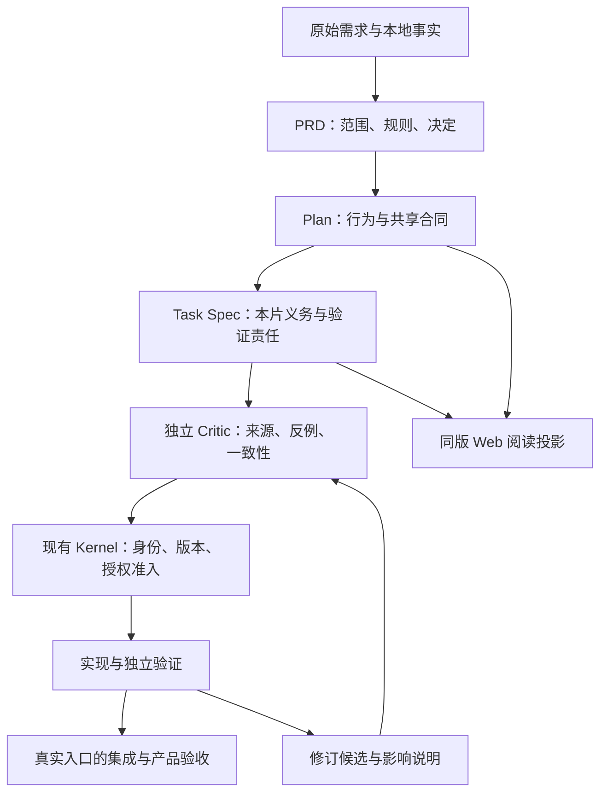

# 206：从公开资料借鉴 Spec 方法——造父的完整方案与能力评估

> 状态：implemented（本批工程范围）。2026-11-10 完成阶段 A、内部六类生成/交接试点及有证据的最小阅读改进；外部工具原生对照、真人/多次重复和完整 v5 产品效果资格仍未取得。详见[实施评估](../impl/206-spec-quality-evaluation.md)。

目标：让产品负责人能判断范围，让执行者离开作者聊天也能实现，让验证者能从原始要求构造反例，让规格修订能找全受影响任务。规格的价值由这些行为证明，不能用章节数、字段数或一张总分表代替。

本方案承接 [197](197-prd-spec-contract-and-readable-views.md)、[205 实施记录](../impl/205-prd-methods-and-design-handoff.md) 与当前代码，不覆盖 AGENTS.md 的权威边界。本文是方法与演进方案，不授予批准 Plan、启动产品实施或修改运行态的权限。

## 1. 研究边界与证据

区分三类对象：Spec Kit、OpenSpec 是可检查模板/源码的工具；Kiro 本次检查官方公开功能文档，未审计其闭源实现；NASA、Cucumber、Shape Up 是互补的方法参考，不是三套可直接与 ZaoFu 比较的多 Agent harness。

检索日期：2026-11-10。源码取 GitHub 当次 HEAD 后固定到 SHA；只检查列出的文件及有关段落，不声称完成整个外部仓库安全或质量审计。

| 来源 | 固定范围 / 官方入口 | 证据限度 |
| --- | --- | --- |
| Spec Kit | `08252af8c5fb1c68135768fde2049d6578fa46c3`；spec/plan/tasks 模板、analyze/tasks/clarify 指令、checklist 模板 | 指令和模板支持的能力，不是生成结果实测 |
| OpenSpec | `579fcac57ae00c2dff38f971b6d88b6f1f098b8a`；concepts/workflows、spec-driven schema/templates、validator/specs-apply 的相关路径 | 对指定校验、消费与变更机制做源码核对，未运行整套工具 |
| Kiro | [Requirements First](https://kiro.dev/docs/specs/feature-specs/requirements-first/)、[Analyze Requirements](https://kiro.dev/docs/specs/analyze-requirements/)、[Correctness](https://kiro.dev/docs/specs/correctness/) | 动态官方文档；不等同已验证各客户端实现 |
| NASA | [需求质量检查表](https://www.nasa.gov/reference/appendix-c-how-to-write-a-good-requirement/) | 需求工程方法，按软件项目裁剪 |
| Cucumber | [Example Mapping](https://cucumber.io/docs/bdd/example-mapping/)、[Gherkin](https://cucumber.io/docs/gherkin/reference/) | 共同澄清及可执行示例的方法 |
| Shape Up | [Map the Scopes](https://basecamp.com/shapeup/3.3-chapter-12) | 集成切片、范围组织方法 |

本地研究下载清单、14 个源文件 SHA256 和取回时间在 `reports/spec-research/sources/manifest.json`，按仓库规则忽略。文中固定 SHA 链接可在没有本地 reports 时追查原文；不把外部正文复制进仓库。

证据记号：D=文档声明，S=指定源码核对，T=本地定向测试，L=历史单次真实 Provider 产物，E=固定条件的重复对照实验，P=内部六类一次生成/交接试点。本次外部工具为 D/S；造父现有 S/T/L，续批新增 P；没有任何一方获得多次重复的 E 证据。以下“借鉴建议”和分数均为本次评审判断，不是来源作者对造父的评价。

## 2. 先对齐术语，避免错误迁移

| 层级 | 要回答的问题 | 造父承载位置 | 不宜直接对应的外部概念 |
| --- | --- | --- | --- |
| PRD / Requirement | 谁有什么问题、价值、范围、成功与未决项 | 原始 Requirement 与可读 PRD，受控来源引用 | 不能把技术实现 plan 当完整产品 PRD |
| Plan / 系统 Spec | 本批行为、合同、设计选择、任务图和验收责任 | 同版 Plan Package、Task Map、既有矩阵、正文 | Spec Kit 的 plan 偏技术设计，OpenSpec proposal 偏变更理由 |
| Shared Spec | 多任务共同遵守什么，版本与消费者是谁 | 已有共享规格/工件引用和 Plan 正文章节 | 不新建另一份 canonical task schema |
| Task Spec | 本片交付什么、失败后什么不变、如何独立交接 | 现有任务合同及 `execution_spec` 分区或精确 Task 标题 | 外部 checklist 的每一行不等于一个可调度 Task |
| 实现步骤 | 如何完成本片中的工作 | 任务内部清单、代码与测试 | 不因有文件路径就拆成独立 Agent 任务 |
| 执行证据 | 哪个版本由谁、何时、在哪里被验证 | 受控事件、证据工件、身份与版本绑定 | 打勾、文档存在或作者自评不等于完成 |

这一层级区分决定了迁移策略：借鉴外部的澄清、规格和变更方法；调度、授权和终态继续由造父现有 Kernel 管理。

## 3. 六个来源的深度分析与取舍

### 3.1 Spec Kit：值得借鉴的是跨产物一致性方法

**核对事实。** [spec 模板](https://github.com/github/spec-kit/blob/08252af8c5fb1c68135768fde2049d6578fa46c3/templates/spec-template.md) 将用户故事、验收场景、要求和成功判据显式化；[tasks 模板](https://github.com/github/spec-kit/blob/08252af8c5fb1c68135768fde2049d6578fa46c3/templates/tasks-template.md) 按故事组织实施步骤、独立验证和并行标记。[analyze 指令](https://github.com/github/spec-kit/blob/08252af8c5fb1c68135768fde2049d6578fa46c3/templates/commands/analyze.md) 对照 spec/plan/tasks，查重复、歧义、遗漏、约束冲突和覆盖，并将无法直接建设的上线业务 KPI 与工程任务区分。

**机制判断。** 单份文档可能合理，组合后却冲突；它把审查对象从“模板填满没有”推进为“这些文档能否同时成立”。但任务覆盖映射包含关键词或 ID 推断，关联存在不能证明行为充分；同一个模糊表述在所有文档重复也可能全部一致。

**造父差距。** 已有来源账本、矩阵、Critic 和一致性方法；剩余风险是只检查关联 ID，或相信作者的“已对齐”，没有拿最终持久化正文构造反例。不能再新增一套平行覆盖表制造第三份真相。

**采纳。** Critic 读取同版最终工件，对具名冲突写出两侧位置、违反的来源、最小反例和受影响任务；将“没有关联”与“有关联但语义不足”分开。首批加强局部责任和评估方法，沿原入口加载。

**不照搬。** 模板把测试设为按需求选择，不能覆盖造父按风险必须验证的规则；固定 setup/foundation 阶段不能无条件阻塞所有业务；小 checklist 不机械膨胀成带独立运行成本的 Task。

**验证办法。** 给合法共享与串任务两类样本；既要发现遗漏，也要证明不把合法依赖报错。用原始来源核对，不以 coverage=100% 直接通过。

### 3.2 OpenSpec：值得借鉴的是变更规格与消费路径一致

**核对事实。** [concepts](https://github.com/Fission-AI/OpenSpec/blob/579fcac57ae00c2dff38f971b6d88b6f1f098b8a/docs/concepts.md) 区分当前规格与 change 中的 proposal/design/tasks/delta；delta 表达增加、修改、删除等行为变化。[validator](https://github.com/Fission-AI/OpenSpec/blob/579fcac57ae00c2dff38f971b6d88b6f1f098b8a/src/core/validation/validator.ts) 的 `validateChangeDeltaSpecs` 复用发现规则，拒绝会被消费路径遗漏的根级规格；提供 `mainSpecsDir` 时检查修改造成的场景丢失。部分语言/步骤完整性检查在普通模式是 warning，不能描述为全部强制门禁。

**机制判断。** 变化量比重写全文更容易审阅；但是只有“旧状态、修改意图、新状态、保留义务”同时可定位，差量才安全。检查者接受的文件必须也是归档/应用者真正消费的文件，否则形式正确仍可能丢需求。

**造父已有与缺口。** Plan Package 已有 digest、代际与引用准入；方法有修订影响分析。缺少更紧凑的人工“前后行为差异”视图及重复实测的影响识别能力。机械版本绑定不能自行判断旧行为是否应保留。

**采纳。** 修订时在现有正文记录 ADDED/MODIFIED/REMOVED/保留行为、来源、消费者和旧证据失效理由；Planner 重发受控候选，Critic 检查未修改场景是否误删。本轮增强方法，不新造一套 delta runtime。

**不照搬。** 不让 Agent 直接改已接纳的 Package、事件或任务状态；不把外部轻量变更流替代造父审批。非行为改动无需编造业务要求，可记录适用性及工程验证。

**验证办法。** 修改一个共享合同，要求找出直接和间接消费者、保留未变场景、撤销不再适用的旧证据；核对写入、校验、展示、执行消费的是同一版内容。

### 3.3 Kiro：值得借鉴的是明确行为与从规格寻找反例

**核对事实。** [Requirements First](https://kiro.dev/docs/specs/feature-specs/requirements-first/) 描述 requirements→design→tasks 的工作流；[Analyze Requirements](https://kiro.dev/docs/specs/analyze-requirements/) 检查跨要求的逻辑矛盾、隐含前提及边界条件，并带着相关要求发出澄清问题。[Correctness](https://kiro.dev/docs/specs/correctness/) 介绍将前提和性质关联到要求的属性测试；当前功能表仅标注 IDE 支持 PBT，不能外推为 CLI/Web 已具备。

**机制判断。** 示例能说明一个场景，性质能描述一组输入必须保持的关系。例如“写入失败不改变旧快照”，可以对不同合法输入及失败注入反复检查。错误或过弱的性质仍会全绿，有限随机测试也不是形式证明。

**造父缺口。** 当前 GWT、失败不变项与分层验证已有基础，但没有跨产品证明“作者提出的性质”足够独立、能抓住实现错误。增加一个 PBT 字段不能解决预期与实现共同犯错。

**采纳。** 复杂状态/序列化/幂等任务由 Skill 要求说明输入域、前提、不变量及反例；记录 seed 和最小失败输入，按技术栈选现有工具。预期从原始要求与确认合同推导，不能从当前代码输出反推。

**不照搬。** 不强制所有 UI、外部服务或体验任务采用 PBT；不为全绿而由实现者默改需求；未决定的业务选择仍归 owner。

**验证办法。** 对规格加入“保存失败却提交内存状态”的错误变体，验证者必须给出来源和可复现反例；同时保留正确实现作为正例，记录误报。

### 3.4 NASA：值得借鉴的是需求质量与双向追溯

**核对事实。** [官方检查表](https://www.nasa.gov/reference/appendix-c-how-to-write-a-good-requirement/) 强调清楚、单一义务、正确抽象层级、术语一致、可行和可验证，以及来源和验证关系。

**造父适配判断。** 借鉴它对“好的要求”的判据，避免将航天文书体量搬入普通软件。需求价值要能追到业务问题，实施与验证又要能反查来源；“快速、安全、易用”必须说明观察条件或待决定负责人。质量判断仍由 Agent/人负责。

**采纳与限制。** 保留定性约束及理由；一个 AC 混合多个义务时分别说明验证责任。量化阈值有依据才填，没有测量基线则登记未知和最迟决定点。产品验证关注是否解决问题，工程验证关注是否符合已确认要求，不能互相替代。

**验证办法。** 从任务反查来源、从原始要求正查本片/后续验证；检查失败行为、接口和约束有没有被概括性 AC 吞掉。

### 3.5 Cucumber：值得借鉴的是规则、示例、问题的分离

**核对事实。** [Example Mapping](https://cucumber.io/docs/bdd/example-mapping/) 将故事、规则、具体示例与待答问题分开，澄清中发现的新故事可另行保留；[Gherkin](https://cucumber.io/docs/gherkin/reference/) 给出可执行场景的表达方式。

**造父适配判断。** “Given/When/Then 三个字段都有”不能证明规则明确。规则解释为何如此，示例展示具体结果，问题保留尚未决定的边界；三者混成一个列表会令 Agent 把疑问当事实。

**采纳与限制。** 现有场景使用具体输入、动作和可观察结果；拒绝、异常恢复与重复操作按业务风险补齐。Task Spec 引用具名场景，不复制所有项目场景；技术内部不变量可以用契约/单元验证，不强迫业务读者理解 CSS selector 或内部函数名。先改善规则，不要求所有项目安装 Cucumber。

**验证办法。** 对同一规则给正例与有意义的边界反例；独立读者应能复述预期，而不是只读到“操作成功、结果正确”。

### 3.6 Shape Up：值得借鉴的是可完成的集成范围

**核对事实。** [Map the Scopes](https://basecamp.com/shapeup/3.3-chapter-12) 按可独立完成的项目结构组织范围，避免只按人员/技术层列清单；范围在探索过程中逐步清晰，关注早期集成结果。

**造父适配判断。** 多个 Agent 同时产生大量文件不等于产品前进。切片应回答“本片完成后能观察到什么”，并指明接入真实入口的生产者。基础设施、迁移和研究也可成为独立任务，但要有自己的结果及消费者，不必伪装成用户故事。

**采纳与限制。** 保留小而完整的旅程、共享合同和最终装配责任；Task 内可以有技术步骤。遇到未知先用有界 Spike，不提前猜完全部设计。范围探索不能成为绕过已批准合同、随时扩大写入边界的理由。

**验证办法。** 只提供已完成前置和本片输出就能进行本片验证；必须等待未来任务的检查明确交给候选/集成阶段，不把未来命令塞入当前完成条件。

## 4. 适合造父的完整借鉴方案

### 4.1 全链路与权威归属

图中的“独立”指职责和输入边界，不能仅凭角色名宣称不同模型或盲评。所有修订均走现有受控入口；图不定义新的运行状态机。

| 借鉴能力 | 造父现有基础 | 本轮落点 | 仍需取得的证据 |
| --- | --- | --- | --- |
| 需求澄清与规则分层 | requirement-reconciliation、PRD 方法、owner decisions | Task Spec 方法区分规则/示例/问题，保留当前与未来决定 | 不同领域真实产物是否减少误解 |
| 跨产物一致性 | execution-consistency、source/coverage 矩阵、Critic | 按局部义务检查最终工件；评估协议要求具名反例 | 受控错误注入的漏报和误报 |
| 集成切片 | Task 合同、依赖、允许路径、任务/候选验证 | 强化可观察结果及本片/共享/后继验证区分 | 独立实现和装配的返工表现 |
| 变更与保留义务 | spec-revision-review、Package digest/generation | 方法记录行为差量、消费者、证据复用/失效依据 | 共享合同变更样本的影响定位准确性 |
| 属性与反例 | GWT、失败不变项、现有验证命令 | 按风险采用性质测试，保留输入域和反例 | 项目实际测试及独立 oracle 是否有效 |
| 人读交接 | 同版 Markdown、模块规格、来源入口 | 共享场景逐任务责任、原始决定状态与时点 | 真人交接时间、澄清率和遗漏率 |
| 效果评估 | 原始输入/工件归档、测试与运行证据 | 新增可复算评分、固定条件及独立交接协议 | 多样本、多次运行及成本记录 |

### 4.2 各层应做和不应做的事

- **Skill**：规定怎样澄清、分片、寻找反例、判断适用性、评审变更；允许项目裁剪且必须给理由。新增方法放在 `zf-plan-execution-readiness/references/`，从已有 PRD/Planner/Critic 依赖链消费。
- **Prompt**：提供本次目标、来源、阶段、需要读取的方法和评审输出要求。不复制整套长期方法，不让多个入口维护不同“好 Spec”定义。
- **工件**：用现有 Plan、Task Map、execution_spec 和矩阵表达；共享正文只保存一处，Task 引用同版条款并写本片责任。必要的语义正文不可变成可丢弃投影。
- **Runtime**：维持 schema、身份、路径、digest、代际、授权和证据存在性等机械不变量。不按字数、标题、关键词或主观评分决定语义通过，不增加第二 canonical task contract。
- **Web**：只读展示已接纳内容及明确关系，显示缺失/未知/歧义；不猜测任务义务，不把 NOT_RUN 显示成通过。需要审批仍走现有 token/身份绑定动作。
- **评估**：分开测方法已送达、产物语义、交接效果、产品实现效果；复用已有工件记录，不为了本轮研究建设新评估服务。

### 4.3 推荐的最小 Task Spec

正文以行为为中心，不追求固定篇幅。共享内容按版本引用；本片不能只留一句“见总文档”。

| 内容 | 最少需要交接的事实 |
| --- | --- |
| 目的与边界 | 对应哪条已确认要求；本片做与不做的范围 |
| 行为 | 前态、触发、后态、拒绝/失败后不变项；按风险补权限、并发、幂等 |
| 合同 | 消费/生产接口、数据或共享规则的同版引用；原始要求与技术选择分开 |
| 场景与责任 | 每个具名场景的本片 AC、命令、验证 owner/tier、入口及证据位置 |
| 依赖与阶段 | 已完成前置；本片能验证的结果；交给后续任务验证的集成义务 |
| 决定与变更 | 未决负责人、受影响消费者、最迟关闭点；当前修订差量及保留行为 |

教学示例：规则“保存失败不改变已有数据”；场景给出旧快照 A、提交 B、存储失败，预期仍为 A 且保留输入。功能任务承担状态回滚检查，装配任务承担真实入口的错误反馈与重试。必须分别绑定各自 AC/命令，不能靠同一场景挂两个 Task 就声称两边责任齐全。此例是方法示范，不是已经实现的产品证据。

### 4.4 分阶段演进与退出条件

| 阶段 | 内容和依赖 | 退出条件 / 取舍 |
| --- | --- | --- |
| A：本轮首批 | 研究与评分 → 方法分发 → 已复现的阅读器问题 → 聚焦验证与归档 | 见第 6 节四项实施；不等待外部工具账号或真实产品授权 |
| B：方法效果资格 | 冻结六类样本、统一模型/预算/权限、先校准再独立生成/交接；依赖可比较执行环境 | 报告漏报、误报、澄清、返工、时间及 token；不达标则修方法重测，不抬高能力分掩盖效果 |
| C：有证据再扩展产品 | 若 B 证明变更消费者难定位，做同版变化阅读视图；若局部合同仍丢失，先修作者方法和受控分区交付 | 先复现真实问题及消费路径，再决定需要哪些机械字段/代码；不能按外部模板字段数扩 schema |

阶段 A 已落地。续批按用户批准执行 B 的内部六类基线/候选试点和 C 的最小阅读改进：任务定位、重复章节折叠、证据位置变化及明确消费者。B 不再是全部 NOT_RUN，但完整效果资格仍 partial：校准在生成后补做，非预先资格通过；没有外部原生同条件、真人或多次重复。没有新增配置开关、数据库或多套 Spec 模式。详见第 8 节。

校准至少考虑：简单旅程的失败恢复、权限/多主体状态、跨任务集成、既有行为修订、未来不阻塞决定、循环或未来验证依赖。每类都应有合理正例；答案由评估者从来源独立建立并与作者输入分开。方法作者参加本次文档评审这一事实不能包装成独立盲评。

## 5. 能力评分：优势、劣势和敏感性

### 5.1 规则与用途（阶段 A 历史评分；当前复评见第 8 节）

0=核实缺失，1=零散描述，2=基础可用且明显缺口，3=主要关系明确，4=方法与入口具备可定位证据，5=另有多样本独立重复验证。未检查/不适用为 N/A，不能填 0。

这是同一评审者基于公开资料和本地证据的**能力评分**，不是成功率、产品质量或商业排名。预定维度覆盖来源到任务全过程；本研究没有预注册盲评，权重本身也应接受质疑。D/S/T 的强度不同，所有总分仅用于决定借鉴方向。

七项公共维度均可从选定范围评价。造父额外的运行授权/证据准入单列，避免把工具定位差异当成其他项目的零分。NASA/Cucumber/Shape Up 按特定方法适配性评价，不加入完整工具总分。

| 维度 | 多 Agent 交接权重 A | 轻量迭代权重 B | Spec Kit | Kiro | OpenSpec | 造父基线 | 造父本轮 |
| --- | ---: | ---: | ---: | ---: | ---: | ---: | ---: |
| 行为明确性 | 15 | 15 | 4 | 4 | 4 | 4 | 4 |
| 任务切片与交接 | 15 | 10 | 3 | 3 | 3 | 4 | 4 |
| 来源及跨产物一致性 | 15 | 10 | 3 | 3 | 3 | 4 | 4 |
| 验证责任及可证伪性 | 20 | 10 | 3 | 4 | 3 | 4 | 4 |
| 变更与保留义务 | 10 | 15 | 3 | 3 | 4 | 3 | 3 |
| 人读定位与理解支持 | 10 | 20 | 3 | 4 | 4 | 2 | 3 |
| 使用轻量程度 | 5 | 20 | 4 | 3 | 4 | 2 | 2 |

权重 A 合计 90，B 合计 100；各自独立归一化。总分 = `20 × Σ(分值 × 权重) / Σ权重`。原始向量可直接复算；展示一位小数只是算术精度，不是测量精度。

| 对象 | A：多 Agent 交接 /100 | B：轻量迭代 /100 | 主要证据 |
| --- | ---: | ---: | --- |
| Spec Kit | 64.4 | 67.0 | 固定模板与 analyze 指令 S/D |
| Kiro | 70.0 | 69.0 | 官方要求/设计/任务及分析/PBT 文档 D |
| OpenSpec | 68.9 | 74.0 | 固定概念/schema/变更校验 S/D |
| 造父基线 `2fdee307` | 71.1 | 61.0 | 当前方法/准入源码 S，历史 R2 L，既有测试 T |
| 造父本轮 | 73.3 | 65.0 | 同一基线 + 局部责任阅读回归 T；未新增真实生成样本 |

**分数解释：** A 下造父得益于交接责任；B 下 OpenSpec 更有优势。改变权重会改变顺序，因此不能给出“造父全面领先”的结论。任一高权重维度上下浮动 1 分就可能改变接近对象的顺序。造父只因已修复并验证的阅读问题将阅读支持从 2 调到 3，其他维度不因新增方法文字加分。

### 5.2 每项得分的理由与扣分点

以下行与上一表逐维对应，依据是第 3 节的具体来源和第 6 节的本地入口；评的是可检查支持，不评未测的用户速度。

| 维度 | Spec Kit | Kiro | OpenSpec | 造父基线 → 本轮 |
| --- | --- | --- | --- | --- |
| 行为 | 4：故事/要求/场景模板；尚无本研究的重复效果验证 | 4：要求、设计及澄清入口；仅 D | 4：要求与场景/差量明示；不证明语义正确 | 4→4：来源、状态、失败不变项方法齐；单例不能推到 5 |
| 交接 | 3：按故事独立测试，但 checklist 与调度任务仍需适配 | 3：任务由设计派生；未取得跨 Agent 完整交接实测 | 3：分组任务与验证说明；细步骤不是独立 dispatch 合同 | 4→4：owner/范围/依赖/实际入口明确；共享责任还有需作者核对的项 |
| 一致性 | 3：analyze 明确，但关键词推断关联不足以证明覆盖 | 3：要求间分析明确；未核对全部产物身份绑定 | 3：当前/差量关系清楚；来源到每个任务的责任仍需组织 | 4→4：来源账本、矩阵、同版引用与 Critic；尚缺多领域语义召回实测 |
| 验证 | 3：故事可测试；选用测试与独立责任需要项目补充 | 4：场景和性质方法有官方入口；PBT 限 IDE，效果未测 | 3：任务验证和场景校验明确；校验通过不证明行为 | 4→4：owner/tier/command、局部/候选验证；新 PBT 方法未跑项目，不加分 |
| 变更 | 3：澄清与一致性重审有方法；所查范围不如 delta 集中 | 3：重分析受影响要求；未核实旧证据失效全链路 | 4：delta 与保留场景检查、消费路径一致有 S | 3→3：版本/审批绑定强，语义差异定位仍分散；新方法不等于效果 |
| 人读 | 3：Markdown 分层，但跨文档定位仍需读者整合 | 4：官方编辑/澄清入口明确；未进行真人可用性比较 | 4：当前规格与本次变更分离，适合审阅；未做真人实验 | 2→3：原有 Markdown 可读，真实共享归属有误报；修复后可定位，重复内容和实际理解耗时仍未解决 |
| 轻量 | 4：模板/命令易裁剪；全流程仍有维护成本 | 3：集成产品入口便利，方法/客户端差异有成本；未测 token | 4：以变更组织，适合已有产品的小步更新；非实测成本优势 | 2→2：多工件、多角色和受控准入成本明显；未测新方法成本下降 |

额外维度“确定性执行授权与证据身份”：造父 **4/5（S/T，沿既有实现）**，依据 `plan_artifact_package.py`、`plan_admission.py`、`plan_approval_identity.py` 及对应测试。该分只描述已有机制，不是本轮重新完整认证；外部三者在本研究范围 **N/A**，不能据此声称其不具备授权或安全机制。

方法适配分同样按 0–5，限定到各自专长：NASA 需求质量 **4**、Cucumber 规则/示例澄清 **4**、Shape Up 集成范围组织 **4**（均 D + 本次适配判断）。共同扣分项是造父还没有这些方法带来效果提升的重复验证；不能相加后参与工具排名。

### 5.3 造父的主要优势和劣势

**值得保持的优势**：来源→任务→验证责任链更适合多 Agent 交接；本片与集成验证有明确边界；Plan 版本、授权与证据绑定由确定性代码负责；阅读投影可以保持原文和未知状态。

**优先补的弱点**：小需求承担较多工件/角色成本；共享规则重复铺到任务后难读；变更的行为差异与消费者不够集中；评审仍可能与作者共享盲点；已有真实样例覆盖窄，缺少交接澄清和实现返工数据。

**借鉴优先序**：先提升局部责任和紧凑阅读，再做独立反例/变更校准，然后用真实交接决定是否继续做变化视图或更强机械合同。PBT 是适用项目的验证手段，不应成为所有规格的格式要求。

## 6. 首批 backlog、实现与真实证据（阶段 A 历史记录）

本批从本地候选移动到 active 后实施；完成时归档到 `tasks/done/`，实现提交号记录在各任务中。四项对应用户授权的研究、实施和评估范围，不把阶段 B/C 宣称已完成。

| 工作项 | 交付 | 验收 |
| --- | --- | --- |
| [研究与评分](../../tasks/done/2026-11-10-1306-spec206-research-scorecard.md) | 本文、固定源码引用、分项理由与两种权重 | 来源可定位、算术复算、未知证据明确 |
| [方法演进](../../tasks/done/2026-11-10-1306-spec206-spec-methods.md) | Task Spec 局部义务、差量与反例方法、评估协议，同步三个技能目录 | Planner/Critic 实际物化与分发字节一致 |
| [阅读器](../../tasks/done/2026-11-10-1306-spec206-shared-scenario-reader.md) | 共享场景逐任务责任；原始决定状态、最迟决定时点 | 真实字段夹具 + 正/反例单测 + Docker 双视口 |
| [评估交付](../../tasks/done/2026-11-10-1306-spec206-evaluation-closeout.md) | 能力分、局限、聚焦验证、实现和归档提交 | 区分通过与 NOT_RUN，当前 worktree 干净 |

### 6.1 实际发现与修复

历史 R2：Workflow `workflow-38a3e3db1318725f`，Plan `evt-1dcfc632f607`，3 Task、21 场景、7 决定。两角色使用同一模型系列，Critic approve 后停人工审批；没有实施示例产品，不能算独立跨工具实验。

`S-add` 挂 T-2/T-3，场景列 AC-1 及 V-CORE/V-BROWSER/V-PRODUCT。T-2 持有前两个命令；T-3 的 V-PRODUCT 关联本片 AC-I。旧阅读器按当前任务判断全体命令，因此 T-2 把合法的 T-3 命令报成未绑定。本轮先增加真实字段回归，旧代码失败，再修复。

新投影仅在场景明确的参与任务内解析，显示每片直接匹配的 AC、命令正文、owner/tier 和命令自身 AC。T-3 与场景 AC-1 没有直接绑定，仍显示“本片责任待核对”，不通过阅读器推断 AC-I 语义等同 AC-1。未知任务、未知命令、重复定义或不在参与列表中的同名 AC 不能静默兜底。

决定保留原值：confirmed 4、deferred 1、pending_validation 1、proposed 1。原通用统计中的其他状态仍为 3，不把它们自动归为解决；补充显示 `latest_decision_stage`。本轮没有改变后端状态合同。

### 6.2 验证层级与未覆盖项

- 方法入口：`tests/test_prd_design_methods.py` 检查 Planner/Critic 实际物化新增参考与分发字节。它证明方法送达，不证明 Agent 遵循。
- 前端：模型回归覆盖真实共享关系和合成反例；浏览器回放选取的真实字段，经实际 React/API 页面在 1280/375 视口检查任务关系、决定状态和只读行为。
- 固定夹具：`web/tests/fixtures/spec206-shared.json` 保留所选原值，并记录三个原工件 SHA256；完整历史样本保存在忽略的 reports。浏览器响应替换是展示回归，不是新 Provider 生成或完整 admission 重放。
- 本轮具体验证结果记录于 [205 实施记录](../impl/205-prd-methods-and-design-handoff.md#2026-11-10公开资料借鉴与共享责任阅读)，运行日志在 `reports/spec-research/`。
- 外部三工具同条件生成、独立实现/交接、用户阅读效果、预算收益：**NOT_RUN**。造父本轮新方法的真实生成质量：**NOT_RUN**。历史 R2 的 approve、方法物化和 UI 测试都不能补齐这些证据。

## 7. 后续决策规则

是否继续增加规格字段或产品功能，优先由阶段 B 的失误样本决定：哪条来源被遗漏、哪种交接要反复澄清、哪个消费者没重审。如果问题是方法没说明或 Agent 没读到，先修方法/交付；如果机械引用能指向错误版本，才修运行合同；如果作者内容正确但读者找不到，修阅读投影。

复评保留相同评分维度与原始分数；新增来源、适用范围或实测证据应说明变化。未来真正能支持“比参考方案更好”的证据，应来自相同输入条件下更少的重大遗漏和返工，而不是把造父自己的结构完整性当成胜出标准。

## 8. 续批实施与当前复评（2026-11-10）

本节更新当前结论，保留第 5/6 节的历史基线。完整失败、提示/输入摘要、样本结果、成本和局限见
[206 实施评估](../impl/206-spec-quality-evaluation.md)，复现入口见[固定案例说明](../../tests/fixtures/spec_handoff_eval/README.md)。

### 8.1 按建议顺序完成的工作

| 顺序 | 本批结果 | 验收记录 |
| --- | --- | --- |
| 1 基线与修复 | 真实摘录复现两处重复；折叠相同 Task Markdown 章节，保留原文；任务直达来源/AC/命令/证据 | [紧凑阅读](../../tasks/active/2026-11-10-1347-compact-spec-reading.md) |
| 2 多样本交接 | 六类内部基线/候选，18 份初始及修订生成、18 次新会话交接；另做命令澄清两组及正反校准；六份小接口实现通过独立测试 | [比较实验](../../tasks/active/2026-11-10-1306-spec206-comparative-effects.md) |
| 3 按效果减负 | 最终方法缩短 21.8% 字节；修复方法被当作产品来源问题；扩展现有变化阅读，比较证据位置和消费者 | [变化阅读](../../tasks/active/2026-11-10-1306-spec206-change-reader.md) |
| 复评 | 保留外部 D/S、内部 P/T 的区别；统一两组权重，单列 NASA/Shape Up；不新增语义 Kernel 门禁 | [结果交付](../../tasks/active/2026-11-10-1347-spec206-reevaluation.md) |

首个精简候选产物反而更长，不能靠缩短 Skill 判定成功。修订候选相对历史基线本次输出 token 少 6.1%、
产物字符少 11.5%，但使用事后修订、单次样本和复用基线，不能推断普遍性能或整个流程成本。
原案例三组均为接手者报告 17 条 covered、1 条 partial；partial 源于实际命令输入缺失。
相同命令澄清后两组均完整表达，必须保留输入变化，不能抹掉原始 partial。

### 8.2 当前能力评分

延续第 5 节维度和权重。当前造父七维 `[4,4,4,4,3,4,2]`，仅人读支持从阶段 A 的 3 升至 4；
真实读者理解速度仍未测，轻量程度仍为 2，变更仍为 3，不将机械路径比较说成语义重审闭环。

| 对象 | 多 Agent 交接 A /100 | 轻量迭代 B /100 | 主要证据 |
| --- | ---: | ---: | --- |
| Spec Kit | 64.4 | 67.0 | 固定模板/指令 S/D，未原生运行 |
| Kiro | 70.0 | 69.0 | 官方能力 D，未原生运行 |
| OpenSpec | 68.9 | 74.0 | 指定变更机制源码 S/D，未原生运行 |
| 造父阶段 A | 73.3 | 65.0 | 历史评分 |
| 造父续批 | **75.6** | **69.0** | 新阅读入口 T；内部真实生成/交接 P；已有授权/版本机制 S/T |

| 方法 | 本次适配分 /5 | 造父已经采用 | 仍缺的证据 |
| --- | ---: | --- | --- |
| NASA | 4 | 明确义务、可验证、来源双向追溯 | 多领域真实需求的独立质量验证 |
| Shape Up | 4 | 集成切片、当前与未来验证分开 | 真实项目周期、装配返工收益 |
| Cucumber | 4 | 规则/示例/问题分开，正反例校准 | 更广业务规则和独立评审召回 |

方法分不与工具排名混算。造父的优势继续是交接责任和受控证据；OpenSpec 的轻量变更组织仍值得借鉴。
本次不是六个项目的同场运行竞赛，不能据表宣称造父整体优于某个产品。

### 8.3 完成度口径

首批四项及续批四项工程交付均已实施；阶段 B 的内部试点已执行，阶段 C 的最小阅读问题已修复。
206 的“跨工具、独立读者、重复真实产品效果资格”仍未完成，不给整个研究目标虚假的 100%。
后续扩大样本时应补真实 v5/Channel 生成、独立人类/跨模型交接和完整产品装配，不继续靠增加字段弥补证据不足。
