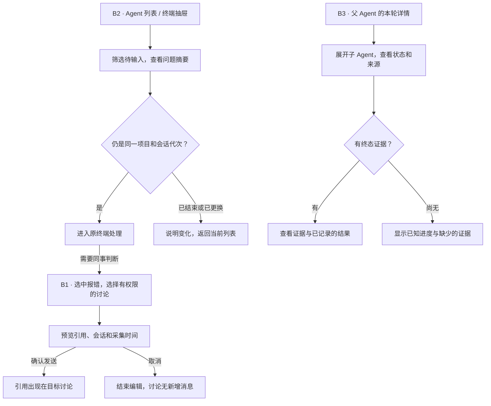
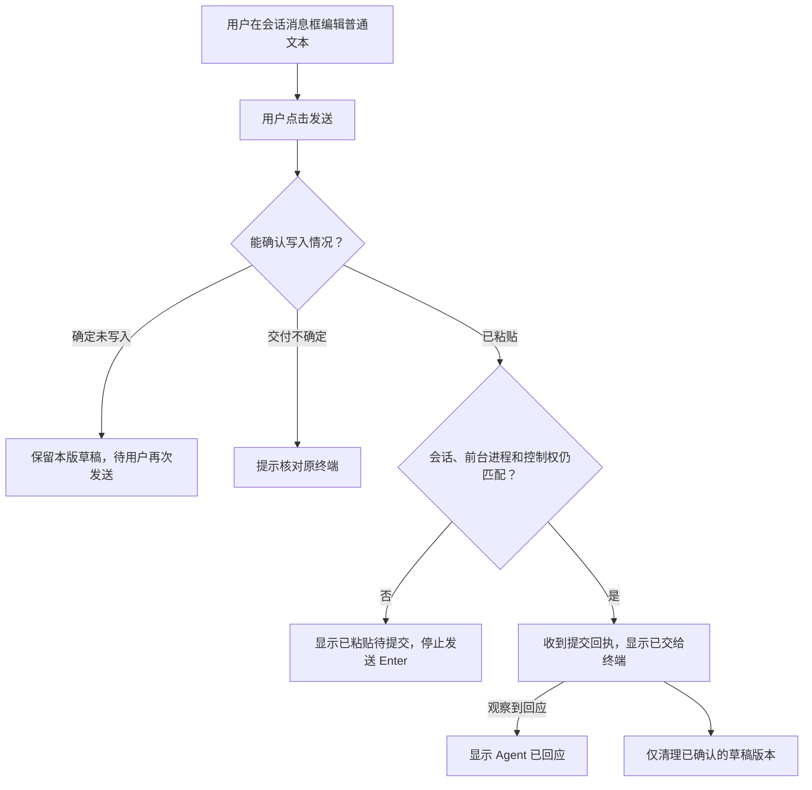
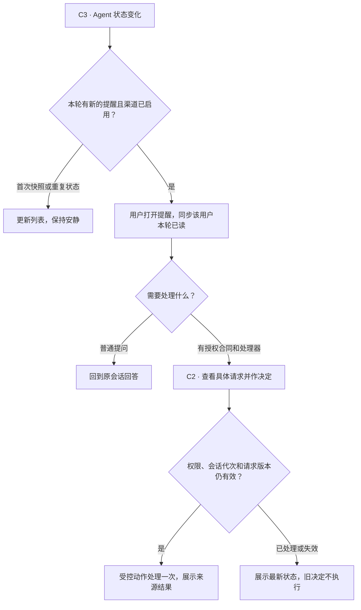
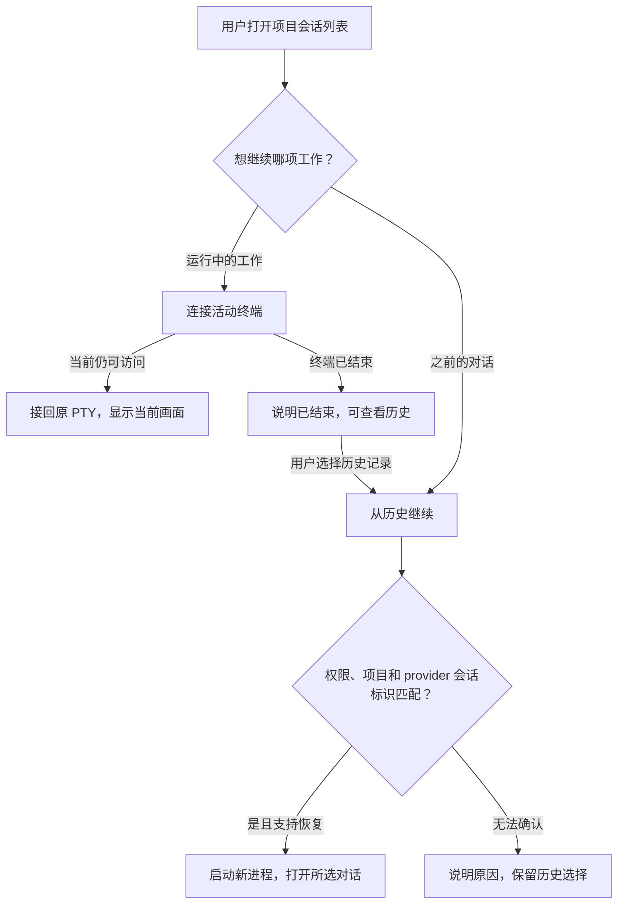
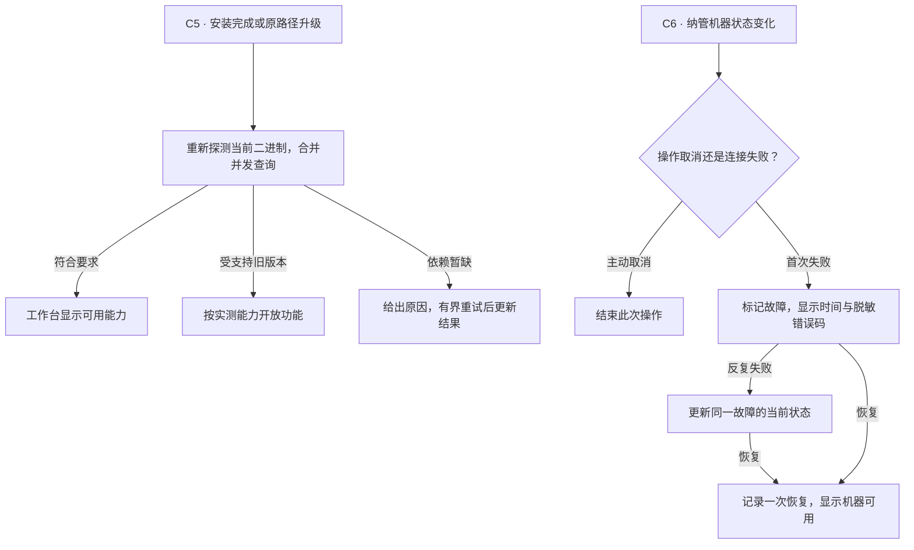
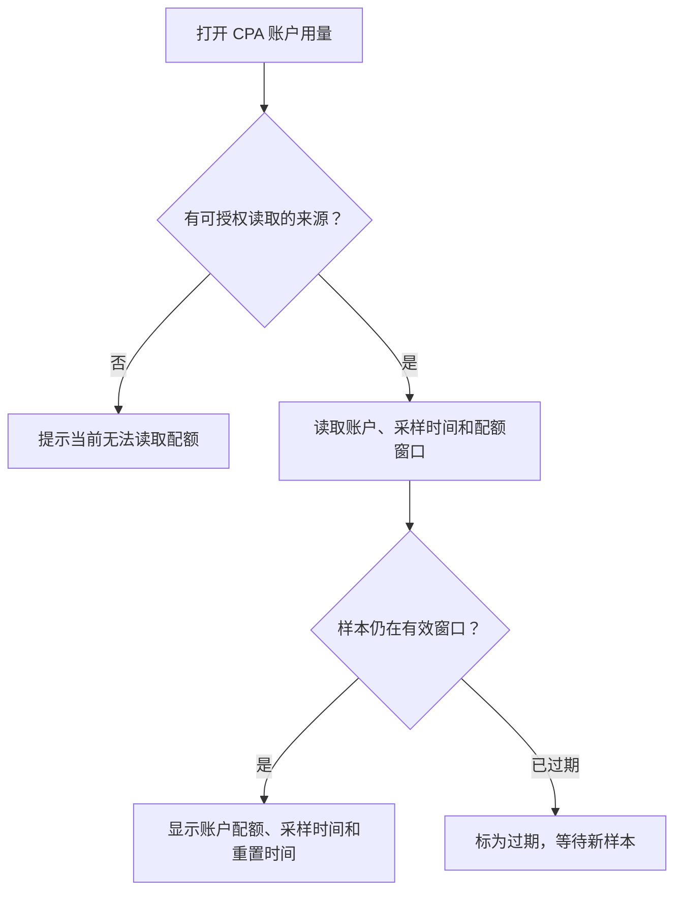
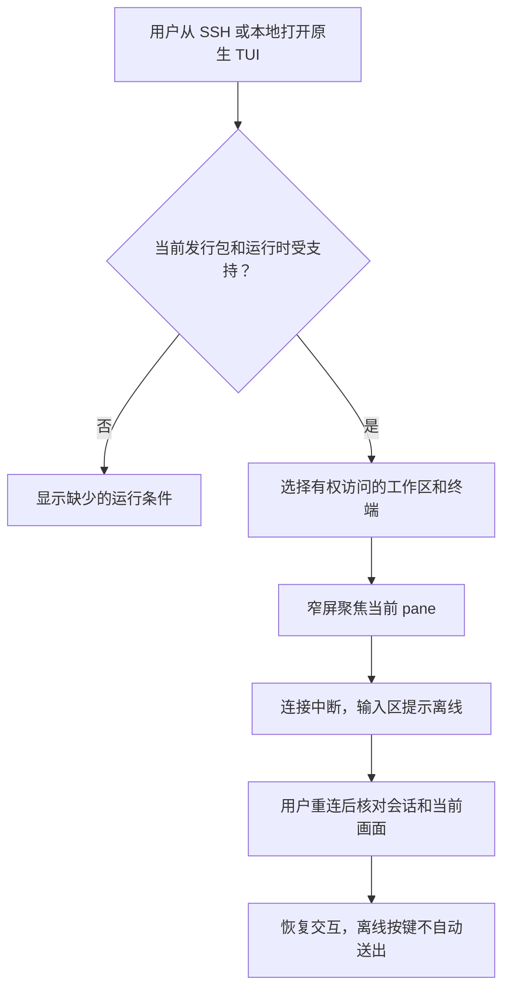

# 212. 多会话 Web Terminal 与 Agent 待处理体验

操作多个 Coding Agent 时，用户应能打开其中一个终端，看清中文 prompt 和真实选区，在手机上旁观而不打断桌面输入。短暂掉线后，页面应说明哪些输入送达、怎样回到同一会话。Agent 需要人介入时，用户能从工作台直达原问题，并把选中的报错引用给协作者。

**状态**　2026-11-23，A1–A9 和 B1–B3 已实施。第四节记录代码入口、复测方法与移动端验证范围。C1–C8 按第三节的进入条件保留。

## 一、首批用户行为与验收

### 打开、切换和恢复会话

| 编号 | 用户操作与可观察结果 |
| --- | --- |
| A1 列表以最新请求为准 | 同一项目并发刷新，再重命名或停止会话。让最新列表先返回，旧成功与旧失败随后到达。名称、运行状态、错误提示和加载指示均以当前请求为准。切换项目后，原项目结果不会出现在当前抽屉。可复用已有 `LatestRequestGate`。 |
| A2 按访问建立连接 | 新浏览器打开含多个运行中会话的抽屉。保留可发现的标签，首次只为选中会话申请连接。其余标签的 attachment 请求数为 0。访问第二个标签后切回，仍能看到前一次的输出。恢复浏览器标签列表时沿用同一规则。关闭标签只释放相应连接，停止 Agent 仍需显式操作。 |
| A3 重连有明确终点 | 连续模拟三次 WebSocket 握手成功、有效完整帧到达前异常断开，重试间隔逐次增长直至上限。稳定接收输出后，下一次临时中断从短间隔重试。重连取得同一终端的新 ticket、完整首帧和连续序号。主动关闭、权限撤销和已停止会话结束重试。旁观重连保留只读身份。稳定期与上限由实现给出并使用假时钟验证。 |
| A4 输入中断可见 | 控制者在断线期间输入中文、按回车或粘贴长 prompt，立即看到当前无法发送。若断线前部分数据已发出且没有交付证明，提示用户检查终端。重连时捕获出站帧，原按键、粘贴和回车自动重放次数均为 0。首批直接在终端输入处提示。独立草稿框见 C1。 |

### 中文、浅色主题与双端旁观

**代表场景 A5**　桌面在浅色主题提交一条含中文、emoji 和换行的长 prompt，滚动使标记行离开视口，再切换主题并重新附着。历史提问、续行及留白在浅色背景上可读，真正的拖选有独立选区色，邻近普通深色输出保留原色。打开 `/model` 菜单时其高亮仍可辨认。深色主题沿用终端颜色。保存脱敏 ANSI 原帧、Codex/Herdr 版本、行列数，以及相同场景的浅色和深色截图。同时断言单元格或样式，截图供人工审美复核。

| 编号 | 用户操作与可观察结果 |
| --- | --- |
| A6 字符宽度 | 在固定 Herdr 0.9.5 的隔离 pane 查询实际光标列，以同一输入驱动仓库安装的 xterm。样本含汉字、普通 ASCII、⚠️、👨‍👩‍👧、👍🏽 和临近行尾的混排。比较光标、换行、退格及下一字符的位置，再验证点击对应单元格。以本机固定版本测量值决定适配方式，保留原测量与浏览器结果。 |
| A7 两个浏览器看同一终端 | 桌面控制端打开一个已有输入的终端，另一浏览器以窄屏 Observe 加入、旋转、断网和重连。桌面当前输入、光标、行宽及控制权稳定，旁观者输出可读，旁观连接发送的 input/resize 为 0。桌面主动调整后双方可继续阅读。控制端在线期间，另一端须由授权用户显式接管才能接替控制。手机接管后，键盘弹出、收起及恢复前台时，控制端输入栏可见。软键盘适配限制在终端区域。 |
| A8 高输出与慢端 | 两个浏览器同时连接，向隔离终端持续输出，使一端变慢。健康端仍接受操作与 Ctrl+C。慢端得到完整连续输出，或被明确告知输出中断并能重新取得全帧。终端进程存活。分别记录服务端队列与浏览器 xterm 完成解析的进度，前台持续过载时提供人工重连，后台冻结后允许一次恢复尝试。先取得积压数据，再决定是否引入解析回执、字节窗口和协议协商。 |

### 长会话里的用量

**A9 增量读取有据可查。** 在同项目并发运行两个会话，给其中一个会话的已绑定 transcript 追加 token 记录。未变化的文件使用缓存。正常追加仅解析新增完整记录，允许有限的连续性核验。对逐行追加、末行分两次写入、截断、同路径替换、模型切换、累计计数重置及重复刷新分别比较增量结果与全量重算。项目、provider session 和 generation 匹配，累计值、按模型分项及停止时结算均一致，同一代结算幂等。验证记录解析行数和读取字节数。当身份或连续性无法确认时重新建立基线，身份冲突沿用现有不可用提示。

## 二、第二批协作入口

| 编号 | 入口与验收 |
| --- | --- |
| B1 从终端引用到讨论 | 选中终端报错，选择同项目且有权限的 Channel 或任务讨论。目标草稿展示用户选中的文本、会话、采集时间及可得的行范围。含反引号、换行和中文的文本仍可辨读。可以修改、取消或确认发送。取消后目标会话无新消息。通过原讨论入口提交。滚屏后引用仍表示采集当时的内容。 |
| B2 找到等待输入的 Agent | 在 Agent 列表或 Terminal 抽屉筛选“待输入”。有可靠来源时展示问题摘要，缺失时显示“需要输入”，点击直达对应项目与终端。可见列表在状态变化或重新获得焦点时更新。键盘选择或触摸一行期间保持目标稳定。会话已结束或代次已改变时给出说明。普通终端问答回原会话处理，有具体授权合同和现有处理器的事项沿用设计 196 的 Inbox 准入。 |
| B3 父子工作可见 | 父 Agent 已回复但子 Agent 仍工作时，在原有父轮次详情展示子项状态、来源及可用证据。子项缺少终态证据时给出相应提示。沿用现有 child activity 投影，Kernel 按任务合同、事件与证据推进状态。 |

### 第二批的用户流程

#### 第二批 · 从待输入的 Agent 到协作讨论

例如，发布检查停下来等人选择测试环境。操作者从「待输入」进入原终端。如果需要同事判断，可以只引用出错的几行。父 Agent 已经回复时，仍能从该轮详情查看后台测试进度。三个入口各自可用。

## 三、后续候选及进入条件

以下为两轮讨论中保留的产品选择。每项在进入实施批次前解决对应问题，不阻塞 A、B 的独立工作。

| 编号 | 能力、触发条件及决定点 |
| --- | --- |
| C1 草稿与消息交付 | 产品负责人选定显式 prompt 输入框或 Kanban 向终端投递的入口后，按用户、项目、会话代次和草稿版本保留普通未发送文本。回执仅清理对应版本，密码及原始终端按键排除在持久化之外。分别显示未写入、已粘贴待提交、已交给终端、已观察到回应。前台进程或控制权变化后停止后续 Enter。以粘贴后切会话、断线后改写及旧回执晚到验收。 |
| C2 远程回答授权卡 | 有原生请求身份、有效权限合同和受控动作后，由授权入口展示具体问题。绑定项目、会话代次、请求 ID 或版本，重复点击幂等。桌面已处理后，即使再出现同文案问题，旧手机卡也失效。普通问答继续按 B2 导航。 |
| C3 通知与已读 | 产品负责人选定通知渠道和人群后，仅对真实状态变化发提醒，首份快照、重复轮询和重连避免重复通知。终端个人提醒按用户、项目、会话代次、轮次归属，跨设备合并。既有审批 Inbox 的项目共享已读遵循设计 196。 |
| C4 历史对话恢复 | 在 provider 提供已验证的会话标识和受支持的恢复参数后，分别提供“连接活动终端”和“从历史继续”。界面说明前者保留运行中 PTY，后者创建新进程并打开对应对话。校验项目、用户权限与来源，扫描设上限。对同目录并发会话、旧会话缺标识和跨项目同名做负例。 |
| C5 安装与宿主探测 | 安装维护者在下一次版本资格验证时评估并发探测合并、原路径升级后的缓存失效、失败后有界重试。验收涵盖固定版本安装、依赖暂缺后修复，以及既有受支持旧宿主按能力降级。运行安装脚本与修改安装版本另行交付。 |
| C6 云端机器诊断 | 云端纳管运维采用首次失败及首次恢复记录，区分主动取消，展示机器、操作、时间及脱敏错误码。选定运维入口后验证故障期间连续刷新、恢复和不同用户空间隔离。认证沿用设计 211 的 standalone 本地账号与云端受管用户身份。 |
| C7 CPA 与用量展示 | 有可授权读取的配额来源后，展示账户、采样时间、窗口及过期状态。过期样本避免呈现为当前配额。Ovis 的 CLIProxy 审阅证据涵盖连接与账号用量。Codex 本地 `/model` 目录自动同步单独调研和立项。 |
| C8 原生 TUI | 有 SSH 或本地 TUI 的明确用户场景时再评估。Ovis TUI 依赖 herdr-core，需独立验证运行时、发行包、窄屏布局和断线输入提示。A、B 直接复用 ZaoFu 现有 Herdr 网桥。 |

### 候选能力的用户流程

#### C1 · 在断线前后发送一条消息

候选入口是显式消息框。用户看到的提示随交付证据更新。已经粘贴但提交结果不明时，最有用的操作是「查看原终端」；重新连接本身不会发送草稿。

#### C2、C3 · 在手机看到提醒并处理当前请求

手机收到「有事项需要你处理」时，打开提醒只更新该轮个人已读。普通问题回原会话；符合 Inbox 准入的授权才出现决定按钮。如果同事已在桌面处理，手机上的旧按钮只能查看最新状态。

#### C4 · 回到昨天的工作

两个入口的结果要写在按钮旁边。用户可以接回仍在运行的原终端，也可以在新的终端进程中继续有明确归属的历史对话。

#### C5、C6 · 安装完成后与机器掉线时

安装者关心本机到底能用哪些功能；云端值班人关心哪台机器何时出了问题。这是两个独立入口，云端运维流程只适用于已纳管机器。

#### C7 · 判断 CPA 账户的配额还能否参考

操作者打开账户用量，先看采样时间和重置窗口，再决定是否继续使用。缺少授权来源与样本已过期需要不同的页面提示。此入口只涉及配额观测。

#### C8 · 通过 SSH 或本机终端工作

这是原生 TUI 的使用设想，进入排期的前提是存在明确的 SSH 或本地需求，并已验证 herdr-core 和发行包。窄屏与断线行为是这条路径的重点。

## 四、实现边界与交付验证

- **连接与身份。** 沿用短时一次性 ticket、项目和浏览器绑定、服务端 Observe/Control 权限与显式接管。原始帧经现有 NDJSON → WebSocket → xterm 路径。授权撤销后结束输入。现有 registry、provider transcript 和运行事件各自按原职责读取。状态目录从项目配置解析。
- **行为兼容。** 延续 WT1–WT6 的资源归属、探测失败语义、只读观察、鼠标、旧宿主降级和用量绑定。使用已具备的全帧/序号校验。终端提示、输入回执及已读表示各自的交互事实，业务验收归现有 Kernel 合同。[0.9.5 基线](../impl/herdr-web-terminal-095.md) · [审批准入](196-inbox-human-decision-center.md) · [身份与部署](211-standalone-login-and-cloud-workbench.md)
- **首批顺序。** 前端先完成 A1–A4。A5–A8 由终端前后端共同完成，先采基线再选插件或协议。A9 可由用量模块独立交付。B1–B3 由相应讨论、终端及 Agent 页面共同验证。产品负责人在 C 项进入排期时决定外部通知、操作权限与入口，工程负责人在拿到实测数据后选流控与列宽方案。

| 验证层 | 条款、方法与证据 |
| --- | --- |
| 前端与后端定向测试 | 前端执行 `npm --prefix web run build` 及相应单测，覆盖 A1–A7 的状态与视图逻辑。涉及网桥或用量时执行 `uv run pytest -q --no-cov tests/test_web_terminal_routes.py tests/test_web_terminal_runtime.py tests/test_web_terminal_usage.py`，增加 A8/A9 的慢消费者和读取量断言。B 项落地时增加各入口的归属、取消及授权测试。 |
| Docker Playwright | 在独立临时项目把 API/UI 绑定到 `0.0.0.0`，使用 8002 以上端口、`mcp/playwright:latest` 与 host 网络。扩展现有测试与筛选参数使新增场景实际被收集，然后运行 `bash tests/e2e/scripts/run_web_terminal_herdr.sh fixture` 和 `legacy` 档。用独立浏览器上下文记录 A2/A7/A8 的出站帧、连接和恢复结果。A5 保留浅深色截图。B1–B3 从真实 UI 入口操作并检查来源与目标。 |
| 固定宿主与移动端 | `bash tests/e2e/scripts/run_web_terminal_herdr.sh host /path/to/herdr` 为既有真实宿主入口，新增 A5/A6 使用隔离项目、官方 0.9.5 及注明版本的 Codex。只保存合成或已脱敏的 ANSI 与截图。A7 可用 Chromium 手机视口验证尺寸与连接。iOS 软键盘、冻结恢复另记真实 Safari 设备结果及限制。 |
| 验收记录 | 各批写明 ZaoFu、Herdr、provider、浏览器版本和命令、实际收集的用例、断言、证据位置与未运行项。公开仓库样本、协议替身、真实宿主和真机结果分别标记。本轮结果见下表。 |

### 本轮复测记录

本轮 Docker Playwright 共通过 13 个场景（fixture 11、legacy 1、host 1）。后端定向验证通过 105 项，工作树相对 dev 的自动确定性测试通过 334 项，两组包含重叠用例。

环境为独立临时项目、Herdr 0.9.5、Codex 0.171.0、xterm.js 6 和 Docker Chromium 149.0.7827.22。以下命令从工作树根目录运行，先激活项目的 Python 环境并构建 `web/dist`。

| 已接入的行为 | 复测与实测结果 |
| --- | --- |
| A1–A4 列表、按需连接与输入恢复 | `bash tests/e2e/scripts/run_web_terminal_herdr.sh fixture`。浏览器让两次旧请求晚到，初次只申请一个 attachment，访问第二个后切回仍保留第一份输出。假时钟验证前三次退避为 250、500、1,000 ms，上限 5 s。完整帧后连接稳定 10 s 重置。断线按键、中文粘贴和回车均无自动重发。 |
| A5–A7 主题、列宽与旁观 | 用隔离 Codex 的合成提问采集 120×40 可见 ANSI 行，保留中文、emoji 和菜单反显。fixture 回放验证选区、滚动及重新附着。加 `ZF_TERMINAL_SCREENSHOTS=/tmp/zf-212-evidence` 可导出浅深 PNG。`host "$(command -v herdr)"` 档实际创建、旁观、接管和停止同一 PTY。Herdr 光标查询与 xterm 对 ASCII、汉字和三种 emoji 分别前进 1、2、2、2、2 列。行尾混排、退格后续字符也落在相同坐标。浏览器验证点击混排后的 X 命中第 10 列。窄屏和视口变化使用 Chromium，Safari 真机软键盘及系统冻结仍待设备复核。 |
| A8 慢消费者恢复 | 网桥测试阻塞一个 sender，4 帧队列满后关闭该连接并报告恢复原因。双浏览器协议替身测试冻结一端的 xterm 定时器，记录已解析序号 1、收到序号 10、积压 9 MiB。另一端仍可发送 Ctrl+C，慢端经显式重连取得完整帧。生产默认浏览器积压阈值为 8 MiB。日志只记录数值。 |
| A9 用量读取与结算 | `pytest -q --no-cov tests/test_web_terminal_usage.py`。66 行基线之后，未变化时解析 0 行，分段追加的 12 字节不计入用量，补齐后解析 1 行。常规追加只对已提交前缀首尾各最多 4 KiB 做连续性核验。验证模型切换、计数重置、截断、同路径替换、与既有账本冲突、同代重复结算及两个并发 Claude 会话。Claude 在新记录到达后按消息 ID 重新汇总内存中的用量。 |
| B1–B3 协作入口 | fixture 从真实 Dashboard 组件拖选含中文与反引号的输出，覆盖取消、编辑、进入对应草稿和 Channel 显式发送。待输入列表点击时重新核对代次和状态。Herdr AgentInfo 提供 blocked 状态，抽屉显示 Needs input。父轮详情按 parent_turn_id 读取既有子任务投影，分别显示缺少终态证据的说明和已记录的事件引用。 |
| 兼容与复现 | 同一浏览器脚本的 `legacy` 档覆盖旧宿主。完整 ANSI 采样中的宿主路径已移除。测试样本及脚本见下方。 |

[ANSI 回放样本](../../web/tests/fixtures/herdr-codex-prompt.json) · [终端与协作浏览器测试](../../web/tests/web-terminal-212.spec.ts) · [固定宿主光标测量](../../tests/e2e/scripts/herdr_cursor_widths.py) · [Docker 测试入口](../../tests/e2e/scripts/run_web_terminal_herdr.sh)

## 五、来源与证据强度

- 第一轮 Ovis 评审提出重连退避、断线输入、真实 prompt 回放、双端几何以及等待输入入口，对应 A3–A5、A7、B2、C1。
- 第二轮将范围扩展到列表乱序、后台连接、列宽、用量、高输出、跨端协作与部署，对应 A1–A9、B1–B3、C1–C8。两轮对话确认汇总规格。批次、交互落点与验证方法为本规格建议。B2 对等待项位置的取舍依据设计 196。
- ZaoFu 调研基线为 dev `4d88585e` 上的 Herdr 工作分支 `20467e1e`。隔离样本观测到旧标题覆盖新标题，用量三次读取行数为 1,001 / 0 / 1,002，xterm Unicode 11 对 ⚠️、👨‍👩‍👧、👍🏽 分别前进 1、6、4 列。Ovis 的 Herdr 0.9 样本三者均为 2 列。前述数字作为复现线索，A6 以固定宿主复测为准。[列表](../../web/src/components/terminal/useTerminalSessions.ts) · [终端](../../web/src/components/terminal/TerminalView.tsx) · [用量](../../src/zf/web/terminal_usage.py)
- Ovis 固定提交为 `d8c2714d663a37e9ab24ee46efd8ccf51fc6a1a4`。终端侧可核查连接和解析边界、列宽与草稿。协作侧可核查目标归属、列表排序及历史读取。[输出流控](https://github.com/devswha/ovis/blob/d8c2714d663a37e9ab24ee46efd8ccf51fc6a1a4/docs/terminal-flow-control.md) · [列宽样本](https://github.com/devswha/ovis/blob/d8c2714d663a37e9ab24ee46efd8ccf51fc6a1a4/src/lib/terminalWidths.test.ts) · [草稿](https://github.com/devswha/ovis/blob/d8c2714d663a37e9ab24ee46efd8ccf51fc6a1a4/src/lib/draft.ts) · [收件箱](https://github.com/devswha/ovis/blob/d8c2714d663a37e9ab24ee46efd8ccf51fc6a1a4/src/components/InboxList.tsx) · [历史会话](https://github.com/devswha/ovis/blob/d8c2714d663a37e9ab24ee46efd8ccf51fc6a1a4/server/session-history.ts)
