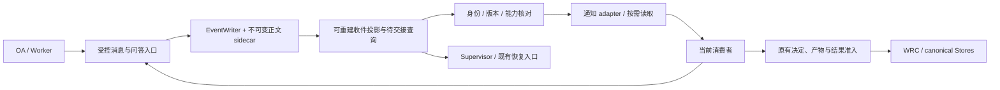

# 216 · Agent 持久收件箱与责任交接

OA 与 Worker 需要在不同时间接手同一份工作。成员已经获准但还没启动、OA 正在处理另一项判断、Worker 重启或替换后，一条问题或指导不应只因为原会话不存在就失去接收责任。操作者应能看到消息交给谁、正文是否已交付、问题由谁接手、仍欠什么结果，以及下一次何时唤醒或升级。

本规格在既有阶段义务、Board、assistance、事件账本和受控动作上补充持久交接合同。正常派工继续由 WRC 执行，OA 作业务判断，独立 Verify/Judge 签署。收件箱不成为另一个调度者，也不以消息回执代替业务完成证据。

> 状态：已授权在 215 worktree 实施。逐项验证结果见[实施与验证记录](../../impl/216-durable-agent-mailbox-implementation.md)。Orca 机制与局限见[源码调研](../../refer/orca-mailbox-code-review-2026-11-25.md)。

## 1. 需要解决的场景

### S1：选中的成员尚未派发

**前提：** 215 的阶段分工已经准入，专家 B 的义务存在，但无执行位，尚无 operation/attempt。

**动作：** OA 或获准专家 A 向 B 的义务发送补充问题。

**结果：** 系统记录消息、批准范围、接收义务和待绑定原因。B 正常派发时，在身份和输入授权仍有效的前提下取得这封消息；不能因为发送时没有进程就丢掉接手责任，也不能为了送信越过容量限制启动 B。

### S2：OA 忙，多个 Worker 同时求助

**前提：** 多个当前 Worker 发出有证据的问题，OA 已在处理一个有效 checkpoint。

**动作：** 新问题到达。

**结果：** 问题持久排队，已有 checkpoint 不被任意中断；等待者能看到责任人和唤醒条件。已有获准方案足以继续的无关 Task 正常派发。问题超期或接手者结束却无答案时，形成明确的待处理事实，不要求模型重复分诊来证明队列存在。

### S3：消息已保存，唤醒结果不明

**前提：** runtime 已保存消息及通知 claim。

**动作：** 在写入 provider 前后任一点崩溃，无法证明原提示是否已送达。

**结果：** 消息正文和可读取入口仍存在；保留未知、核查原 session/turn，不盲目重复会引起新执行的输入。可证明未发送时才重试通知；无法查证时记录恢复责任、期限和受控出口。

### S4：旧 Worker 被替换

**前提：** 同一获准义务由新 attempt 接手，旧 Worker 迟到提交读取或回答。

**动作：** 新旧消费者竞争读取、确认或答复。

**结果：** 旧消费者被隔离，新消费者仅取得仍适用的消息。已读但未回答的问题不会因旧 ACK 自动完成；旧回答保留历史，是否适用于新合同由授权 Agent 判断并绑定证据。

### S5：只有接手，没有结果

**前提：** OA 或专家已接手问题，但本轮结束；关联工作也已结束，尚无有效回答或正式交接。

**动作：** Supervisor / 既有恢复运行时观察到这一事实。

**结果：** 提问者与操作者看到“已接手、尚未回答”和下一责任人。通知本身不回答问题、不判产品失败，也不隐式关闭业务义务。

## 2. 来源、已有能力与差量

用户要求先深入审查 Orca mailbox，再判断如何借鉴给 ZaoFu 并形成 spec。稳定地址、消息级活性和下面的阶段划分是作者基于该目标提出的工程方案，不是用户已批准的运行策略变更。

| 已有合同 | 本规格保留 | 本规格补充 |
| --- | --- | --- |
| 215：版本化成员义务、operation、attempt、独立签署 | 分工及正式结果仍由原入口准入 | 对尚未派发义务与换代消费者的持久寻址 |
| 213：公开 Run Board、定向提及、seen/consumed | 原 Board 受众和冻结目标语义 | 显式选择的义务级收件箱、待绑定与交接回执 |
| 200：Worker assistance、OA/RM 分工 | 问题版本、诊断责任与原受控恢复 | 统一的交付/接手投影及单个问题的活性追踪 |
| 212：输入索引、按需读取与 session 恢复 | 正文权限、版本/digest 与恢复绑定 | 邮件附件经原索引授权；传输通知不冒充必读输入凭证 |
| OA checkpoint 与 advisory queue | 已有持久请求、单实例占用与紧急指导排序 | 从同一问题稳定关联到已有请求，避免新增第二条执行队列 |

`workflow_board.post()` 当前冻结发送时的具体 operation/attempt；无唯一运行目标会保存 null audience。`deliver_mentions()` 将无有效绑定者过期。此行为符合旧提及合同，不应通过偷偷改变它来实现跨 attempt 邮箱。

`agent_mailbox.py` 目前是没有生产调用链的纯折叠器；它的全消息 sent/delivered/read 状态也不足以表达多人收件、消费者代数和问题接手。本规格不要求直接启用它。实施前应决定复用、迁移或保留历史兼容，禁止同时建立两套消息真相。

## 3. 目标与非目标

本轮目标是让批准范围内的 Agent 交接具备可恢复的收件身份、可区分的交付事实和明确的责任出口。首批优先 Worker→OA 求助与 OA→Worker 指导，再覆盖获准阶段成员的证据通知。

不在本轮实现：跨机器 federation、外部邮件服务、任意匿名私聊、全量聊天历史同步、通用消息代理、任意 Agent 自主组队、通过消息修改合同/预算/权限、替换 Verify/Judge、自动改变常驻 RM 配置。现有 Board 的公开消息继续存在；不把所有日志和 heartbeat 变成邮件。

### 3.1 为什么补交接合同，而不是再加一套系统

| 方案 | 收益与代价 | 本规格判断 |
| --- | --- | --- |
| 保持当前 Board + assistance | 改动最少，当前 attempt 内通信与求助已有能力；未派发成员和跨消费者责任仍需分散处理 | 若仅需要给活跃 Worker 发通知，足够；不能独立满足 S1/S4/S5 |
| 在既有权威入口补持久收件与接手 | 复用现有正文、事件、身份和恢复；需要处理版本、交付未知和责任投影 | 推荐，首批限定 Worker↔OA 与稳定成员义务 |
| 独立 broker、第二套消息/任务状态机 | 引入跨存储一致性、重复队列和额外运维；仍需接回原授权与 gate | 当前源码证据不足以支持这些新增成本，不选 |

必要性来自 215 的异步成员与恢复接续目标，并非“多 Agent 必须有邮箱”的一般推论。Mailbox 能防止交接责任随会话消失，但不会解决错误的 OA 判断、缺失验收证据、provider 容量不足或原有 gate 的错误作用域。评价试点时必须把这些故障分别归因。

## 4. 架构位置与唯一权威

| 信息 | 持久位置与更新者 |
| --- | --- |
| 消息接受、消费者绑定、回执、回答、交接和过期 | `EventWriter/EventLog` 的受控追加 |
| 完整正文与大证据 | 既有原子、不可变 sidecar，事件绑定 ref/digest |
| Task / Feature / Session / RoleSession / Attempt 当前状态 | 各自既有 Store；消息投影不得直接写入 |
| 收件列表、pending 索引、游标、UI 摘要 | 可由账本与所需 sidecar 重建的投影；SQLite 可用于查询但不成为第二消息权威 |
| 当前进程和 provider turn | 现有 transport / session / attempt 身份与观测 |

不能使用“消息到达”旁路启动业务操作。已准入工作仍由 WRC 调度；需要 OA 判断的问题通过已有 checkpoint/assistance 请求入口接入。消息内容中的命令、角色名和建议不授予任何执行权。

## 5. 地址与消费者合同

### 5.1 三种语义显式区分

| 寻址模式 | 目标 | 目标变化时 |
| --- | --- | --- |
| 当前执行通知 | 精确 operation/attempt/lease | 保持现行行为：过期，不转给未来实例 |
| 义务收件箱 | Run + 已准入阶段版本 + 稳定义务 ID | 未派发时待绑定；同义务接续经校验后交给当前消费者 |
| Run 协调责任收件箱 | Run + 已准入 OA/诊断职责及授权引用 | 无活跃会话仍保留；由已有角色执行入口取得，不凭角色显示名找进程 |

以上是寻址合同，不是已实现的 CLI 字符串。不得用用户名、模型名或 `oa-1` 单独作为持久身份。跨 Run 转交默认拒绝。

### 5.2 绑定字段

逻辑消息至少可关联：稳定 message ID、幂等请求 ID、project/Run、发送身份、目标义务及批准版本、消息类型、正文 ref/digest、关联问题/因果事件、可见范围、适用合同/目标引用，以及适用的等待期限与责任人。优先引用已有字段和事件，不复制 Task contract。

每次交付另绑定当前 operation、attempt、role instance、dispatch/lease（适用时）、provider session/turn，以及消费者版本。应先核对现有 request hash、attempt 和租约能否完整充当隔离凭证；只有无法覆盖的责任级换绑才增补消费者代数，不在同一事实旁建立另一套独立 epoch。

没有真实 Task 的 Plan 阶段允许 task_id 空；用 Run、阶段和义务身份，不伪造 Task。没有实例时不伪造 attempt。

### 5.3 接续与重分配

同一义务、同一获准合同与输入仍有效时，可按已准入的 replacement 绑定重建消费者。变更任务范围、目标提交、必读证据或授权时，先交语义 owner 判断旧消息与答案是否适用，再引用其决定继续。不得自动把旧代已读复制为新代已读。

阶段或 Run 新代次只修改另一项义务时，沿 215 的继承/适用性凭证保留未受影响成员的有效消息与结果。不能因为全局 generation 变化就使所有人的 inbox 失效；同样不能无凭证把旧消息批量迁到新代。

多人通知逐接收义务保存交付状态；一人读取不消费其他人的份额。群组在准入时固定成员和授权版本。提问必须有唯一责任 owner；多人可提供意见，但不靠“广播到所有人”代替接手。

## 6. 消息、交付、问题与业务结果分别记账

不得把所有阶段压成一个 `done`：

| 维度 | 需要区分的事实 |
| --- | --- |
| 消息 | 请求被接受、正文可核验、撤销/过期/被替代 |
| 接收绑定 | 待绑定、当前合法消费者、已隔离的旧消费者 |
| 通知尝试 | 尚未发送、已预留、已尝试、已确认、明确失败、效果未知 |
| 内容交付 | 正文已向特定消费者交付、消费回执可恢复；模型是否理解不作机械断言 |
| 问题责任 | 等待接手、已接手未回答、回答已提交、回答有效、合法等待、转交/取消 |
| 正式业务结果 | 原有 call-result、Task Verify、Candidate、Judge、受控动作与下游效果证据 |

正文读取不是附件必读完成；已接手不是已回答；回答有效不是新动作获授权；Worker 报告的消息不是 Task done。

建议至少区分 `notice`、`question`、`guidance` 和 `evidence_notice`。正式派工、取消、权限变更和完成仍走原有结构化入口。类型选择是有界 schema，不按自由文本关键词猜测动作。

## 7. 写入、读取、通知与恢复

### 7.1 接受消息

受控入口先校验发送者 capability、Run/义务范围、正文/附件权限和幂等键。正文先原子发布，再在同一目标作用域的串行准入中校验当前绑定并追加接受事件。相同键相同内容返回原回执；相同键不同内容明确拒绝。

只有接受事件成立的消息可投递。正文已写而事件未写的孤立 sidecar 不可被扫描当成新邮件。接受已完成但响应丢失时，重试能找回原回执。事件与 sidecar 不假装是一个跨文件事务；恢复分别处理这两个崩溃窗口。

### 7.2 读取与接手

操作者查看与 Worker 消费分离：只读列表/预览不标记接手；带 capability 的 Worker 才能读取自己获准正文、提交或取得消费回执。API/CLI 名称在实施评审确定，不宣称新增命令已经可用。

读取正文失败或 digest 不符，不能产生成功消费回执。消费提交绑定原消息、正文 digest、当前消费者和稳定 delivery ID；返回响应失败时，同请求可重放这批正文与回执。后继请求不会把刚到的新邮件混入旧批次。

回执重放也必须重新检查当前调用者权限；旧消费者已被隔离时，不因其持有旧 request ID 就返还正文或准许 ACK。需要的是消费交付的可恢复证明，不要求 Agent 完成业务后才确认收件；业务完成继续使用原结果合同。

问题接手记录实际消费者和角色责任，不跟随 UI 当前显示的 owner 回写历史。回答者可以是同一责任的有效后继，但须通过现行授权及版本校验；旧消费者不能借未过期的消息 ID 冒签新答案。

### 7.3 通知通道

通知只指向获准收件入口与稳定 delivery/message ID；完整正文与证据按需读取。支持原生结构化会话时，可以用其可核验的 operation/journal 回执证明正文交付；只有 PTY/tmux 时，只声明能证明的提示写入事实。

通知与正在等待的读取不能竞争消费同一条消息。繁忙消费者保留 pending，合并的是重复唤醒，不是删除或合并有业务区别的正文。避免每封邮件都额外调用 OA；沿用现有占用、预算、容量和队列规则。

必须检查暂停、人机确认和当前进程身份。不能把“投递一条消息”实现成给确认弹窗发送 Enter。provider 是否支持运行中消息按 adapter 能力声明；无证据的通道不得冒充已接收。

### 7.4 重启与未知

重启从账本重建 pending 消息和未终结交付。通知失败不删除邮件，worker 可在合法恢复的输入入口重新发现它。重试原通知前核对原 session/turn、consumer 和 provider 可查询回执。

可证未发、可证失败、已确认交付、无法查证分别处理。未知保留原 claim 与恢复 owner，不能换 request ID 绕过防重。只读正文可按稳定 ID 再读取；会触发 provider 新 turn 的通知不因“只是消息”就被视为无副作用。

不得承诺端到端 exactly-once。目标是持久接受、受控重驱动、当前消费者隔离，以及受控业务动作按既有幂等与准入合同避免重复效果。

### 7.5 取消、留存与缺件

Run 结束、义务撤销或显式取消后，停止新通知并保留历史与原因；必需业务义务的豁免仍由原授权路径完成。已经被接手的问题需记录取消/转交回执，不能只从 pending 列表移除。

正文 sidecar 在消息、问题或引用它的审计义务仍有效时不得按缓存回收。已结束数据依项目批准的保留策略归档；策略尚未确定时不主动删除。重建缺少必要正文时标为 evidence unavailable 并交恢复 owner，不静默跳过或回报空 inbox。

## 8. 单个问题的活性与恢复职责

| 情形 | 机械观察 | 决策 / 执行边界 |
| --- | --- | --- |
| 接收义务已准入、尚无实例 | 等容量/依赖/授权的具体原因 | WRC 沿原合同派发；邮箱不额外招募 |
| 已接受、未交付 | 消费者和通知状态、期限 | runtime 有界重试可证安全部分；未知交既有恢复入口 |
| 已接手、未回答 | 当前 turn、相关后继 operation、明确等待与 deadline | OA/诊断 owner 负责回答；监督者报告未答事实 |
| 接手者已结束且无后继 | 未答问题与当前归属 | 通知提问者和恢复 owner，不能伪造答案 |
| 旧消费者迟到 | 当前代数/attempt 与原回答绑定不一致 | 拒绝准入，保留历史；复用旧意见须有适用性决定 |
| 当前 owner 不可用 | 缺失消费者与原责任范围 | 按既有接管策略转交；无授权消费者时升级有权者 |

活性按 message/question/obligation 观察；其他成员聊天或 heartbeat 不能重置该问题的期限。合法暂停按现有 pause lifecycle 计算有效等待，不把 pause 当失败。期限、重试和预算从 `zf.yaml` 的已有政策或经批准的扩展取得，禁止写死新的 SLA 或无限重试。

OA 与 RM Agent 的业务分工保持 199/200/215：解释任务、改变策略由 OA；运行故障调查由配置的诊断 owner；WRC/RM runtime 执行获准动作；Supervisor 独立监督。邮件状态不让任何一个 Agent 成为第二状态机。

## 9. 与已有实现的接线及迁移

| 现有落点 | 候选改动与必须证明的调用链 |
| --- | --- |
| `workflow_board.py`、`artifact_board.py` | 保留旧公开 Board API；新增义务寻址通过明确版本/模式接入，不能改变旧 `--ack` 语义 |
| `worker_reply_binding.py`、`task_attempt_continuation.py` | 复用发送前身份核对与未知保护；补充消息级恢复查询，不直接放开重复 send |
| `worker_assistance.py`、`orchestrator_advisory_queue.py` | 原问题 ID 与 mailbox ID 可双向关联；不复制问题、checkpoint 或 OA 请求 |
| `orchestrator_agent_transport.py` | 从已有 pending checkpoint/assistance 入口执行；证明 OA busy 时排队与释放后接手 |
| 215 阶段义务、成员准入与 replacement | 从已准入定义建立地址与消费者绑定；明确接线，不能只在测试手工填 `run_boards` |
| `orchestrator_periodic_sweep.py`、既有 watcher | 丢失 wake / 重启后对账；按索引或单次快照批量读取，避免每封邮件重扫全账本 |
| `board_liveness.py`、Supervisor / RM 入口 | 增加消息/问题级未接手与未回答事实；既有 Run 静默观察继续服务其原目标 |
| `stage_team_projection.py`、CLI/Web 工作台 | 同快照显示交付、接手、回答、等待和历史；不得将 seen 展示为业务完成 |

新行为通过 `zf.yaml` 显式选择的试点策略启用，未配置项目保持旧路径。历史 Board 消息不自动推断成私信或义务邮件；历史缺失接手凭证显示未知。迁移优先增加适配器和投影，收敛原重复路径后才删除兼容模块。

停用试点只停止新消息准入，不遗弃已接受的问题：在原授权内完成、明确取消或受控交接，并保留只读/恢复入口。未知通知必须先对账，不能靠切回旧路径再次发出同一动作。

## 10. 操作者与 Agent 可见行为

215 的成员详情应按同一 Run/阶段版本/账本游标显示：待接手消息数、最老等待、当前责任、上一条接手/回答、通知效果未知与恢复入口。尚无实例的成员同样可见。历史查看保留当时消费者，不能混入当前代绑定。

公开 Board 与受限邮件在权限上分开；即使不允许看正文，也需按授权显示可公开的等待元数据。收件人名单不是正文访问授权；附件继续受 212 输入范围和 capability 校验。只读 Web 查看不改变消费游标、不签 ACK、不创建恢复动作。

来源可信度随正文与附件传递：普通成员建议不能伪装成人类批准、Kernel 事实或 OA 正式决定。发送者证明、内容权限和业务授权是不同检查。不得将私人会话、密钥或未经批准的 transcript 自动复制到公开 Board。

## 11. 实施分期与验收

P0 建立最小的 Worker↔OA 交付闭环及未派发义务寻址；P1 覆盖多成员接续、工作台和迁移；真实 provider 资格单列。每期以真实入口接线为完成条件，纯库和 reducer 测试不构成完成。

| AC | 步骤 → 验证 | 阶段 / 验证层 |
| --- | --- | --- |
| AC-01 | 对同消息 ID 重发相同内容、再提交不同内容 → 前者返回原回执，后者拒绝；只有一条接受事实 | P0 / 受控入口与事件合同 |
| AC-02 | 在正文写入与接受事件前后分别中断 → 孤立正文不投递；已接受消息重启可发现、可读取 | P0 / 故障注入 |
| AC-03 | 沿真实阶段准入建立 B 义务，无 operation 时发信，再让 WRC 派发 → B 取得原消息，未绕过容量；旧执行通知仍按旧合同过期 | P0 / mock E2E |
| AC-04 | 在正文准备后、消费提交前替换消费者 → 旧 ACK/答案拒绝，新消费者可继续，历史身份不被覆盖 | P0 / 并发与恢复 |
| AC-05 | 消费已提交、返回连接中断，再用同请求读取 → 返回同批正文与回执，新邮件不混入；无正文/digest 错误不记成功 | P0 / CLI/API 与 sidecar 合同 |
| AC-06 | OA busy 时多 Worker 求助，释放 OA，并重启 watcher → 原请求恰有一条有效接手链，无关任务继续，答案仍 proposal-only | P0 / 调度调用链 mock E2E |
| AC-07 | 在通知 reserve、write、Enter/结构化 send 与回执边界中断 → 可证未发才重试，未知保留与可恢复，不重复授权业务效果 | P0 / mock transport；真实 adapter 资格另测 |
| AC-08 | 问题已被接手但无答案，结束消费者及其后继；另做合法等待对照 → 前者产生未答责任与出口，后者不误报；其他 heartbeat 不重置期限 | P0 / 监督与恢复 |
| AC-09 | 读取 private 正文、跨 Run 发送、伪造 OA/旧 lease、通知期间出现确认框 → 各自拒绝或等待，无越权正文、无自动批准 | P0 / 安全与 transport |
| AC-10 | 提交答案/Worker 完成报告邮件但不给正式验证证据 → 问题投影可更新，Task/Verify/Judge 不被消息 ACK 绕过 | P0 / 原 gate 回归 |
| AC-11 | 同义务 replacement 与变更合同分别接续 → 前者按有效绑定交接，后者要求适用性决定，旧答案不自动变成新证据 | P1 / 阶段接续 |
| AC-12 | 多收件者、重复 wake、CLI 与原生聊天竞争 → 逐收件者独立，重复不产生第二业务效果，已消费旧卡片不再次运行 | P1 / 并发与双通道 |
| AC-13 | Web/CLI 看当前与历史快照、无实例成员及受限邮件 → 身份/计数/等待一致，查看不消费，不泄露正文 | P1 / API、CLI、Docker 浏览器 |
| AC-14 | pending/answered/unknown 混合状态下停用试点，再恢复 → 无已接纳问题遗失，无兼容路径重复发送，未知仍可定位 | P1 / 迁移与回退 |
| AC-15 | 归档事件/重建查询索引，缺一份必要 sidecar → 正常重建保留回执；缺件显式 unavailable，不伪装空收件箱 | P1 / 持久恢复 |

代码实施时先用 `scripts/dev-verify.py plan --base dev` 确定影响闭包。状态/事件/恢复变化执行相关模块及直接调用方测试、pre-merge sentinel 和对应 deterministic mock E2E；不把全量 pytest 当默认。浏览器用本机已有 Docker Playwright 镜像，先核实启动和版本，保留业务断言与证据。

真实 Codex/Claude/tmux/stream-json 在隔离状态中单列验证：真实消息读取、消费者恢复、问题回答及下游原 gate 都要有证据；provider 进程启动或返回 0 不算通过。P0 mock 通过不宣称无人值守完整交付成立。

性能验证记录消息数、接收者数、事件读取次数、待处理延迟、通知/有效消费比与额外模型调用。比较相同 Run、预算和失败注入下的旧路径与试点，不在未测量时承诺百分比收益。消息选择应采用有界页与可重建索引，避免每封消息/每个 recipient 全量扫描历史；具体上限在实现时沿现有配置明确。

## 12. 待定事项与最迟决定点

| 事项 | 当前建议 / 允许继续 | 决定者与最迟时点 |
| --- | --- | --- |
| 现有 namespace 与新交付事件怎么兼容 | 复用已接线领域事件，新增只表达缺失事实；先形成事件映射，不启用孤立 reducer | 实施者与架构评审，在 schema/准入改动前 |
| consumer fencing 是否需要新增字段 | 优先已有 attempt/request hash/lease；只为责任换绑缺口增加最小代数 | 实施者与并发评审，在读/ACK 接口实现前 |
| 原生 provider 是否可查询完整接收事实 | 有证据的 adapter 支持正文交付；其他只承诺 pointer 和显式读 | adapter 实施者，在该通道资格验证前 |
| 期限、重试预算与留存 | 沿项目现行授权；没有来源的数值不假定，未定不自动删正文 | 项目 Owner/现行配置授权者，在生产试点启用前 |
| 试点 Run 与生产切换 | 候选建议先 Worker↔OA；不因此停 RM 或修改正在运行的 Run | Owner，在真实试点/策略切换前 |

这些事项不阻塞本次文档交付，也不授权运行时默认切换。本文不是已准入 Task Map，不自动创建开发任务或开始实现。

### 12.1 本轮实施与验收决定

- 发送者、收件者换代分别检查当前执行凭据。相同逻辑发送者重放同一请求时，需核对正文、地址、附件、问题及期限。已准备的批次和显式 ACK 各有独立凭证。
- 每个问题沿原 assistance/checkpoint 路径排队。OA 繁忙、消费者换代、通知结果未知与已接手待答均保留可恢复责任。原业务门继续核对正式证据。
- 父 Run 结束时按该 Run 的诊断策略处置派生任务；同一 watcher 托管的其他 Run 保留自己的恢复责任。公开工作台仅提供获准查看的交接元数据。
- 无人资格在已批准 Plan 至冻结终点之间统计。核对受控 Web 动作及独立宿主观察，分别给出业务交付、实际并发、自动恢复与批准后人工介入证据。

## 13. 审查与来源记录

- 用户来源：本会话关于 `spec215-20261125` 与 `~/workspace/orca` 的深度审查、mailbox 机制挖掘及“借鉴给造父生成一个 spec”的请求。保留为 S1–S5、差量分析和全部 AC；没有把生成文档授权扩大为实现、提交或部署。
- 源码依据：[Orca 调研第 10 节](../../refer/orca-mailbox-code-review-2026-11-25.md#10-来源与核验边界)，包含两仓库版本、worktree 未提交状态和关键文件摘要。Orca 部分为静态调用链及测试源码审查；两个 ZaoFu 边界为实际函数的纯内存验证。
- 既有规格：[215](215-oa-stage-teams-and-execution-workbench.md)、[213](213-zaofu-antigravity-borrowings.md)；198/199/200/212 按当前索引及代码核对，未存在的历史文档不假定已读。
- 本文提出的地址模式、生命周期细分、分期、API 行为与 AC 是工程设计候选。正文阅读自检应核对开头的操作者结果、S1/S4 的前提/动作/结果，以及 AC-03/04/07/10 的对应验证。作者自检不替代独立评审。
- 初稿的静态审查不含实现测试或真实模型效果。实施阶段的工程验证与真实窗口以[逐项实施记录](../../impl/216-durable-agent-mailbox-implementation.md)为准。
