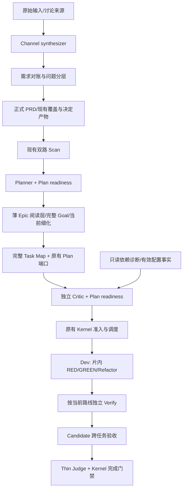

# 187 实施：需求对账、Epic 阅读层与交付证据

> 状态: implemented — 方法及机械诊断已接入；真实模型效果评估见记录中的未覆盖项。
> 设计: [187](../design/187-bmad-inspired-epic-task-map-and-tdd.md)。
> 验证: [本轮评估记录](../records/2026-10-26-0336-187-delivery-validation.md)。

## 六项实施任务

用户授权后从 `backlogs/` 激活为 `tasks/active/2026-10-26-0336-187-*.md`；
实现通过验证后本地提交，完成记录带实现提交及标题归档到 `tasks/done/`。

| 任务 | 落点 | 验证边界 |
| --- | --- | --- |
| 01 需求对账与问题分层 | 新增 `zf-requirement-reconciliation`；Channel 综合直接依赖，Planner/Critic 经 readiness 依赖 | 实际角色物化、来源样例逐项复核；不以加载证明模型执行 |
| 02 薄 Epic 与细化 | readiness 的 Epic reference + 现有 task-scoped JSON 示例 | Task 读取 shared + 自身；Candidate 全文；草稿不能作为 Task Map 准入 |
| 03 图诊断与并行复核 | `plan_execution_review._graph` + 既有 CLI/Plan preflight | 最长链实例、层分组、上下游、缺失/环、顺序稳定性、真实 CLI |
| 04 片内 TDD | `yoke/tdd-evidence/references/cycle-evidence.md` | 新功能真实 RED→GREEN；首跑绿/环境失败处理；最终树证据规则 |
| 05 验证缺口与组合验收 | `yoke/verify-review/references/regression-and-integration.md` | 隔离接口故障注入与当前产品验收/Goal 门禁回归 |
| 06 验证和收口 | 定向测试、mock E2E、哨兵、评估记录与归档 | 工程完成率与真实模型效果分开报告 |

## 方法进入实际角色的路径

当前流程的状态与转换仍由原有实现负责。默认 `stage_barrier` 与可选 v4 Task
Pipeline 的验证时点不同，图不表示默认每片都已启用独立流水验证。

新增方法是 `load_on_demand` 依赖。调用角色正文明确要求读取，物化测试检查真实
依赖展开与完整 reference 复制。模型是否正确执行，需要检查实际报告和语义样本。
`skills/` 修改同步至 `.codex/skills/`、`.claude/skills/`；`yoke/` 方法由现有
source loader 物化到工作角色，没有另造第二份独立维护的实现。

## 图诊断的新增字段

`zf plan inspect-execution --config zf.yaml --task-map <file> --flow-kind prd`
继续只读返回 `plan-execution-review.v1`，新增 `graph` 字段：

| 字段 | 含义 |
| --- | --- |
| `longest_dependency_path` | 完整 DAG 中一条最长节点链；同长时按任务 ID 确定端点与前驱；空图为 `[]`，环/缺依赖为 `null` |
| `tasks_by_level` | 已拓扑解析任务的层分组；组内任务 ID 排序，JSON 的层键为字符串 |
| `direct_dependencies` | 每个任务的直接前置，含缺失引用 |
| `direct_dependents` | 每个已知任务的直接后继 |

迭代拓扑遍历与前驱回溯支持深链，无递归。原 `missing_dependencies` 和
`unresolved_task_ids` 保留；存在未解析分支时，仅报告可解析分支的层分组。
这是节点数意义的最长链，不含时长，不是资源可用性、产品优先级或派发授权。

当前 CLI 和 Plan preflight 消费同一诊断函数；Critic 的 required input 已有绑定和
read ledger，本轮扩展其事实正文，不新增调度状态或语义评分器。

## Epic 的执行边界

[示例](../../skills/zf-plan-execution-readiness/references/epic-plan-example.json)是阅读层
草稿，不能作为可执行 Task Map。`shared` 保留所有来源、Epic、尚未履行的验收与
未决问题；准备进入执行的叶子任务仍须经过现有合同和完整 Goal 覆盖检查。

这不提供“提交半张 Task Map 继续派发”的新能力。未细化范围通过合法阶段 Goal
授权或完整计划补齐处理；受影响冻结图仍走受控 replan。全图路径 owner 唯一、
原子事务单 owner、真实数据/证据依赖及共享环境约束均保留在方法和原准入中。

## 验证与评估解释

新增测试验证公开结果、物化与读取边界；不将 Skill 关键词出现当语义通过。
隔离故障注入检查新集成断言能否抓住生产者/消费者协议偏差，并明确区分注入缺陷
与生产发现。既有 v4 池、背压、恢复和门禁回归用于确认复用路径，没有重写调度器。

不调整默认 lanes、审批、shadow/blocking 模式或 rollout。需要真实模型对照时，
以固定来源、模型、预算与完整验收比较漏项率、首次反馈、等待、返工及成本；
工程测试通过不能证明这些指标已改善。
