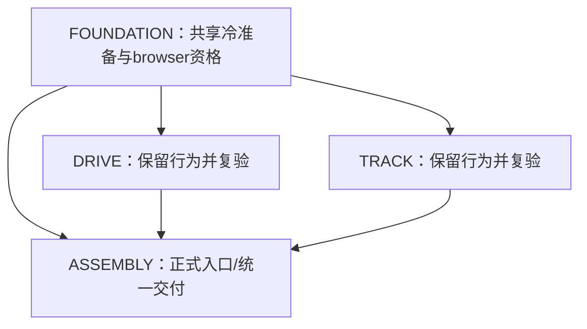

# 187 Racing Supervision — 环境修复与时长证据 Plan Preview

本次交付目标仍是可玩的桌面单人2D俯视赛车。沿用需求revision6和已有产品实现，沿用442e54ec完整冷候选依赖准备与Docker浏览器执行环境方案，本次最小补充时长证据校验；复用已有赛车实现。**本版交由独立Critic及Owner审阅，批准前不得按新计划派发实现/产品验证。**
基线为 `dfe994958e811acbfd95101dafd4a73c4df56eb5`，target_root为仓库相对 `.`。旧候选被拒绝，不能称产品已交付；操作员正常90秒探测只是诊断。本版未执行产品验收。

## PRD：用户结果、范围与规则

用户从正式首页开始比赛，以Arrow或WASD加速/刹车/自由转向，在可见赛道避障，合法前进得分、碰撞扣分；暂停冻结并可继续，90秒有效游戏时间结束一次结算，显示距离/碰撞/总分，点击“重新比赛”重置后可再次驾驶。
保留原始11条需求及既有16项AC，包括AC-A07真实入口注入、dispose和runner失败传播。非目标仍为移动触控、Firefox/Safari、多人与账号/排行榜及3D。
完整产品规格绑定[PRD](../racing/prd.md)和execution_spec.shared.prd；采用已有圆环赛道/8检查点、连续转向、刹停不倒车、最高合法进度计距离、floor(米数)-20×碰撞并最低0分、失焦自动暂停规则。
成功标准仍为所有mandatory行为断言通过、至少一局正常真实90秒Docker Chromium比赛、独立验证与后续Judge/Kernel完整证据。缓存可用或下载成功不等于游戏通过。

## SDD：任务、接口与本轮变化

保留RaceController单一状态写入者、纯TrackPort.resolve和只读UI；所有数值、输入映射、数据字段、动作/事件、顺序及失败不变集详见[模块接口](../racing/interfaces.md)及同包execution_spec.shared.interfaces。
核心合同：规范化InputState→Pose运动→TrackPort裁剪/接触/合法距离→RaceSnapshot统一计分/时钟→一次RaceResult；暂停/终局不推进，重开清空全部状态。根index.html/src/main.ts只由ASSEMBLY装配真实依赖。
本轮仅FOUNDATION共享runner及ASSEMBLY聚合接线有修复；DRIVE/TRACK保留已存在功能，适配自己的Playwright配置并生成新复验收据。不得从旧空仓库开始。

| 任务 | lane / 波次 | 依赖 | 本轮成果 | AC / 本片验证 |
| --- | --- | --- | --- | --- |
| RACE-FOUNDATION | prd-dev-lane-0 / 1 | 无 | 修复共享runner冷启动与Docker浏览器选择，保持既有工程页/协议；最早用scaffold真实页面验证环境可用。 | AC-F01, AC-F02；VC-FOUNDATION, VC-SCAFFOLD-BROWSER |
| RACE-DRIVE | prd-dev-lane-0 / 2 | RACE-FOUNDATION | 复用基线赛车状态与输入实现；消费修复后的共享runner，复跑独立驾驶demo与规则回归，新增本次收据和环境适配说明。 | AC-D01, AC-D02, AC-D03, AC-D04；VC-DRIVE, VC-DRIVE-BROWSER |
| RACE-TRACK | prd-dev-lane-1 / 2 | RACE-FOUNDATION | 复用基线赛道与碰撞实现；消费修复后的共享runner，复跑独立赛道demo与几何回归，新增本次收据和环境适配说明。 | AC-T01, AC-T02, AC-T03；VC-TRACK, VC-TRACK-BROWSER |
| RACE-ASSEMBLY | prd-dev-lane-2 / 3 | RACE-FOUNDATION, RACE-DRIVE, RACE-TRACK | 保留正式入口/重新比赛文案及AC-A07；接入共享冷准备和浏览器策略，验证全套根命令及正常90秒比赛，消费各片新证据。 本次吸收GAP-ASSEMBLY-TIMING-001，修复90秒证据的类型、有限性和下界校验，保留所有既有产品及交付门禁。 | AC-A01, AC-A02, AC-A03, AC-A04, AC-A05, AC-A06, AC-A07；VC-ASSEMBLY |



波1修复共享runner并真实打开scaffold；波2仅两个无相互import、无写冲突的既有demo独立复验；波3装配共享准备器与完整交付。恰好3实现lane是容量，峰宽2不强行3并行。
所有任务base_commit显式绑定当前集成基线。受控输入resume_scope=all_tasks_rework，沿原ID恢复；这不授权重写所有产品。DRIVE/TRACK新增本轮证据/配置/文档的必要delta，产品反例出现再按归属返工。
原角色边界保留：package/lockfile/.gitignore和scripts/racing-runner/**由FOUNDATION唯一拥有；根入口、playwright.config.ts和scripts/verify-racing.sh由ASSEMBLY唯一拥有。各demo的配置归自己的任务。
环境修复不进入Kernel，不修改运行中的zf.yaml：旧setup未配置→仍未配置，以每个canonical入口自准备解决真实消费者冷执行。若实际更外层timeout/权限不足，监工先按受控配置路径说明旧新值并验证加载，不能偷改或缩减验收。

## TDD：结果、命令和证据

下表是当前完整16项验收，全部状态为新候选NOT_RUN。每条command在test_matrix.commands只有一个定义；每个AC的evidence_by_command明确区分本片与候选证据，不能用scaffold收据代替VC-INSTALL或用单元收据代替browser。
证据目录约定artifacts/racing/<slice>/runs/<unique-run-id>/，每次排他新建，原始stdout.bin/stderr.bin、result/report、receipt及SHA-256；浏览器另需截图、trace、browser-errors、browser-source，正式比赛另有normal-90-seconds.json。
全局通过规则：同一被审候选commit、所有断言满足、每条原文命令exit0且必需证据齐全；缺依赖/未执行/跳过/超时/空报告均非通过。

| AC | 可观察预期结果 | 命令ID | owner / tier | 证据根 |
| --- | --- | --- | --- | --- |
| AC-F01 | 测试从空依赖状态的已记录 setup 输出核对锁文件和工具链；共享协议字段/单位齐全，启动页非空；无宿主浏览器下载进程。 每个独立门禁在无node_modules时自行按锁文件准备并实际加载Vitest/Vite；setup收据与命令绑定，顺序不依赖VC-INSTALL；npm ci后缓存仍可验证复用。镜像浏览器只有明确版本/路径和协议探测通过才使用，否则容器持久缓存安装，失败非零。 | VC-FOUNDATION, VC-SCAFFOLD-BROWSER, VC-INSTALL | impl_self_check / runtime | VC-FOUNDATION: artifacts/racing/scaffold/runs/<br>VC-SCAFFOLD-BROWSER: artifacts/racing/scaffold/runs/<br>VC-INSTALL: artifacts/racing/assembly/runs/ |
| AC-F02 | git check-ignore 确认 node_modules、dist、artifacts/racing/{scaffold,race,track,assembly}/runs、playwright-report、test-results 被忽略；src、tests、scripts、.gitignore 等不被忽略；原有忽略保留。 新增仅artifacts/racing/{scaffold,race,track,assembly}/cache/精确忽略；缓存不放node_modules、不掩盖源码。 | VC-FOUNDATION | impl_self_check / runtime | VC-FOUNDATION: artifacts/racing/scaffold/runs/ |
| AC-D01 | 相同输入dt的两套按键轨迹相等；W+S刹车优先，A+D转向0；速度不负且≤45m/s，静止转向不增距离，清键后无卡键。 | VC-DRIVE, VC-DRIVE-BROWSER, VC-UNIT | impl_self_check / runtime | VC-DRIVE: artifacts/racing/race/runs/<br>VC-DRIVE-BROWSER: artifacts/racing/race/runs/<br>VC-UNIT: artifacts/racing/assembly/runs/ |
| AC-D02 | 89999ms再推进2ms仅消耗1ms；paused任意dt状态不变；resume重建时间基线；running大间隔不因物理分步截断丢有效时间。 | VC-DRIVE, VC-DRIVE-BROWSER, VC-UNIT | impl_self_check / runtime | VC-DRIVE: artifacts/racing/race/runs/<br>VC-DRIVE-BROWSER: artifacts/racing/race/runs/<br>VC-UNIT: artifacts/racing/assembly/runs/ |
| AC-D03 | 重开后车辆回起点、速度0、elapsed0、距离/分数/碰撞0、接触集空、result空；重复finish不再发事件；finished输入和tick后结果深相等。 | VC-DRIVE, VC-DRIVE-BROWSER, VC-UNIT | impl_self_check / runtime | VC-DRIVE: artifacts/racing/race/runs/<br>VC-DRIVE-BROWSER: artifacts/racing/race/runs/<br>VC-UNIT: artifacts/racing/assembly/runs/ |
| AC-D04 | 125.9米、2次碰撞得85分；0米1次为0分；持续接触不重复扣分；只有合法新增路线进度计入距离，终点同帧先处理截断步事件再结算。 | VC-DRIVE, VC-DRIVE-BROWSER, VC-UNIT | impl_self_check / runtime | VC-DRIVE: artifacts/racing/race/runs/<br>VC-DRIVE-BROWSER: artifacts/racing/race/runs/<br>VC-UNIT: artifacts/racing/assembly/runs/ |
| AC-T01 | 圆环中心(300,300)，中心线半径180；车辆中心可行半径143..217；半径3车辆对半径8障碍接触距11；高速线段穿透被首接触截断。 | VC-TRACK, VC-TRACK-BROWSER, VC-UNIT | impl_self_check / runtime | VC-TRACK: artifacts/racing/track/runs/<br>VC-TRACK-BROWSER: artifacts/racing/track/runs/<br>VC-UNIT: artifacts/racing/assembly/runs/ |
| AC-T02 | 空接触→A+B输出一个带sorted ids事件；保持接触100步仍1；间隔>0.01m后再触碰计2；位置纠正不产出奖励距离。 | VC-TRACK, VC-TRACK-BROWSER, VC-UNIT | impl_self_check / runtime | VC-TRACK: artifacts/racing/track/runs/<br>VC-TRACK-BROWSER: artifacts/racing/track/runs/<br>VC-UNIT: artifacts/racing/assembly/runs/ |
| AC-T03 | 独立初态：首次progress=highWater=0时0→10增10；折返progress=highWater=10时10→5→10各增0、10→12增2。顺序跨圈、缺检查点、越界、速度跳变、位置纠正分别重置夹具；只有合法新增历史最高进度计分，详细边界见CASE-AC-T03及其具名子场景。 | VC-TRACK, VC-TRACK-BROWSER, VC-UNIT | impl_self_check / runtime | VC-TRACK: artifacts/racing/track/runs/<br>VC-TRACK-BROWSER: artifacts/racing/track/runs/<br>VC-UNIT: artifacts/racing/assembly/runs/ |
| AC-A01 | 1280×800与1440×900桌面视口可见按钮/HUD/赛道；键盘改变车辆位置/朝向与像素；碰撞闪红300ms且次数和分数同步；暂停2秒状态全冻，继续后恢复。 | VC-BROWSER, VC-DELIVERY | candidate_verify / e2e | VC-BROWSER: artifacts/racing/assembly/runs/<br>VC-DELIVERY: artifacts/racing/assembly/runs/ |
| AC-A02 | 单独完整比赛用例从按钮开始到finished：活跃时间90000ms，浏览器单调经过时间≥90000ms；不注入状态/时钟、不改duration；终局等待2秒结果不变，再按钮重开归零。结束面板的重开按钮可见文本及可访问名称必须精确为“重新比赛”；真实点击该按钮后，按既定restart规则重置车辆、速度、输入、时间、距离、highWater、检查点、碰撞数及接触集、结果与结算计数并进入running，仍只有一个更新循环且能再次驾驶。 正式normal-90-seconds.json的三个原始时间字段须为有限number，两个时长均≥90000；不以夹具报告或operator诊断替代本候选真实比赛。 | VC-BROWSER, VC-DELIVERY | candidate_verify / e2e | VC-BROWSER: artifacts/racing/assembly/runs/<br>VC-DELIVERY: artifacts/racing/assembly/runs/ |
| AC-A03 | 镜像记录digest；host UID/GID可写新证据目录；0.0.0.0绑定、端口≥8004且避开8001/8002；容器fetch成功才启动浏览器；失败原样报告且非0。 记录项目Playwright版本/期望revision、实际浏览器版本/revision/path/hash、镜像digest及image或download-cache来源；不凭安装标记判可用，未知不兼容组合拒用或回退安装。 | VC-INSTALL, VC-BROWSER, VC-DELIVERY | candidate_verify / e2e | VC-INSTALL: artifacts/racing/assembly/runs/<br>VC-BROWSER: artifacts/racing/assembly/runs/<br>VC-DELIVERY: artifacts/racing/assembly/runs/ |
| AC-A04 | 实际整套运行所有阶段有收据且90秒用例通过才exit0；单独runner故障注入测试令每个阶段分别失败/超时/缺报告，均非0且清理本次服务。 任一canonical命令均可从冷工作树独立启动；统一入口使用同一准备器，禁止人工预热假设；相同工作树安装与执行互斥，不同工作树端口/输出/缓存隔离。 完整阶段成功仍须拒绝缺失、类型错误、非有限、倒序或不足90000的时长证据；时长校验失败不得继续生成成功汇总。 | VC-LINT, VC-UNIT, VC-BUILD, VC-DELIVERY | candidate_verify / e2e | VC-LINT: artifacts/racing/assembly/runs/<br>VC-UNIT: artifacts/racing/assembly/runs/<br>VC-BUILD: artifacts/racing/assembly/build/<br>VC-DELIVERY: artifacts/racing/assembly/runs/ |
| AC-A05 | 两次运行目录不同，第一轮sha256不变；含空白和CRLF日志的归档hash相等；每次输出command/commit/exit/stages/图片/trace/浏览器错误报告，缺必需文件非0。 缓存与归档证据分开；环境摘要不含凭据，不打印整份环境或代理值；日志在产生前隔离凭据，原始允许输出不事后清洗。 | VC-BROWSER, VC-DELIVERY | candidate_verify / e2e | VC-BROWSER: artifacts/racing/assembly/runs/<br>VC-DELIVERY: artifacts/racing/assembly/runs/ |
| AC-A06 | 审计绑定本Run/Plan digest的人工plan.approved（auto不为true）、实际writer fanout.child.dispatched顺序、受控配置加载快照及预算风险；独立验证/最终Judge/Kernel各自未来收据由阶段门核查，不要求本脚本消费自己的未来结果。 | VC-GOVERNANCE | candidate_verify / manual_evidence | VC-GOVERNANCE: artifacts/racing/assembly/runs/ |
| AC-A07 | 真实src/main.ts装配createRace与真实TrackPort，生产durationMs=90000；dispose移除按钮/键盘/blur/visibility监听并取消rAF，重复dispose安全，重新挂载一次动作只响应一次。preflight/install/lint/unit/build/browser逐阶段独立失败及超时均非零、停止后续阶段，cleanup不吞原错误，只清理本次服务；缺阶段或必需报告不成功。 新超时层级有序且失败后不执行下一阶段；共享准备器接线失败归FOUNDATION，交付控制器吞错归ASSEMBLY。 normal-90-seconds.json 的 started、finishedAt、monotonic_elapsed_ms 三个原始字段必须存在且为有限 number，禁止强制类型转换；monotonic_elapsed_ms 和有限的 finishedAt-started 均至少90000。逐字段缺失/null/字符串/非有限值、倒序和任一时长89999均非零并停止成功汇总，只做本次清理并保留失败收据；合法90000及更长时长通过。snapshot.elapsedActiveMs仍精确90000、phase为finished、finishCount为1，摘要/commit/环境/报告真实性和历史证据规则保持。 通过真实racing_verify交付校验路径作具名夹具回归，夹具收据标记fixture_only，不充当真实90秒比赛证据。 | VC-ASSEMBLY | impl_self_check / runtime | VC-ASSEMBLY: artifacts/racing/assembly/runs/ |

原子场景的Given/When/Then在test_matrix.tests和execution_spec.tasks[].body完整交接。具名环境反例：

| 场景 | 前态与动作 | 必须观察到的结果 |
| --- | --- | --- |
| ENV-COLD-ENTRY | 无node_modules的独立临时工作树、锁文件及可控制npm执行器；直接调用共享入口，不先运行VC-INSTALL；分别测试缺失、半安装、锁摘要改变 | 工具导入前准备；只在完整成功时写戳，下一次复用，准备失败非零且不运行产品断言 |
| ENV-ORDER | 各canonical入口可用的隔离控制器夹具；以FOUNDATION在INSTALL之前及反序lint/unit/build/browser调用；任一入口独立从冷状态开始 | 不依赖父进程预热；每次先自准备；正式browser缺build时自建，失败传播不被后续成功掩盖 |
| ENV-CACHE-AFTER-CI | 已发布的版本缓存及node_modules；另有不完整安装缓存；模拟npm ci移除node_modules并重建，第二次选择浏览器 | 缓存路径和hash不变；重建工具链后重新验证版本/启动，残片不可命中，不凭标记成功 |
| ENV-CONCURRENT | 两个独立worktree与两个同worktree子进程；同时准备/安装/运行，并让一个异常退出 | 不同tree独立；同tree持锁覆盖执行，30秒忙则非零，活锁不被删除；无绑定、端口、缓存或证据串线 |
| ENV-VERSION | 镜像期望tuple、未知tuple、越界symlink、坏binary及协议失败的独立样本；逐一运行浏览器选择；真实scaffold用项目PW探测并打开页面 | 限定tuple且完整探测通过才image；其余回退确切版本缓存；坏缓存不被复用；实际版本/来源可审计 |
| ENV-DOWNLOAD-FAIL | 无可用镜像浏览器/缓存，安装器返回失败或超时的受控子进程；调用容器安装控制器，分别模拟900秒deadline与非零 | 非零、无成功戳、无产品PASS/RED、保留原始失败输出；不得偷偷换宿主或跳安装 |
| ENV-SECRET | 含假token和带userinfo代理URL的环境以及匿名代理对照；执行preflight和日志路径 | 凭据配置在执行前拒绝且只给键名；匿名白名单正常传递；stdout/stderr/receipt/argv不含假token，已有原始日志hash保持 |
| ENV-REAL-COLD | 独立Verifier在无node_modules且无构建的新候选工作树；当前新镜像/缓存资格未证明；按原文直接执行VC-BROWSER，再执行VC-DELIVERY；另以冷目录检查各原文命令不依赖顺序 | 真实准备/版本资格/构建/服务/浏览器全部实际完成；统一入口保留90秒与4旅程；第二次运行证据独立且历史hash不变，npm ci后复用已验证缓存 |

AC-A07保留三个单独可证伪用例：真实入口注入真实race/track及duration90000；dispose后按钮/键盘/blur/visibility/rAF均停止、重复dispose安全、重挂载单响应；每阶段失败/超时停止后续并非零，清理不吞错误。候选完整90秒始终由VC-BROWSER/VC-DELIVERY负责，不能提前算成本片通过。

## 环境修复规格 ENV-v2

适用基线 git:dfe994958e811acbfd95101dafd4a73c4df56eb5，只修复已存在runner和交付接线，不重新开发赛车。来源为当前plan-rework-context（environment/cold_setup/browser_installation），不是产品失败结论。原14条canonical检查/16项AC保留，现有3实现/3验证lane、Discovery、Judge和Kernel继续分责。重审后才可实施。

### 冷依赖与入口契约
project.scripts.setup继续未配置：本方案不依赖Kernel或操作者额外npm初始化，不修改YAML。
FOUNDATION独占scripts/racing-runner/**，新增setup.mjs与check.mjs，修改unit.mjs/docker.mjs/browser.mjs/container.sh及辅助模块；setup的启动代码只用Node内置模块，在import Vitest/Vite/Playwright前完成冷准备。
setup从根目录读取package.json/package-lock.json及Node版本/ABI/OS/arch，核对锁摘要、安装戳和实际工具可解析/可启动；不能仅看node_modules目录存在。
缺失或不匹配时执行 env PLAYWRIGHT_SKIP_BROWSER_DOWNLOAD=1 npm ci --ignore-scripts，内部600秒有界；成功后探测Vitest/Vite/Playwright及esbuild可用，才写完整安装戳。安装失败非零并停止，不能制造成功戳。
setup.mjs单独入口生成VC-INSTALL收据；unit.mjs <suite>、check.mjs <lint|unit|build>、docker.sh <suite>均在各自入口调用同一准备器。check分别执行npm run lint、npm test和npm run build，原断言不变。
VC-FOUNDATION可在VC-INSTALL之前独立执行；所有其他顺序、重跑及CandidateRebuilder均有同样行为，不假定消费者会排序setup。VC-GOVERNANCE只用Node内置模块，无项目依赖。
环境初始化不是产品RED；片内断言RED必须在工具成功启动后记录。FOUN­DATION的环境回归是明确的runner行为测试，不把缺包冒充赛车缺陷。

### 并发、缓存和证据隔离
同一工作树的每个准备后命令持有一个按UID及工作树realpath哈希命名的OS临时文件锁，从准备开始到工具进程结束；锁不能放node_modules。获取锁最多30秒，忙则非零报告environment_busy，不偷删活锁；操作系统进程退出释放锁。
交付脚本逐阶段调用准备器，不在外层持有同一个锁再嵌套锁；内部子命令通过函数调用处于已有锁内，禁止未经验证的环境变量旁路。不同worktree的锁不同。
每条命令在自身slice的artifacts/racing/<scaffold|race|track|assembly>/runs/<UTC-random>/排他建目录，保存每个阶段、精确command/id、commit、锁摘要、工具版本和失败原因；同suite两次运行也不能共用active-browser/binding.json。
Docker绑定当前唯一run id/path，容器与服务仅清理本次创建资源；不得读取另一次run的binding或覆盖历史报告。
浏览器缓存设为artifacts/racing/<suite-owner>/cache/browsers/<image-digest>/<pw-version>/<revision>/<os-arch>/，明确在node_modules之外。不同worktree或suite互不改缓存，缓存安装临时目录+成功校验后原子发布；失败残片不得被命中。
npm ci删除node_modules不会删除浏览器缓存；下一次实际版本/路径/启动探测仍必须通过。缓存只是加速器，不是测试证据；归档证据目录不可清空。精确cache忽略归FOUNDATION的.gitignore。

### 浏览器选择与版本资格
固定Docker mcp/playwright:latest，--pull never、--network host、宿主实际UID/GID、显式--entrypoint bash；每次记录镜像Id与RepoDigest，不能从tag推断同版。
优先检查镜像自带Chromium：安全realpath在/ms-playwright内、可执行权限、安装完整性、--version、文件SHA-256；读取镜像playwright-core/browsers.json与项目playwright-core/browsers.json分别记录实际与期望revision。
当前只读探测：镜像sha256:d022a54c8422484ecb9e5cb3e3882ba81ee2f092a058b0a9f59a83ac8ba9430b，镜像playwright-core=1.61.0-alpha-1781023400000、Chromium revision1226、149.0.7827.22；项目@playwright/test=1.58.2（反馈期望revision1208）。这不是相等版本，也不是已证明兼容。
允许本版明确限定的资格组合：项目1.58.2 + 上述镜像digest + chromium1226/149.0.7827.22。首次及每个实际run须用项目锁文件Playwright经显式executablePath启动该二进制，完成新context、页面DOM/evaluate、真实键盘、截图、trace落盘和正常关闭探测，全部成功才标qualified-image。任何任一失败不得借操作员诊断标通过。
没有该已声明组合、镜像漂移、路径越界、版本不符或协议探测失败时，使用项目当前锁文件CLI在容器内安装其确切期望revision到上述持久缓存。内部 timeout 900s ./node_modules/.bin/playwright install chromium，PLAYWRIGHT_BROWSERS_PATH为当前缓存路径；严禁宿主执行浏览器安装。
持久缓存也须版本、路径、文件hash与启动探测合格，不能只信INSTALLATION_COMPLETE。安装超时/下载失败/探测失败返回非零并保存原始日志，不能改为宿主浏览器、缩短比赛或改产品期望。
FOUNDATION提供共享launchOptions/浏览器描述对象；各suite Playwright config使用同一解析器。scaffold配置归FOUNDATION，race/track配置各归本片，根playwright.config.ts归ASSEMBLY；不越界改兄弟配置。
browser-source.json保存来源(image|download-cache)、image digest、项目PW版本/期望revision、实际revision/browserVersion、executablePath/hash、资格探测结果及cache key；receipt绑定其hash。正式产品报告独立于资格探测。

### 精确Docker边界
主机入口 bash scripts/racing-runner/docker.sh <suite> 使用参数数组启动：
docker run --rm --pull never --network host --user "<actual uid>:<actual gid>" --entrypoint bash -v "<actual worktree>:/work" -w /work -e RACING_SUITE -e RACING_RUN_DIR -e RACING_BROWSER_CACHE mcp/playwright:latest -lc 'bash scripts/racing-runner/container.sh'
三个RACING变量由runner生成并白名单校验，suite仅scaffold/race/track/acceptance，run/cache路径限制到该suite授权目录。凭据不出现在命令值或报告；代理按名称传入的白名单为HTTP_PROXY/HTTPS_PROXY/ALL_PROXY/NO_PROXY及小写别名，不打印值，不继承全量宿主环境。
容器继承镜像默认PLAYWRIGHT_BROWSERS_PATH=/ms-playwright用于镜像探测；回退安装时在子进程中显式改为对应cache路径，不能继续设为0。
网络安装使用隔离的匿名registry配置；任何带用户名/密码的proxy/registry URL或要求令牌的配置在启动子进程前拒绝，错误只报告键名。不得记录env、.npmrc、Docker全部Config或xtrace。输出在产生前隔离凭据，允许的原始日志按字节保存不事后清洗；具名测试用假token证明stdout/报告不含凭据。
服务0.0.0.0，端口8004..8023实际listen后占用，冲突重选最多20次；禁止8001/8002；容器Node fetch实际service_url成功再运行浏览器。
acceptance独立入口还须检查当前commit生产构建是否存在；缺失或摘要不匹配时在该命令内部执行生产build（120秒），然后preview；不依赖VC-BUILD已先运行。不同worktree独立构建，绑定产物摘要。
只声明http://127.0.0.1:<实际端口>，不宣称其他origin。资格探测/页面smoke均不能代替正式4个mandatory旅程与90秒比赛。

### 显式期限修订与退出
旧浏览器安装180秒 → 新回退安装900秒；主机npm准备240秒 → 600秒。
canonical外层：局部单元90/120秒→780秒，VC-INSTALL240→660秒，lint/unit/build120→780秒，scaffold300→2100秒，race/track360→2100秒，正式浏览器600→2400秒，根交付1200→3600秒；VC-GOVERNANCE90秒不变。
内部产品测试期限不扩大：局部单元90/120秒、浏览器suite scaffold90秒/race与track按原120秒/acceptance360秒、正常整场单用例180秒。新增额度给准备、冷下载和收据/清理，不加速时间、不缩短90秒。
外层预算包含锁30秒+冷npm600秒+探测60秒+回退900秒+构建120秒+浏览器360秒+清理/写证据余量；Docker子deadline必须小于外层并容纳这些步骤，禁止旧280/570秒硬截止残留。
verify-racing.sh仍按preflight→安装→lint→单测→build→容器浏览器顺序，调用统一准备器，最后校验阶段、report、browser-source、normal-90-seconds、trace/截图及错误检查全部齐全才0。
内部故障注入测试（仅测试夹具）覆盖每阶段失败、超时、空报告/跳过、取消、清理错误；第一处失败停止后续阶段并保留原退出码，清理不将其覆盖为0。禁止给正式CLI增加跳阶段/缩赛程参数。
预算尚未保证；指令中零限制不代表资源足够。监工需确认外层执行者尊重canonical timeout；若更外层限制不足，走受控配置变更，旧/新值及消费者加载证据齐全才执行，不让worker静默压缩期限。


## 90秒证据校验补充（GAP-ASSEMBLY-TIMING-001）

normal-90-seconds.json 的 started、finishedAt、monotonic_elapsed_ms 三个原始字段必须存在且为有限 number，禁止强制类型转换；monotonic_elapsed_ms 和有限的 finishedAt-started 均至少90000。逐字段缺失/null/字符串/非有限值、倒序和任一时长89999均非零并停止成功汇总，只做本次清理并保留失败收据；合法90000及更长时长通过。snapshot.elapsedActiveMs仍精确90000、phase为finished、finishCount为1，摘要/commit/环境/报告真实性和历史证据规则保持。

唯一实现owner为RACE-ASSEMBLY，修改scripts/verify-racing.sh及tests/assembly内测试/夹具；共享环境方案ENV-v2不变。本片VC-ASSEMBLY（impl_self_check/runtime）通过原有Vitest内部注入调用真实racing_verify；外部阶段可替身，生产解析、时长断言、证据校验及清理不能被替换或另抄predicate。

每次从完整合法夹具重置，逐一变更目标字段并重算sha256；失败须来自对应字段/时长而非陈旧摘要。非法JSON词法与可解析的1e309非有限数分别覆盖，不把JSON.stringify(NaN)输出null当作NaN测试。失败保留原始文件、日志、失败收据和hash，停止成功汇总，清理不能吞掉错误。所有夹具标记fixture_only，正式候选收据不得引用它冒充真实比赛。

- TIMING-VALID-BOUNDARY：完整90000合法边界；分别使用{started:0,finishedAt:90000,monotonic_elapsed_ms:90000}和{started:1234.5,finishedAt:91234.5,monotonic_elapsed_ms:90000}。 预期：两个原始时间戳和经过时长都是有限数字、差值恰好90000；真实控制器fixture_only收据成功且exit0，保持snapshot精确90000。
- TIMING-VALID-LONGER：长于90000的合法证据；分别使用{started:100,finishedAt:90100.25,monotonic_elapsed_ms:90000.25}和{started:100,finishedAt:95100,monotonic_elapsed_ms:95000}。 预期：真实控制器fixture_only收据成功且exit0；墙钟/单调证据允许超过90000，snapshot.elapsedActiveMs仍恰为90000，不误要求时长精确等于90000。
- TIMING-MISSING：逐字段缺失不得通过；分别删除started、finishedAt、monotonic_elapsed_ms；再删除全部三个字段，每例均由合法基线独立变更。 预期：真实racing_verify进程非零、receipt.status=failed且fixture_only=true；停止成功汇总/证据晋升，保留原始normal文件、stderr、退出码与失败receipt及hash；只清理本次资源，清理不得抹去主错误，其他run哈希不变。
- TIMING-TYPE：逐字段拒绝null与非number；对三个字段分别替换为null、数字字符串（started用"0"、其余用"90000"）、空字符串、true、false、数组[]或对象{}；不使用Number()等强制转换。 预期：真实racing_verify进程非零、receipt.status=failed且fixture_only=true；停止成功汇总/证据晋升，保留原始normal文件、stderr、退出码与失败receipt及hash；只清理本次资源，清理不得抹去主错误，其他run哈希不变。
- TIMING-NONFINITE：拒绝非有限值与非法JSON数；对三个字段分别以原始JSON文本写入1e309/-1e309（JSON.parse得到±Infinity），以及NaN/Infinity/-Infinity非法JSON词法；重算文件摘要。不能把JSON.stringify(NaN)得到的null声称为NaN覆盖。 预期：真实racing_verify进程非零、receipt.status=failed且fixture_only=true；停止成功汇总/证据晋升，保留原始normal文件、stderr、退出码与失败receipt及hash；只清理本次资源，清理不得抹去主错误，其他run哈希不变。 非法JSON本身即拒绝；可解析的溢出数必须由有限性检查拒绝。
- TIMING-SHORT：两个时长分别检查89999；独立变体A={started:0,finishedAt:90000,monotonic_elapsed_ms:89999}；B={started:0,finishedAt:89999,monotonic_elapsed_ms:90000}；另含两者89999及0的反例。 预期：真实racing_verify进程非零、receipt.status=failed且fixture_only=true；停止成功汇总/证据晋升，保留原始normal文件、stderr、退出码与失败receipt及hash；只清理本次资源，清理不得抹去主错误，其他run哈希不变。 一个合法时长不能遮蔽另一个不足90000。
- TIMING-REVERSED-OVERFLOW：倒序及差值溢出；使用{started:90000,finishedAt:0,monotonic_elapsed_ms:90000}；另以有限端点started=-1e308、finishedAt=1e308产生非有限差值。 预期：真实racing_verify进程非零、receipt.status=failed且fixture_only=true；停止成功汇总/证据晋升，保留原始normal文件、stderr、退出码与失败receipt及hash；只清理本次资源，清理不得抹去主错误，其他run哈希不变。 在比较下界前差值也须有限。
- TIMING-EXISTING-GATES：合法时长不绕过既有门禁；时间字段均为有效90000；分别令snapshot缺失/elapsedActiveMs为89999或90001/phase非finished/finishCount为0或2、commit不符、环境证明不符、报告失败或跳过、截图trace缺失；另有不重算hash的摘要反例。 预期：真实racing_verify进程非零、receipt.status=failed且fixture_only=true；停止成功汇总/证据晋升，保留原始normal文件、stderr、退出码与失败receipt及hash；只清理本次资源，清理不得抹去主错误，其他run哈希不变。 合法时间不能替代其余证据校验；各变体仅破坏一个门禁，环境修订后的browser-source资格检查同样保留。

原gap仅在修复进入新候选并经独立Verify/Discovery复验后关闭。完整真实90秒仍由VC-BROWSER/VC-DELIVERY承担，保留全部四mandatory旅程、正常时钟及Judge/Kernel门禁。既有5项Decision Register不变，本版仍待独立Critic和Owner审批。

## Requirement traceability

来源revision6的原文及同版Goal Claim Set保留。REQ-01..11和REQ-ASSEMBLY-LOCAL的mandatory、AC集合、command集合、owner/tier沿当前已绑定任务图逐项保留；11个OBJECTIVE-AC身份按对应原条款同义映射，不删除或新解释。
矩阵及来源：artifacts/plan/{source_index,capability_matrix,acceptance_matrix,test_matrix,real_e2e_matrix,product_acceptance_spec,execution_spec}.json。test_matrix为唯一命令注册副本，和task_map逐字一致。

| 来源 | 需求 | 责任任务 | AC | 状态 |
| --- | --- | --- | --- | --- |
| REQ-01 | PRD 明确车辆控制、赛道边界、有效前进距离、碰撞判定与扣分去重、计分公式及结束规则；Plan Preview 列出模块接口、依赖图、文件归属、验收映射和证据生产路径，生成后停在 Owner 人工审批，批准前不得派发游戏实现。 | RACE-FOUNDATION, RACE-DRIVE, RACE-TRACK, RACE-ASSEMBLY | AC-F01, AC-D01, AC-D02, AC-D04, AC-T01, AC-T02, AC-T03, AC-A06 | NOT_RUN；分阶段门禁 |
| REQ-02 | 完整 YAML Preview 展示 3 个实现 lane、至少 2 个独立验证 lane、Judge、预算及人工审批门；受控配置变更、验证与消费者加载确认，建单确认不授权启动 Workflow 或实施 Plan。 | RACE-ASSEMBLY | AC-A06 | NOT_RUN；分阶段门禁 |
| REQ-03 | 3 个实现 lane 初步为车辆与比赛状态、赛道与碰撞、画面与交互；最终共享入口、依赖、验证脚本和测试配置唯一写入归属，仅无依赖无冲突工作并行。 | RACE-FOUNDATION, RACE-DRIVE, RACE-TRACK, RACE-ASSEMBLY | AC-F01, AC-A01, AC-A06 | NOT_RUN；分阶段门禁 |
| REQ-04 | 真实 Chromium 两套键盘控制加速、刹车、自由转向；赛道障碍可见、碰撞反馈及扣分；静止或无效移动不能刷分。 | RACE-DRIVE, RACE-TRACK, RACE-ASSEMBLY | AC-D01, AC-D04, AC-T01, AC-T02, AC-T03, AC-A01 | NOT_RUN；分阶段门禁 |
| REQ-05 | 90 秒有效时间；暂停冻结车辆、时间和分数，继续恢复；重开全部重置；归零只结算一次、终局不推进、结果显示距离/次数/总分并可重新开局。 | RACE-DRIVE, RACE-ASSEMBLY | AC-D02, AC-D03, AC-A01, AC-A02 | NOT_RUN；分阶段门禁 |
| REQ-06 | 确定性测试覆盖输入运动、边界碰撞、距离计分及完整状态流；独立验证逐条关联真实结果。 | RACE-DRIVE, RACE-TRACK, RACE-ASSEMBLY | AC-D01, AC-D02, AC-D03, AC-D04, AC-T01, AC-T02, AC-T03, AC-A04, AC-A06 | NOT_RUN；分阶段门禁 |
| REQ-07 | Docker mcp/playwright:latest --network host 的真实 Chromium 键盘及按钮旅程；至少一局正常时间完整 90 秒；截图、trace、报告、浏览器错误检查，不用模拟状态替代。 | RACE-ASSEMBLY | AC-A01, AC-A02, AC-A03, AC-A05 | NOT_RUN；分阶段门禁 |
| REQ-08 | 宿主禁止浏览器下载/安装；容器可安装；测试服务 0.0.0.0 且端口 >=8004，禁止 8001/8002。 | RACE-FOUNDATION, RACE-ASSEMBLY | AC-F01, AC-A03 | NOT_RUN；分阶段门禁 |
| REQ-09 | 各自实际环境检查 Docker、镜像、host networking、端口和容器到服务连接；环境失败保留证据，不改预期。 | RACE-FOUNDATION, RACE-ASSEMBLY | AC-A03, AC-A05 | NOT_RUN；分阶段门禁 |
| REQ-10 | Plan 批准后根目录 bash scripts/verify-racing.sh 依次 preflight/安装/lint/单测/构建/容器 Playwright；全部完成成功才为0，否则非0。 | RACE-ASSEMBLY | AC-A04 | NOT_RUN；分阶段门禁 |
| REQ-11 | 保留 .gitignore 源码范围；准确忽略输出缓存，每次独立目录、不覆盖历史；原始日志无损归档另写摘要，不掩盖源码变更或降低 clean/diff。 | RACE-FOUNDATION, RACE-ASSEMBLY | AC-F02, AC-A05 | NOT_RUN；分阶段门禁 |
| REQ-ASSEMBLY-LOCAL | VC-ASSEMBLY必须绑定一个专属的局部自检验收项，并在execution_spec中提供具名TDD断言：真实入口依赖注入、按钮与输入监听器dispose清理、runner各阶段失败及超时非零传播；同步task_map、acceptance_matrix、test_matrix与证据引用。完整90秒浏览器验收、独立Verify/Discovery/Judge仍保留原来的候选集成后责任，不提前当作片内自检，也不减少原有验收项。 | RACE-ASSEMBLY | AC-A07 | NOT_RUN；分阶段门禁 |

治理责任：本版人工Plan批准绑定当前Run/Plan/package后才允许writer；候选VC-GOVERNANCE从RACING_WORKFLOW_EVIDENCE只读bundle核对人工批准auto非true、身份digest、批准早于实际writer fanout.child.dispatched、配置加载与3 lane；缺证据非零。不能要求本脚本读取自己的未来Verify/Judge结果。
配置中prd-verify-lane-0/1/2分别承担规则与源码、Docker完整旅程、交付失败/证据及审批因果复核；至少2个独立验证lane必须实际成功。Discovery补漏，judge-prd独立裁决，Kernel负责交付。当前task_pipeline为空，早期反馈是writer自检，不能声称独立Task Verify已发生。

## Decision Register与审批门

同版机器登记artifacts/plan/decision_register.json、task_map.owner_decision_items、execution_spec.shared.decision_register及payload保持一致。

| 决定 | 单项问题 / 选项 | 当前处理 | 影响与阻塞 |
| --- | --- | --- | --- |
| DEC-01 | 是否采用环形赛道、连续自由转向、刹车到零而不倒车的本版驾驶参数？ adopt：采用 PRD 候选参数；revise：在 Plan Chat 指定调整后重审 | retained_from_existing_product_baseline；建议adopt | RACE-FOUNDATION, RACE-DRIVE, RACE-TRACK, RACE-ASSEMBLY；沿用已实现的产品规则，本次环境修复不重开该产品选择；如需改变须另行受控修订。 |
| DEC-02 | 是否采用只计历史最高合法路线进度、每米1分、每次接触事件扣20分且总分不低于0？ adopt：采用本版计分及接触去重规则；revise：调整计分参数并重新审批 | retained_from_existing_product_baseline；建议adopt | RACE-DRIVE, RACE-TRACK, RACE-ASSEMBLY；沿用已实现的产品规则，本次环境修复不重开该产品选择；如需改变须另行受控修订。 |
| DEC-03 | 是否在失焦或页面隐藏时自动暂停，并只由页面继续按钮恢复？ adopt：自动暂停且显式继续；revise：提出后台计时规则再审 | retained_from_existing_product_baseline；建议adopt | RACE-DRIVE, RACE-ASSEMBLY；沿用已实现的产品规则，本次环境修复不重开该产品选择；如需改变须另行受控修订。 |
| DEC-04 | 是否保持已编译3实现/3验证 lane，保留未配置预算风险并由监工按实际用量观察？ retain：保持现配置及风险记录；controlled_revision：执行前受控调整预算或权限 | owner_clarification_retained；建议retain | RACE-FOUNDATION, RACE-DRIVE, RACE-TRACK, RACE-ASSEMBLY；Planner不改配置；writer实际访问权、消费者加载和预算在派发前由编排方核对，零值不代表无限。 |
| DEC-ENV-01 | 是否按本次环境返工采用可审计镜像浏览器复用及容器持久缓存回退，并显式放宽安装/外层期限？ qualified_reuse_cache：采纳经过资格探测的镜像复用与900秒缓存回退；controlled_revision：在Plan审阅中指定其他合规环境方案 | proposed_for_plan_approval；建议qualified_reuse_cache | RACE-FOUNDATION, RACE-DRIVE, RACE-TRACK, RACE-ASSEMBLY；本版需Critic和Owner审批；未批准不按新期限派发。只修改执行准备，不降低90秒、Docker或独立验收。 |

审批依据为Owner需求acceptance[0,1]和plan_approval_required=true；没有新增权限询问。本轮提交完整可审阅方案，下一步由Kernel安排Critic及Owner审批。未配置预算仍是风险，零/null不代表无限；新增冷准备/安装期限必须被实际消费者支持。Docker可访问只证明本reader环境，不代表未来worker或兼容性已通过。

## Authority与本轮审查

本轮权威返工输入：/tmp/zf-racing-supervision-20261025T211020Z/racing-project/.zf-187 Racing Supervision/artifacts/plan-synth/rework-contexts/c985fc63cea01eaa96b2691e91d88387ad509b533c52ec46aa8f0cfbf178533f.json（sha256 c985fc63cea01eaa96b2691e91d88387ad509b533c52ec46aa8f0cfbf178533f）。最近完整候选为442e54ec，来源 /tmp/zf-racing-supervision-20261025T211020Z/racing-project/.zf-187 Racing Supervision/artifacts/fanouts/fanout-prd-plan-evt-442e54ec/prd-planner/artifacts/plan/task_map.json；其Critic建议见 /tmp/zf-racing-supervision-20261025T211020Z/racing-project/.zf-187 Racing Supervision/artifacts/call-results/control/plan-synthesis-result.v1/d2b2ad0d6b321cbb5f49d5019c7845041110d9a3f7551b521dfe355c49a1c615.json，该fanout已取消，未成为task_map.ready或Owner批准。当前Plan需重新预校验、独立Critic和Owner人工审批。


- authority-r6：`/tmp/zf-racing-supervision-20261025T211020Z/racing-project/.zf-187 Racing Supervision/workflow-requests/prepare-TASK-5F44B4-c32763f31115843f/requirements/revision-0006-5c0dd9f57a1ada94.json`；sha256 5c0dd9f57a1ada94b699ab4ec0bee6a6df05ee695f49c79b7af28850d40ebb9b。
- product-scan：`/tmp/zf-racing-supervision-20261025T211020Z/racing-project/.zf-187 Racing Supervision/fanouts/fanout-prd-scan-evt-da89bee7/children/prd-product-scan/report.json`；sha256 efb5655075f2ab95385defa8f1804e27506ce41352590aaa59523244d4a06597。
- tech-scan：`/tmp/zf-racing-supervision-20261025T211020Z/racing-project/.zf-187 Racing Supervision/fanouts/fanout-prd-scan-evt-da89bee7/children/prd-tech-scan/report.json`；sha256 20fbf24735d98217e8b105cc83a2e21f25647bba68b7f68eeada0fc8f2ff1f2e。
- effective-manifest：`/tmp/zf-racing-supervision-20261025T211020Z/racing-project/.zf-187 Racing Supervision/workflow-requests/prepare-TASK-5F44B4-c32763f31115843f/effective/revision-0006-badbb8ce6abd97be/workflow-input-manifest.json`；sha256 badbb8ce6abd97bef4dbd388249a712a5749b52f65b3c2855714b9e4b3e8eb85。
- compiled-preflight：`/tmp/zf-racing-supervision-20261025T211020Z/racing-project/.zf-187 Racing Supervision/artifacts/workflow/prepare-TASK-5F44B4-c32763f31115843f/workflow-preflight.json`；sha256 78d82be15e4b13eb42e7907e7724b73129b8e9598c9e3e5f28b1b8e4c3061f8d。
- rework-env-v2：`/tmp/zf-racing-supervision-20261025T211020Z/racing-project/.zf-187 Racing Supervision/artifacts/plan-synth/rework-contexts/3883bdcaf9a4d23433aaabb62e60a9a27b5f14c77d2f89c40a0c2f8adabc54dc.json`；sha256 3883bdcaf9a4d23433aaabb62e60a9a27b5f14c77d2f89c40a0c2f8adabc54dc。
- candidate-baseline：`git:dfe994958e811acbfd95101dafd4a73c4df56eb5`。
- current-contracts：`/tmp/zf-racing-supervision-20261025T211020Z/racing-project/.zf-187 Racing Supervision/artifacts/plan-synth/rework-contexts/3883bdcaf9a4d23433aaabb62e60a9a27b5f14c77d2f89c40a0c2f8adabc54dc.json#/canonical_task_snapshot`。
- goal-claim-set：`/tmp/zf-racing-supervision-20261025T211020Z/racing-project/.zf-187 Racing Supervision/artifacts/goal-closure/claim-sets/cdfbeb745d46f6173053d6f265322a3f7ee80dab54e4a03c693bbad51f20c2aa.json`；sha256 cdfbeb745d46f6173053d6f265322a3f7ee80dab54e4a03c693bbad51f20c2aa。
- assembly-local-owner-review：`/tmp/zf-racing-supervision-20261025T211020Z/racing-project/.zf-187 Racing Supervision/artifacts/workflow/plan-reviews/67096ba35da5c33ff46de80373d732bff4ec9e31896fd62d5d18179e9fe03a2a.json#/replacement`。

本轮只读探测/规划审查位于planner-preflight.json、execution-readiness.json、semantic-readiness.json和mechanical-check.json。本轮26项必读输入已完整读取，正确绑定442e54ec最近环境候选；原4任务/16 AC/14条命令/23 mandatory claims和“重新比赛”均沿用，仅补强时间字段证据校验。
尚未证明：新冷启动实现、镜像资格组合及缓存回退的真实执行、新候选产品验收、独立Critic/Owner本版批准、后续Verify/Discovery/Judge/Kernel。计划就绪仅表示规格与归属可执行，不是这些门已通过。

## 附件：唯一写入范围与片内步骤

### RACE-FOUNDATION

纯基建例外：统一工具链、共享类型、测试收据与容器runner，独占依赖和配置；不创建后续片目录的占位文件。

- `package.json`
- `package-lock.json`
- `tsconfig.json`
- `vite.config.ts`
- `eslint.config.js`
- `.gitignore`
- `src/contracts/**`
- `src/scaffold/**`
- `scripts/racing-runner/**`
- `tests/scaffold/**`
- `docs/racing/toolchain.md`
- `artifacts/racing/scaffold/**`

- ENV-COLD-ENTRY/ORDER/CACHE/CONCURRENT先写控制器断言，工具就绪后确认有效RED，再实现共享setup/锁和cache选择，同断言GREEN。
- ENV-VERSION/DOWNLOAD-FAIL/SECRET分别验证资格、回退/失败和凭据隔离；真实scaffold Docker收据先于其他片。

### RACE-DRIVE

拥有输入、运动、原子比赛状态与自己的可驾驶演示、单测和浏览器spec；只读共享合同，不导入赛道实现。

- `src/race/**`
- `tests/race/**`
- `docs/racing/drive.md`
- `artifacts/racing/race/**`

- 保持基线行为测试不变；仅适配本片Playwright配置到共享browser descriptor，运行本片单元和已具备入口的demo browser。
- 新增本轮命令/版本/commit收据与文档；环境缺陷返FOUNDATION，只有实际行为反例才重开本片源码。

### RACE-TRACK

拥有赛道数据、几何碰撞、合法路线进度及独立交互演示、测试；仅依赖共享合同，与车辆实现无import关系。

- `src/track/**`
- `tests/track/**`
- `docs/racing/track.md`
- `artifacts/racing/track/**`

- 保持基线行为测试不变；仅适配本片Playwright配置到共享browser descriptor，运行本片单元和已具备入口的demo browser。
- 新增本轮命令/版本/commit收据与文档；环境缺陷返FOUNDATION，只有实际行为反例才重开本片源码。

### RACE-ASSEMBLY

唯一最终assembly owner：拥有正式入口、交互画面、共享接线、聚合验证脚本和最终证据；消费已完成片的API与证据，不重写兄弟源码。

- `index.html`
- `src/main.ts`
- `src/ui/**`
- `public/**`
- `playwright.config.ts`
- `scripts/verify-racing.sh`
- `scripts/audit-racing-workflow.mjs`
- `tests/assembly/**`
- `tests/acceptance/**`
- `README.md`
- `docs/racing/delivery.md`
- `artifacts/racing/assembly/**`

- 保留AC-A07真实入口/dispose、ENV-ORDER与预算接线断言；新增TIMING-*八组真实交付路径正反例，按RED→最小修复→同断言GREEN回归，仅改自己的控制器与测试。
- VC-ASSEMBLY通过后候选阶段独立执行各canonical命令，再完整VC-BROWSER/VC-DELIVERY与治理证据；未来独立Verify/Judge不提前声称通过。

## 附件：canonical命令注册

所有命令从仓库根目录执行；已有脚本的环境缺口由本版指定owner修复。期限是提议新合同，禁止未获批即按更长时限执行。

### VC-FOUNDATION

生产者RACE-FOUNDATION；impl_self_check/runtime；外层780秒；AC AC-F01, AC-F02。

```bash
node scripts/racing-runner/unit.mjs scaffold
```

### VC-SCAFFOLD-BROWSER

生产者RACE-FOUNDATION；impl_self_check/e2e；外层2100秒；AC AC-F01。

```bash
bash scripts/racing-runner/docker.sh scaffold
```

### VC-DRIVE

生产者RACE-DRIVE；impl_self_check/runtime；外层780秒；AC AC-D01, AC-D02, AC-D03, AC-D04。

```bash
node scripts/racing-runner/unit.mjs race
```

### VC-DRIVE-BROWSER

生产者RACE-DRIVE；impl_self_check/e2e；外层2100秒；AC AC-D01, AC-D02, AC-D03, AC-D04。

```bash
bash scripts/racing-runner/docker.sh race
```

### VC-TRACK

生产者RACE-TRACK；impl_self_check/runtime；外层780秒；AC AC-T01, AC-T02, AC-T03。

```bash
node scripts/racing-runner/unit.mjs track
```

### VC-TRACK-BROWSER

生产者RACE-TRACK；impl_self_check/e2e；外层2100秒；AC AC-T01, AC-T02, AC-T03。

```bash
bash scripts/racing-runner/docker.sh track
```

### VC-ASSEMBLY

生产者RACE-ASSEMBLY；impl_self_check/runtime；外层780秒；AC AC-A07。

```bash
node scripts/racing-runner/unit.mjs assembly
```

### VC-INSTALL

生产者RACE-ASSEMBLY；candidate_verify/static；外层660秒；AC AC-F01, AC-A03。

```bash
node scripts/racing-runner/setup.mjs
```

### VC-LINT

生产者RACE-ASSEMBLY；candidate_verify/static；外层780秒；AC AC-A04。

```bash
node scripts/racing-runner/check.mjs lint
```

### VC-UNIT

生产者RACE-ASSEMBLY；candidate_verify/runtime；外层780秒；AC AC-D01, AC-D02, AC-D03, AC-D04, AC-T01, AC-T02, AC-T03, AC-A04。

```bash
node scripts/racing-runner/check.mjs unit
```

### VC-BUILD

生产者RACE-ASSEMBLY；candidate_verify/static；外层780秒；AC AC-A04。

```bash
node scripts/racing-runner/check.mjs build
```

### VC-BROWSER

生产者RACE-ASSEMBLY；candidate_verify/e2e；外层2400秒；AC AC-A01, AC-A02, AC-A03, AC-A05。

```bash
bash scripts/racing-runner/docker.sh acceptance
```

### VC-DELIVERY

生产者RACE-ASSEMBLY；candidate_verify/e2e；外层3600秒；AC AC-A01, AC-A02, AC-A03, AC-A04, AC-A05。

```bash
bash scripts/verify-racing.sh
```

### VC-GOVERNANCE

生产者RACE-ASSEMBLY；candidate_verify/manual_evidence；外层90秒；AC AC-A06。

```bash
node scripts/audit-racing-workflow.mjs
```

## 本版提交前检查

本轮本地预校验通过（4任务、16 AC、14条命令、23 mandatory claims、8个新增TIMING场景组），写入范围无重叠，当前策略3 writer与依赖峰宽2匹配。ENV-v2环境正文、各canonical命令和期限与442e54ec候选保持一致。当前reader Docker/指定镜像/host网络到0.0.0.0:8004探测成功，仅是环境预检。

检查证据：artifacts/plan/plan-candidate-preflight.json、mechanical-check.json、execution-readiness.json与semantic-readiness.json。新候选全部产品证据仍为NOT_RUN，GAP-ASSEMBLY-TIMING-001仅已纳入计划，须修复与独立重验后关闭。本次未修改zf.yaml；配置SHA-256为80849c1c01c8f997f650d69819938d0ebeae44603fce37dc5039790cebd27c9b。
