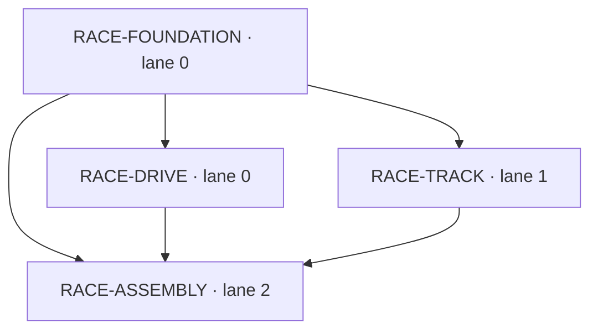

# 187 Racing Supervision — Plan Preview

本版是供独立 Critic 和 Owner 审阅的完整派生计划。**提交计划不授权实施。Owner 显式批准本版 Plan 前，全部游戏 writer 和产品验证保持阻塞。**
初始目标提交：`0937a8f1a57f5df1b5c196df3355613418300391`；目标应用就是当前项目，Task Map 的 target_root 为仓库相对 `.`。
阶段结论：规划产物已准备；产品实现、独立验收和交付均 NOT_RUN。恰好使用已配置的3个实现lane，不新增角色。

## PRD：交付目标与审批范围

桌面 Chromium 单人俯视赛车；双键盘映射、自由转向、可见赛道与障碍、碰撞反馈、合法距离计分、90秒有效时间及开始/暂停/继续/重开/结束闭环。结束面板的重开按钮文案统一为“重新比赛”；行为仍遵循本版既定的重开规则。
本次审阅的具体产品规则在 [PRD](../racing/prd.md)，完整正文也绑定 execution_spec.shared.prd，供搬移后的下游受控读取。
非目标：移动触控、Firefox/Safari、联网多人/账号/排行榜、3D；保留原始范围中的 .gitignore，不省略任何需求。
候选规则：环形赛道与8检查点，刹车到零、连续自由转向；新增历史最高合法进度计距离；每米1分、每次接触事件扣20分、最低0分；失焦自动暂停且显式继续。
这些参数是Planner建议，由本次Plan审阅确认，未冒称既有Owner决定；DEC-01..03可在Plan Chat逐项修改。没有提出削弱90秒、Docker、独立验证或审批强度的选项。

阶段可演示成果：先启动工程页；第二波能分别打开可驾驶比赛demo和赛道碰撞demo；第三波正式首页打通完整比赛。demo只是早反馈，最终验收始终使用正式根入口。

## SDD：模块、入口与依赖

完整 [接口规格](../racing/interfaces.md) 绑定 execution_spec.shared.interfaces。共享v1合同规定坐标单位、规范化输入、Pose、RouteState、TrackPort.resolve、RaceSnapshot、动作/事件与只读观察接口。
RACE-DRIVE是比赛状态唯一写入者，将动作、运动、碰撞、合法距离、得分及结算按同一事务顺序提交；RACE-TRACK只返回几何/进度结果；UI不维护第二套分数或时间。
RACE-ASSEMBLY独占正式index.html/src/main.ts接线，使用真实TrackPort，无夹具进入生产入口；生产画面为Canvas2D+DOM HUD和按钮。
无效数值不推进状态；不适用状态动作无操作；归零只结算一次；环境失败必须非零保留原始证据。

| 正式任务 | 实现角色 / 波次 | 前置 | AC | 验证命令 |
| --- | --- | --- | --- | --- |
| RACE-FOUNDATION | prd-dev-lane-0 / 1 | 无 | AC-F01, AC-F02 | VC-FOUNDATION, VC-SCAFFOLD-BROWSER |
| RACE-DRIVE | prd-dev-lane-0 / 2 | RACE-FOUNDATION | AC-D01, AC-D02, AC-D03, AC-D04 | VC-DRIVE, VC-DRIVE-BROWSER |
| RACE-TRACK | prd-dev-lane-1 / 2 | RACE-FOUNDATION | AC-T01, AC-T02, AC-T03 | VC-TRACK, VC-TRACK-BROWSER |
| RACE-ASSEMBLY | prd-dev-lane-2 / 3 | RACE-FOUNDATION, RACE-DRIVE, RACE-TRACK | AC-A01, AC-A02, AC-A03, AC-A04, AC-A05, AC-A06 | VC-ASSEMBLY, VC-INSTALL, VC-LINT, VC-UNIT, VC-BUILD, VC-BROWSER, VC-DELIVERY, VC-GOVERNANCE |

依赖图：



波次1只有FOUNDATION，符合空仓库先脚手架规则。波次2只有两片并行：都只导入共同合同，互不导入、互不写同一目录。波次3装配消费两个已完成片。
3个实现lane是配置容量，不意味着每波强行3并行。真实依赖峰宽2；任何跨片契约修改回原owner或受控replan，不能在别片白名单中补同一文件。
源码级共享所有权：package/lockfile、Vite/TS/ESLint、.gitignore和容器runner归FOUNDATION；正式入口、根Playwright配置、verify-racing.sh归ASSEMBLY。
本轮读取的实际执行策略是 stage barrier，task_pipeline off、independent_task_verify=false。因此早期反馈为writer自检，第一次独立验证在candidate.ready；不虚构每片独立Verify阶段。

## TDD：可证伪场景、结果与证据

各用例的Given/When/Then见test_matrix.tests；本表给出判断标准。所有预期产物尚待获批实施后生成。证据不存在是计划态，不是测试通过。
impl_self_check只执行本片命令；候选命令即使关联同一AC，也不能拖进前置片。候选验证复跑已集成树上的全部必需命令，命令字符串不得改写。

| AC | 预期结果与边界 | 精确命令ID | 验证责任 / 层级 | 未来证据路径 | 当前状态 |
| --- | --- | --- | --- | --- | --- |
| AC-F01 | 测试从空依赖状态的已记录 setup 输出核对锁文件和工具链；共享协议字段/单位齐全，启动页非空；无宿主浏览器下载进程。 | VC-FOUNDATION, VC-SCAFFOLD-BROWSER, VC-INSTALL | impl_self_check / runtime | artifacts/racing/scaffold/runs/<unique-run-id>/receipt.json | NOT_RUN |
| AC-F02 | git check-ignore 确认 node_modules、dist、artifacts/racing/{scaffold,race,track,assembly}/runs、playwright-report、test-results 被忽略；src、tests、scripts、.gitignore 等不被忽略；原有忽略保留。 | VC-FOUNDATION | impl_self_check / runtime | artifacts/racing/scaffold/runs/<unique-run-id>/receipt.json | NOT_RUN |
| AC-D01 | 相同输入dt的两套按键轨迹相等；W+S刹车优先，A+D转向0；速度不负且≤45m/s，静止转向不增距离，清键后无卡键。 | VC-DRIVE, VC-DRIVE-BROWSER, VC-UNIT | impl_self_check / runtime | artifacts/racing/race/runs/<unit-run-id>/receipt.json<br>artifacts/racing/race/runs/<browser-run-id>/receipt.json<br>artifacts/racing/race/runs/<browser-run-id>/report.json<br>artifacts/racing/race/runs/<browser-run-id>/playwright/<br>artifacts/racing/race/runs/<browser-run-id>/pixel-diff.json<br>artifacts/racing/race/runs/<browser-run-id>/browser-errors.json | NOT_RUN |
| AC-D02 | 89999ms再推进2ms仅消耗1ms；paused任意dt状态不变；resume重建时间基线；running大间隔不因物理分步截断丢有效时间。 | VC-DRIVE, VC-DRIVE-BROWSER, VC-UNIT | impl_self_check / runtime | artifacts/racing/race/runs/<unit-run-id>/receipt.json<br>artifacts/racing/race/runs/<browser-run-id>/receipt.json<br>artifacts/racing/race/runs/<browser-run-id>/report.json<br>artifacts/racing/race/runs/<browser-run-id>/playwright/<br>artifacts/racing/race/runs/<browser-run-id>/pixel-diff.json<br>artifacts/racing/race/runs/<browser-run-id>/browser-errors.json | NOT_RUN |
| AC-D03 | 重开后车辆回起点、速度0、elapsed0、距离/分数/碰撞0、接触集空、result空；重复finish不再发事件；finished输入和tick后结果深相等。 | VC-DRIVE, VC-DRIVE-BROWSER, VC-UNIT | impl_self_check / runtime | artifacts/racing/race/runs/<unit-run-id>/receipt.json<br>artifacts/racing/race/runs/<browser-run-id>/receipt.json<br>artifacts/racing/race/runs/<browser-run-id>/report.json<br>artifacts/racing/race/runs/<browser-run-id>/playwright/<br>artifacts/racing/race/runs/<browser-run-id>/pixel-diff.json<br>artifacts/racing/race/runs/<browser-run-id>/browser-errors.json | NOT_RUN |
| AC-D04 | 125.9米、2次碰撞得85分；0米1次为0分；持续接触不重复扣分；只有合法新增路线进度计入距离，终点同帧先处理截断步事件再结算。 | VC-DRIVE, VC-DRIVE-BROWSER, VC-UNIT | impl_self_check / runtime | artifacts/racing/race/runs/<unit-run-id>/receipt.json<br>artifacts/racing/race/runs/<browser-run-id>/receipt.json<br>artifacts/racing/race/runs/<browser-run-id>/report.json<br>artifacts/racing/race/runs/<browser-run-id>/playwright/<br>artifacts/racing/race/runs/<browser-run-id>/pixel-diff.json<br>artifacts/racing/race/runs/<browser-run-id>/browser-errors.json | NOT_RUN |
| AC-T01 | 圆环中心(300,300)，中心线半径180；车辆中心可行半径143..217；半径3车辆对半径8障碍接触距11；高速线段穿透被首接触截断。 | VC-TRACK, VC-TRACK-BROWSER, VC-UNIT | impl_self_check / runtime | artifacts/racing/track/runs/<unit-run-id>/receipt.json<br>artifacts/racing/track/runs/<browser-run-id>/receipt.json<br>artifacts/racing/track/runs/<browser-run-id>/report.json<br>artifacts/racing/track/runs/<browser-run-id>/playwright/<br>artifacts/racing/track/runs/<browser-run-id>/pixel-diff.json<br>artifacts/racing/track/runs/<browser-run-id>/browser-errors.json | NOT_RUN |
| AC-T02 | 空接触→A+B输出一个带sorted ids事件；保持接触100步仍1；间隔>0.01m后再触碰计2；位置纠正不产出奖励距离。 | VC-TRACK, VC-TRACK-BROWSER, VC-UNIT | impl_self_check / runtime | artifacts/racing/track/runs/<unit-run-id>/receipt.json<br>artifacts/racing/track/runs/<browser-run-id>/receipt.json<br>artifacts/racing/track/runs/<browser-run-id>/report.json<br>artifacts/racing/track/runs/<browser-run-id>/playwright/<br>artifacts/racing/track/runs/<browser-run-id>/pixel-diff.json<br>artifacts/racing/track/runs/<browser-run-id>/browser-errors.json | NOT_RUN |
| AC-T03 | 独立初态：首次progress=highWater=0时0→10增10；折返progress=highWater=10时10→5→10各增0、10→12增2。顺序跨圈、缺检查点、越界、速度跳变、位置纠正分别重置夹具；只有合法新增历史最高进度计分，详细边界见CASE-AC-T03及其具名子场景。 | VC-TRACK, VC-TRACK-BROWSER, VC-UNIT | impl_self_check / runtime | artifacts/racing/track/runs/<unit-run-id>/receipt.json<br>artifacts/racing/track/runs/<browser-run-id>/receipt.json<br>artifacts/racing/track/runs/<browser-run-id>/report.json<br>artifacts/racing/track/runs/<browser-run-id>/playwright/<br>artifacts/racing/track/runs/<browser-run-id>/pixel-diff.json<br>artifacts/racing/track/runs/<browser-run-id>/browser-errors.json | NOT_RUN |
| AC-A01 | 1280×800与1440×900桌面视口可见按钮/HUD/赛道；键盘改变车辆位置/朝向与像素；碰撞闪红300ms且次数和分数同步；暂停2秒状态全冻，继续后恢复。 | VC-BROWSER, VC-DELIVERY | candidate_verify / e2e | artifacts/racing/assembly/runs/<unique-run-id>/receipt.json<br>artifacts/racing/assembly/runs/<unique-run-id>/playwright/<br>artifacts/racing/assembly/runs/<unique-run-id>/browser-errors.json | NOT_RUN |
| AC-A02 | 单独完整比赛用例从按钮开始到finished：活跃时间90000ms，浏览器单调经过时间≥90000ms；不注入状态/时钟、不改duration；终局等待2秒结果不变，再按钮重开归零。 | VC-BROWSER, VC-DELIVERY | candidate_verify / e2e | artifacts/racing/assembly/runs/<unique-run-id>/receipt.json<br>artifacts/racing/assembly/runs/<unique-run-id>/playwright/<br>artifacts/racing/assembly/runs/<unique-run-id>/browser-errors.json | NOT_RUN |
| AC-A03 | 镜像记录digest；host UID/GID可写新证据目录；0.0.0.0绑定、端口≥8004且避开8001/8002；容器fetch成功才启动浏览器；失败原样报告且非0。 | VC-INSTALL, VC-BROWSER, VC-DELIVERY | candidate_verify / e2e | artifacts/racing/assembly/runs/<unique-run-id>/receipt.json<br>artifacts/racing/assembly/runs/<unique-run-id>/playwright/<br>artifacts/racing/assembly/runs/<unique-run-id>/browser-errors.json | NOT_RUN |
| AC-A04 | 实际整套运行所有阶段有收据且90秒用例通过才exit0；单独runner故障注入测试令每个阶段分别失败/超时/缺报告，均非0且清理本次服务。 | VC-LINT, VC-UNIT, VC-BUILD, VC-DELIVERY | candidate_verify / e2e | artifacts/racing/assembly/runs/<unique-run-id>/receipt.json<br>artifacts/racing/assembly/runs/<unique-run-id>/playwright/<br>artifacts/racing/assembly/runs/<unique-run-id>/browser-errors.json | NOT_RUN |
| AC-A05 | 两次运行目录不同，第一轮sha256不变；含空白和CRLF日志的归档hash相等；每次输出command/commit/exit/stages/图片/trace/浏览器错误报告，缺必需文件非0。 | VC-BROWSER, VC-DELIVERY | candidate_verify / e2e | artifacts/racing/assembly/runs/<unique-run-id>/receipt.json<br>artifacts/racing/assembly/runs/<unique-run-id>/playwright/<br>artifacts/racing/assembly/runs/<unique-run-id>/browser-errors.json | NOT_RUN |
| AC-A06 | 审计绑定本Run/Plan digest的人工plan.approved（auto不为true）、实际writer fanout.child.dispatched顺序、受控配置加载快照及预算风险；独立验证/最终Judge/Kernel各自未来收据由阶段门核查，不要求本脚本消费自己的未来结果。 | VC-GOVERNANCE | candidate_verify / manual_evidence | artifacts/racing/assembly/runs/<unique-run-id>/receipt.json | NOT_RUN |

全局pass规则：全部mandatory断言成立、精确命令exit0、目标commit一致、必需证据齐全才通过；空报告、跳过、超时、环境失败和修改预期均不能通过。
每个浏览器用例必须有真实操作→DOM/状态变化与画面差异；截图单独不能证明可玩性。

片内实施步骤：
- FOUNDATION先对合同字段、源码不被忽略、唯一run目录写具名断言，形成有效行为RED，再实现骨架/runner，同命令GREEN；缺依赖不记为RED。容器启动页是最早真实UI smoke。
- DRIVE先测双键映射和速度/朝向，继而测pause/resume时间冻结，最后测restart/89999→90000/finish一次性；每一步使用VC-DRIVE，再用VC-DRIVE-BROWSER核对真实demo按键/按钮、DOM和像素变化，保持上一组回归，不调用尚未存在的VC-UNIT或最终浏览器命令。
- TRACK先测可见世界共用数据和首接触，继而测持续接触/分离重触发，最后测10→5→10→12及跨圈/跳点反例；每一步使用VC-TRACK，首次前进与折返各自重置highWater夹具；用VC-TRACK-BROWSER操作本片车辆代理核对画面/接触/路线读数。
- ASSEMBLY先以VC-ASSEMBLY测实际注入/按钮/监听器dispose及runner各阶段失败传播，再真实运行VC-BROWSER/VC-DELIVERY。浏览器spec包括最终所有旅程，不能沿用片内demo的范围排除。VC-ASSEMBLY必须绑定一个专属的局部自检验收项，并在execution_spec中提供具名TDD断言：真实入口依赖注入、按钮与输入监听器dispose清理、runner各阶段失败及超时非零传播；同步task_map、acceptance_matrix、test_matrix与证据引用。完整90秒浏览器验收、独立Verify/Discovery/Judge仍保留原来的候选集成后责任，不提前当作片内自检，也不减少原有验收项。
每个实现片同时拥有自己测试；没有“稍后补测试”任务。失败按行为owner返工；assembly发现兄弟缺陷交回对应owner，不能越界修源码。

## 真实浏览器、统一入口与证据

正式浏览器门使用Docker mcp/playwright:latest、--network host、宿主UID/GID、显式bash入口。完整命令在下面VC-BROWSER，脚本内浏览器安装有180秒上限；宿主npm安装使用PLAYWRIGHT_SKIP_BROWSER_DOWNLOAD=1与--ignore-scripts。
服务绑定0.0.0.0；默认8004，占用则由runner从8004向上选择且记录实际service_url/browser_origin，拒用8001/8002。容器Node fetch成功再运行锁文件Playwright CLI。
正常完整90秒用例单独运行，不调用fake clock、不改duration、不写游戏状态；开始/结束单调时钟与90000ms有效时间同存，超时180秒，终局再观察2秒。
暂停/继续/重开另测，不能中止或替代唯一完整比赛。执行产生截图、trace、JSON报告、console/pageerror检查、动态帧差与业务断言。
verify-racing.sh依次preflight→依赖安装→lint→确定性测试→build→Docker Playwright；全成功且证据齐全才0，任一步失败/未完成都非0。单元故障夹具证明失败传播，但不代替真实整套运行。
run路径为artifacts/racing/<scaffold|race|track|assembly>/runs/<UTC+随机id>/。首次mkdir必须排他；原始stdout/stderr二进制无损保存，另写摘要与sha256；重跑新建目录，禁止清空历史。
assembly最终运行只聚合已有片收据，重新运行全局命令生成自己的独立记录，不修改片收据。构建输出固定artifacts/racing/assembly/build/；忽略规则不掩盖任何源码。

## Requirement traceability

REQ编号按原始acceptance的顺序从1开始，只是追踪锚点，不改原始authority。原始11条及每条子规则在PRD、AC、具名用例和执行规则中展开。
矩阵：artifacts/plan/acceptance_matrix.json、test_matrix.json、capability_matrix.json、real_e2e_matrix.json；来源索引artifacts/plan/source_index.json；唯一任务图artifacts/plan/task_map.json。
required_plan_ports还包含execution_spec，确保完整PRD/SDD/用例文本随正式Package交给实现/验证，不能只在Planner私有目录可读。

| 来源 | 要求 | 责任任务 | AC | 证据状态 |
| --- | --- | --- | --- | --- |
| REQ-01 / acceptance[0] | PRD 明确车辆控制、赛道边界、有效前进距离、碰撞判定与扣分去重、计分公式及结束规则；Plan Preview 列出模块接口、依赖图、文件归属、验收映射和证据生产路径，生成后停在 Owner 人工审批，批准前不得派发游戏实现。 | RACE-FOUNDATION, RACE-DRIVE, RACE-TRACK, RACE-ASSEMBLY | AC-F01, AC-D01, AC-D02, AC-D04, AC-T01, AC-T02, AC-T03, AC-A06 | NOT_RUN；审批/独立验收依阶段门推进 |
| REQ-02 / acceptance[1] | 完整 YAML Preview 展示 3 个实现 lane、至少 2 个独立验证 lane、Judge、预算及人工审批门；受控配置变更、验证与消费者加载确认，建单确认不授权启动 Workflow 或实施 Plan。 | RACE-ASSEMBLY | AC-A06 | NOT_RUN；审批/独立验收依阶段门推进 |
| REQ-03 / acceptance[2] | 3 个实现 lane 初步为车辆与比赛状态、赛道与碰撞、画面与交互；最终共享入口、依赖、验证脚本和测试配置唯一写入归属，仅无依赖无冲突工作并行。 | RACE-FOUNDATION, RACE-DRIVE, RACE-TRACK, RACE-ASSEMBLY | AC-F01, AC-A01, AC-A06 | NOT_RUN；审批/独立验收依阶段门推进 |
| REQ-04 / acceptance[3] | 真实 Chromium 两套键盘控制加速、刹车、自由转向；赛道障碍可见、碰撞反馈及扣分；静止或无效移动不能刷分。 | RACE-DRIVE, RACE-TRACK, RACE-ASSEMBLY | AC-D01, AC-D04, AC-T01, AC-T02, AC-T03, AC-A01 | NOT_RUN；审批/独立验收依阶段门推进 |
| REQ-05 / acceptance[4] | 90 秒有效时间；暂停冻结车辆、时间和分数，继续恢复；重开全部重置；归零只结算一次、终局不推进、结果显示距离/次数/总分并可重新开局。 | RACE-DRIVE, RACE-ASSEMBLY | AC-D02, AC-D03, AC-A01, AC-A02 | NOT_RUN；审批/独立验收依阶段门推进 |
| REQ-06 / acceptance[5] | 确定性测试覆盖输入运动、边界碰撞、距离计分及完整状态流；独立验证逐条关联真实结果。 | RACE-DRIVE, RACE-TRACK, RACE-ASSEMBLY | AC-D01, AC-D02, AC-D03, AC-D04, AC-T01, AC-T02, AC-T03, AC-A04, AC-A06 | NOT_RUN；审批/独立验收依阶段门推进 |
| REQ-07 / acceptance[6] | Docker mcp/playwright:latest --network host 的真实 Chromium 键盘及按钮旅程；至少一局正常时间完整 90 秒；截图、trace、报告、浏览器错误检查，不用模拟状态替代。 | RACE-ASSEMBLY | AC-A01, AC-A02, AC-A03, AC-A05 | NOT_RUN；审批/独立验收依阶段门推进 |
| REQ-08 / acceptance[7] | 宿主禁止浏览器下载/安装；容器可安装；测试服务 0.0.0.0 且端口 >=8004，禁止 8001/8002。 | RACE-FOUNDATION, RACE-ASSEMBLY | AC-F01, AC-A03 | NOT_RUN；审批/独立验收依阶段门推进 |
| REQ-09 / acceptance[8] | 各自实际环境检查 Docker、镜像、host networking、端口和容器到服务连接；环境失败保留证据，不改预期。 | RACE-FOUNDATION, RACE-ASSEMBLY | AC-A03, AC-A05 | NOT_RUN；审批/独立验收依阶段门推进 |
| REQ-10 / acceptance[9] | Plan 批准后根目录 bash scripts/verify-racing.sh 依次 preflight/安装/lint/单测/构建/容器 Playwright；全部完成成功才为0，否则非0。 | RACE-ASSEMBLY | AC-A04 | NOT_RUN；审批/独立验收依阶段门推进 |
| REQ-11 / acceptance[10] | 保留 .gitignore 源码范围；准确忽略输出缓存，每次独立目录、不覆盖历史；原始日志无损归档另写摘要，不掩盖源码变更或降低 clean/diff。 | RACE-FOUNDATION, RACE-ASSEMBLY | AC-F02, AC-A05 | NOT_RUN；审批/独立验收依阶段门推进 |

治理条款分阶段验证：当前交付可审阅文档/映射；人工批准门绑定当前Plan后才派发；candidate核对实际配置/人工批准与writer开始因果；独立Verify/发现扫描/Judge/Kernel在其后形成各自收据。
不能要求candidate审计读取自己的未来Verify/Judge结果。AC-A06脚本由ASSEMBLY生产，编排/监工在candidate前提供RACING_WORKFLOW_EVIDENCE只读bundle，含原始refs/digests及当前Run/Plan身份；缺失如实阻塞该治理验收。
验证角色建议分责：prd-verify-lane-0复核确定性规则/状态与源码；lane-1跑真实Docker整场及交互；lane-2核对根入口失败传播、证据完整性与审批因果。它们是现有3个独立角色，至少2条独立验证实际成功才满足需求。
Judge只汇总独立结果；Kernel决定交付。实现者自测、Planner报告及配置计数均不能充当独立验收。

## Decision Register

正式数据：artifacts/plan/decision_register.json；同一组条目内嵌task_map.owner_decision_items和本次payload。
没有尚待回答的范围收窄决定；以下常规规则候选与已有澄清保留到Plan审批。Plan批准不等于运行测试通过。

| ID | 单项问题 | 选项 | 状态/推荐 | 影响任务与阻塞边界 |
| --- | --- | --- | --- | --- |
| DEC-01 | 是否采用环形赛道、连续自由转向、刹车到零而不倒车的本版驾驶参数？ | adopt：采用 PRD 候选参数<br>revise：在 Plan Chat 指定调整后重审 | proposed_for_plan_approval，推荐 adopt | RACE-FOUNDATION, RACE-DRIVE, RACE-TRACK, RACE-ASSEMBLY；本版参数随 Plan 审批接受；若要求调整，先修订同版规格与测试，未批准不实施。 |
| DEC-02 | 是否采用只计历史最高合法路线进度、每米1分、每次接触事件扣20分且总分不低于0？ | adopt：采用本版计分及接触去重规则<br>revise：调整计分参数并重新审批 | proposed_for_plan_approval，推荐 adopt | RACE-DRIVE, RACE-TRACK, RACE-ASSEMBLY；禁止 writer 各自改分母或去重；不同规则须受控修订。 |
| DEC-03 | 是否在失焦或页面隐藏时自动暂停，并只由页面继续按钮恢复？ | adopt：自动暂停且显式继续<br>revise：提出后台计时规则再审 | proposed_for_plan_approval，推荐 adopt | RACE-DRIVE, RACE-ASSEMBLY；正常前台90秒完整比赛仍mandatory；不得借自动暂停缩短比赛。 |
| DEC-04 | 是否保持已编译3实现/3验证 lane，保留未配置预算风险并由监工按实际用量观察？ | retain：保持现配置及风险记录<br>controlled_revision：执行前受控调整预算或权限 | owner_clarification_retained，推荐 retain | RACE-FOUNDATION, RACE-DRIVE, RACE-TRACK, RACE-ASSEMBLY；Planner不改配置；writer实际访问权、消费者加载和预算在派发前由编排方核对，零值不代表无限。 |

## 风险、执行就绪与审批清单

当前策略摘要 `sha256:512e21de552e2f4a1828bf710772d4b33ef43ef642cdf423fa02df13f973a83a`。只读inspect-execution报告在artifacts/plan/execution-readiness.json，结构预期为4任务、3层、峰宽2、配置3writer；它只证明结构，不证明产品或调度耗时。
setup_declared=false，worker须显式安装锁定依赖；预算与provider价格未知，null/0不表示免费或无限。usage记录混有未归因project_history，不能把全部历史样本算作本次Run成本或外推未来。
当前reader实测Docker29.9.2、指定镜像存在、host-network容器可达8004临时服务。本轮Node fetch到0.0.0.0:8004的临时响应成功，已清理服务；未安装浏览器、未运行游戏或90秒验收。
writer权限/技能路由WARN、各worker Docker组继承和未来服务端口仍须在实际派发环境核对；不得从reader可用推断writer已获权限。无需为本次Plan另改配置。
独立Critic尚未发生；人工Plan批准尚未发生。下一步由Kernel推进评审及人工审批，本child不调用approve、不派发实现、不提交根Task完成。

审批应核对：
- 原始revision6及PRD完整范围、具体操作/规则和DEC-01..03候选；
- 模块接口、唯一文件归属和真实依赖，3实现lane/独立Verify/Judge/Kernel边界；
- 每条AC的可观察结果、精确命令、生产路径和失败规则；
- 独立正常90秒容器比赛、无宿主浏览器、端口、历史证据不可覆盖；
- 预算/权限/未来证据的真实pending状态。
审批来源要求来自Owner确认的需求acceptance[0,1]及当前plan_approval_required=true，并非Planner另加确认流程。

## Authority与来源

- authority-r6: `/tmp/zf-racing-supervision-20261025T211020Z/racing-project/.zf-187 Racing Supervision/workflow-requests/prepare-TASK-5F44B4-c32763f31115843f/requirements/revision-0006-5c0dd9f57a1ada94.json`，SHA-256 `5c0dd9f57a1ada94b699ab4ec0bee6a6df05ee695f49c79b7af28850d40ebb9b`。
- product-scan: `/tmp/zf-racing-supervision-20261025T211020Z/racing-project/.zf-187 Racing Supervision/fanouts/fanout-prd-scan-evt-da89bee7/children/prd-product-scan/report.json`，SHA-256 `efb5655075f2ab95385defa8f1804e27506ce41352590aaa59523244d4a06597`。
- tech-scan: `/tmp/zf-racing-supervision-20261025T211020Z/racing-project/.zf-187 Racing Supervision/fanouts/fanout-prd-scan-evt-da89bee7/children/prd-tech-scan/report.json`，SHA-256 `20fbf24735d98217e8b105cc83a2e21f25647bba68b7f68eeada0fc8f2ff1f2e`。
- effective-manifest: `/tmp/zf-racing-supervision-20261025T211020Z/racing-project/.zf-187 Racing Supervision/workflow-requests/prepare-TASK-5F44B4-c32763f31115843f/effective/revision-0006-badbb8ce6abd97be/workflow-input-manifest.json`，SHA-256 `badbb8ce6abd97bef4dbd388249a712a5749b52f65b3c2855714b9e4b3e8eb85`。
- compiled-preflight: `/tmp/zf-racing-supervision-20261025T211020Z/racing-project/.zf-187 Racing Supervision/artifacts/workflow/prepare-TASK-5F44B4-c32763f31115843f/workflow-preflight.json`，SHA-256 `78d82be15e4b13eb42e7907e7724b73129b8e9598c9e3e5f28b1b8e4c3061f8d`。
- 人工审阅伴随产物：docs/racing/prd.md、docs/racing/interfaces.md。
- 规划环境收据：artifacts/plan/planner-preflight.json；语义审查：artifacts/plan/semantic-readiness.json。
- 当前baseline仓库无游戏/package/verify脚本，允许未来交付；原有未跟踪.codex/保持原样。

## 第二波演示与确定性防刷分场景

两个demo的首个真实UI反馈在第二波自己的writer自检。FOUNDATION预先实现四个suite选择协议，race/track各自config/spec由本片生产，仅读已完成共享runner；不读最终ASSEMBLY的配置。
Docker脚本参数、容器内180秒安装上限、host网络、UID/GID和0.0.0.0/8004+边界见[接口规格](../racing/interfaces.md)。原始日志、report、screenshots、trace、pixel-diff和browser-errors均落本片独立run目录。

### CASE-DRIVE-DEMO：第二波驾驶演示真实输入与可见状态闭环

前态：只具备FOUNDATION及DRIVE的隔离分支；Docker Chromium 1280×800打开/src/race/demo.html，显示“开放世界演示”标签、ready、开始/暂停/继续/重开、DOM计时/距离/分数和可见车辆，使用DRIVE自有明确夹具。

操作：点击开始，真实ArrowUp+ArrowRight后ArrowDown；按钮重开后真实W+D后S；采集操作前后Canvas；暂停2秒、继续后驾驶、再重开；失焦后回到页面检查仍暂停并显式继续。

期望：两套按键均使速度先增加后降低、位置和朝向发生变化；Canvas非空且车体像素前后变化，DOM读数与只读RaceSnapshot一致；暂停期间比赛状态不变，继续不补时，重开清零且仅一个循环；无卡键、console.error或pageerror。每个驱动和显示断言具名，页面空白、未绑定输入或绘制未加载均失败。

责任：RACE-DRIVE；命令 VC-DRIVE-BROWSER；判定：全部断言、报告、原始日志、截图、trace和错误检查齐全且命令exit0；无效启动/缺文件不算行为RED。此早期smoke不替代最终正常90秒比赛。

### CASE-TRACK-DEMO：第二波赛道演示真实代理操作与接触反馈

前态：只具备FOUNDATION及TRACK的隔离分支；Docker Chromium 1280×800打开/src/track/demo.html。可见同一TrackDefinition的内外边界、3个障碍、车辆代理、当前路线进度/highWater/新增距离/接触次数的DOM及重置控件。

操作：点击“重置代理”到P(0,200)；通过可见路程输入框及“前进/后退”按钮依次请求+10、−5、+5、+2m，等待每次轨迹播放完成。演示把请求按≤1/120秒及≤0.25m的合法小步送入真实TrackPort.resolve，最后一步裁到输入目标，不直接写返回状态。再用“外移/内移”控件接触外边界、保持、分离>0.01m再撞；点击“障碍路线”沿预设合法小步移近并撞障碍。全部请求来自Playwright的fill/click操作，不从evaluate写状态。

期望：代理位姿和Canvas像素随操作变化，世界非空且边界/障碍可辨；路线段读数分别新增10、0、0、2；接触位置不穿透；每个连续episode次数仅+1并可见红色/文本反馈，分离再撞+1，障碍亦有真实接触；只读DOM与resolve结果一致，console.error/pageerror为空。

责任：RACE-TRACK；命令 VC-TRACK-BROWSER；判定：全部业务断言加非空/动态像素检查通过且截图、trace、report、receipt、错误报告齐全、exit0。演示不导入DRIVE、不依赖ASSEMBLY；正式完整比赛仍mandatory。

### AC-T03 独立夹具与每段增量

使用PRD真实TrackDefinition。L=2π×180，P(s,r)=(300+r·sin(s/180),300−r·cos(s/180))；lastAngleRad=atan2(y−300,x−300)。合法路线单步|Δs|≤0.25m、dt=1/120秒、speedMps=45，故r=200时弦长<45dt；该半径避开三个半径8m障碍且在143..217内。每个场景新建contactIds=[]、completedLaps=0和独立累加器；不依赖其他场景输出。

| 子场景 | 完整前态 | 动作 | 预期结果 |
| --- | --- | --- | --- |
| SC-T03-FIRST | from=P(0,200)，progress=0、highWater=0、nextCheckpointIndex=1、completedLaps=0，起点CP0已确认。 | 以合法小步推进s=0→10（不跨CP1）。 | 各步增量为该步正向Δs；累计10，最终progress=highWater=10、nextCheckpointIndex=1、laps=0。 |
| SC-T03-RETURN | from=P(10,200)，progress=10、highWater=10、nextCheckpointIndex=1、laps=0，当前会话已记距离10。 | 按合法小步依次10→5、5→10、10→12。 | 三段新增分别0、0、2；每段结束highWater分别10、10、12；最终累计有效距离12；旧最高点不得重复加10。 |
| SC-T03-LAP | from=P(0,200)，progress=highWater=0、nextCheckpointIndex=1、laps=0；本场景无其他已访问历史。 | 按合法小步完整0→L→L+2，依次跨CP1..CP7、CP0，再前进2m。 | 到L前累计新增L（误差≤1e-6m），跨CP0只增加1圈，nextCheckpointIndex回1；随后新增2，highWater=L+2。L−ε→L+ε的wrap连续，无负向整圈或重复奖励。 |
| SC-T03-MISSING-CP | 独立非法检查点历史夹具：from=P(L/4−0.25,200)，progress=L/4−0.25，highWater=0、nextCheckpointIndex=1、laps=0；CP1从未获确认，不能隐含已通过。 | 合法位移到P(L/4+0.25,200)，分两个小步扫过CP2；不能补写虚构CP1历史。 | 新增有效距离0，highWater仍0、nextCheckpointIndex仍1、laps仍0；输出诊断/不合法进度而不把CP2当作CP1。此负例仅故意替换检查点历史，其几何/速度满足边界。 |
| SC-T03-BOUNDARY | from=P(0,217)在外边界接触位置，progress=highWater=0、nextCheckpointIndex=1、laps=0、contactIds=[]。 | dt=0.1s、speed=45，径向向外提出P(0,218)。 | 首接触截断在r≤217，合法角进度增量0、有效距离0、highWater0；不能为越界提议的位移发距离奖励。 |
| SC-T03-SPEED-JUMP | from=P(0,200)，progress=highWater=0、nextCheckpointIndex=1、laps=0、speed=45，接触空。 | 单步dt=1/120秒直接提出P(10,200)，超过45dt上界；不跨CP1且无几何接触以隔离速度拒绝。 | 新增距离0，highWater和检查点历史不变；返回诊断，不把角进度10当作合法奖励。 |
| SC-T03-CORRECTION | 独立越界恢复夹具：from=P(12,230)，proposed=from，route记录lastAngle对应s=10、progress=highWater=10、nextCheckpointIndex=1、laps=0；没有本步实际运动，dt=0。 | 调用resolve执行越界位置纠正；位置纠正不能冒充由输入产生的新合法运动。 | validDistanceDeltaM=0、highWater保持10且检查点不获奖励；即使修正姿态投影为s=12，也不得额外获得2m。下一次真正合法运动才重新判断进度。 |
| SC-T03-STATIONARY | from=P(10,200)，progress=highWater=10、nextCheckpointIndex=1、laps=0；另一个独立夹具在P(0,200)且progress=highWater=0。 | 第一夹具固定坐标仅改变朝向，第二夹具保持角度径向200→201→200；步长与dt匹配速度上界。 | 两夹具新增距离均为0；原地转向和径向抖动不能把欧氏移动长度当作路线奖励。 |

这两项修订只补足原承诺的反馈和判据，不增加独立Task Verify阶段，不改变正式产品范围或最终90秒门禁。所有实现及产品证据仍NOT_RUN。

## 附件：唯一写入范围

### RACE-FOUNDATION

纯基建例外：统一工具链、共享类型、测试收据与容器runner，独占依赖和配置；不创建后续片目录的占位文件。 FOUNDATION复用lane0；lane2仅供最终ASSEMBLY，避免assembly与依赖bundle共用角色。runner目录归并保持职责不变，不扩大到scripts/**。

- `package.json`
- `package-lock.json`
- `tsconfig.json`
- `vite.config.ts`
- `eslint.config.js`
- `.gitignore`
- `src/contracts/**`
- `src/scaffold/**`
- `scripts/racing-runner/**`
- `tests/scaffold/**`
- `docs/racing/toolchain.md`
- `artifacts/racing/scaffold/**`

可演示结果：可在 /src/scaffold/index.html 打开工程就绪页；冻结合同与runner可被后续独立片直接消费。

证据：`artifacts/racing/scaffold/runs/<unique-run-id>/`；只读依赖：无。

### RACE-DRIVE

拥有输入、运动、原子比赛状态与自己的可驾驶演示、单测和浏览器spec；只读共享合同，不导入赛道实现。

- `src/race/**`
- `tests/race/**`
- `docs/racing/drive.md`
- `artifacts/racing/race/**`

可演示结果：在 /src/race/demo.html 用真实按键驾驶，开始/暂停/继续/重开与结果读数工作；使用本片明确标识的开放世界夹具，不代替最终赛道验收。

证据：`artifacts/racing/race/runs/<unique-run-id>/`；只读依赖：RACE-FOUNDATION。

### RACE-TRACK

拥有赛道数据、几何碰撞、合法路线进度及独立交互演示、测试；仅依赖共享合同，与车辆实现无import关系。

- `src/track/**`
- `tests/track/**`
- `docs/racing/track.md`
- `artifacts/racing/track/**`

可演示结果：在 /src/track/demo.html 移动车辆代理可见边界、障碍、接触反馈和路线进度；该几何演示只验证轨迹查询，不替代生产驾驶。

证据：`artifacts/racing/track/runs/<unique-run-id>/`；只读依赖：RACE-FOUNDATION。

### RACE-ASSEMBLY

唯一最终assembly owner：拥有正式入口、交互画面、共享接线、聚合验证脚本和最终证据；消费已完成片的API与证据，不重写兄弟源码。

- `index.html`
- `src/main.ts`
- `src/ui/**`
- `public/**`
- `playwright.config.ts`
- `scripts/verify-racing.sh`
- `scripts/audit-racing-workflow.mjs`
- `tests/assembly/**`
- `tests/acceptance/**`
- `README.md`
- `docs/racing/delivery.md`
- `artifacts/racing/assembly/**`

可演示结果：正式 / 页面完成开始→驾驶/碰撞→暂停/继续→结束结果→再开局，根验证命令全阶段完成后才成功。

证据：`artifacts/racing/assembly/runs/<unique-run-id>/`；只读依赖：RACE-FOUNDATION, RACE-DRIVE, RACE-TRACK。

## 附件：canonical 命令注册

从仓库根目录原文执行；每个命令只由一个任务定义。本片只执行其impl_self_check命令；candidate_verify命令等装配后执行。所有命令和test_matrix.commands同版；最终完整90秒旅程仅使用正式根入口。

### VC-FOUNDATION

生产者 RACE-FOUNDATION；责任 impl_self_check / runtime；超时90s；AC：AC-F01, AC-F02。

```bash
node scripts/racing-runner/unit.mjs scaffold
```

### VC-SCAFFOLD-BROWSER

生产者 RACE-FOUNDATION；责任 impl_self_check / e2e；超时300s；AC：AC-F01。

```bash
bash scripts/racing-runner/docker.sh scaffold
```

### VC-DRIVE

生产者 RACE-DRIVE；责任 impl_self_check / runtime；超时90s；AC：AC-D01, AC-D02, AC-D03, AC-D04。

```bash
node scripts/racing-runner/unit.mjs race
```

### VC-DRIVE-BROWSER

生产者 RACE-DRIVE；责任 impl_self_check / e2e；超时360s；AC：AC-D01, AC-D02, AC-D03, AC-D04。

```bash
bash scripts/racing-runner/docker.sh race
```

### VC-TRACK

生产者 RACE-TRACK；责任 impl_self_check / runtime；超时90s；AC：AC-T01, AC-T02, AC-T03。

```bash
node scripts/racing-runner/unit.mjs track
```

### VC-TRACK-BROWSER

生产者 RACE-TRACK；责任 impl_self_check / e2e；超时360s；AC：AC-T01, AC-T02, AC-T03。

```bash
bash scripts/racing-runner/docker.sh track
```

### VC-ASSEMBLY

生产者 RACE-ASSEMBLY；责任 impl_self_check / runtime；超时120s；AC：本片接线/runner回归。

```bash
node scripts/racing-runner/unit.mjs assembly
```

### VC-INSTALL

生产者 RACE-ASSEMBLY；责任 candidate_verify / static；超时240s；AC：AC-F01, AC-A03。

```bash
env PLAYWRIGHT_SKIP_BROWSER_DOWNLOAD=1 npm ci --ignore-scripts
```

### VC-LINT

生产者 RACE-ASSEMBLY；责任 candidate_verify / static；超时120s；AC：AC-A04。

```bash
npm run lint
```

### VC-UNIT

生产者 RACE-ASSEMBLY；责任 candidate_verify / runtime；超时120s；AC：AC-D01, AC-D02, AC-D03, AC-D04, AC-T01, AC-T02, AC-T03, AC-A04。

```bash
npm test
```

### VC-BUILD

生产者 RACE-ASSEMBLY；责任 candidate_verify / static；超时120s；AC：AC-A04。

```bash
npm run build
```

### VC-BROWSER

生产者 RACE-ASSEMBLY；责任 candidate_verify / e2e；超时600s；AC：AC-A01, AC-A02, AC-A03, AC-A05。

```bash
bash scripts/racing-runner/docker.sh acceptance
```

### VC-DELIVERY

生产者 RACE-ASSEMBLY；责任 candidate_verify / e2e；超时1200s；AC：AC-A01, AC-A02, AC-A03, AC-A04, AC-A05。

```bash
bash scripts/verify-racing.sh
```

### VC-GOVERNANCE

生产者 RACE-ASSEMBLY；责任 candidate_verify / manual_evidence；超时90s；AC：AC-A06。

```bash
node scripts/audit-racing-workflow.mjs
```

## 附件：返工与来源版本

本轮来源是briefing绑定的旧候选3ac7f23a及最新plan-rework-context（rework_of evt-192ec8c8e680）。旧候选正文仍含已关闭的runner/owner准入问题；本轮根据受控反馈恢复FOUNDATION lane0、共享scripts/racing-runner/**及唯一docker.sh，再落实PC-01、PC-02。没有把旧候选passed字样当作本轮通过证据。逐项delta与反例见artifacts/plan/rework-audit.json。
