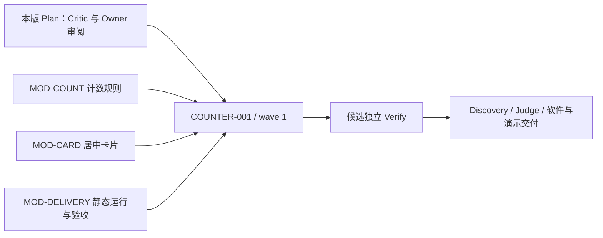

# 187-counter：计数器 PRD、设计与实施 Plan

> 本文是提交独立 Critic 与 Owner 审阅的完整派生 Plan。规划产物已编写；产品实现、测试、浏览器演示及本版 Plan 批准尚未发生。批准前禁止产品 impl/verify。

<a id="prd"></a>
## PRD：本次交付与审批范围

用户需要一个打开即用的小计数器：初始数值为 **0**，点击“加一”增加 1，正数点击“减一”减少 1，0 时减一仍为 0，重置按钮的可见文案为“归零”，点击后仍将计数恢复为 0。页面采用 Owner 已确认的**居中卡片布局**，清楚显示数值及“加一、减一、归零”三个按钮。所有计数在浏览器内完成，使用原生 HTML/CSS/JavaScript，无业务后端。

成功标准是可从仓库根目录启动并实际操作的网页、覆盖同一份生产规则的 `node --test` 自动测试，以及真实浏览器点击/DOM/截图证据。YAML Preview 和本文本身不是最终软件交付。计数规则的自动测试和浏览器接线测试各自必须成立。

本次范围包含原生静态入口、计数状态模块、页面接线与样式、静态预览工具、测试工具、运行说明和演示证据。账户、服务端 API、数据库、持久化、撤销、快捷键、多页面、上限策略没有来源要求，不在本次扩展；也不把工作流的局部文档审阅能力实现为计数器中的文档编辑器。页面没有任意数值输入，因此非法外部数值、越界数值和任意 action 不构成公开产品接口；不得为了添加输入框而编造输入错误规则。浏览器页面生命周期内只有一个数值状态，新页面按初值 0 建立，未承诺跨刷新持久化。

验收样例确定了单位步长和下限：初始 0，依次“加、加、减、重置、减、加”，应逐步看到 **1、2、1、0、0、1**。重置 0 仍为 0，重复点击减一不能穿透下限。按钮保持可点击，使零下限在真实交互中可验证；状态模块也必须独立保护下限。

## 权威与范围依据

当前主权威是 Owner 已确认的 requirement revision 13：
- 原文：`/tmp/zf-187-e2e-20261025T161931Z/counter-project/.zf-187-counter/workflow-requests/workflow-ccaaed87c1b1d6c7/requirements/revision-0013-a5eb15eba216d4d1.json`
- SHA-256：`a5eb15eba216d4d164a490b724949acf242b3151f093bf93302e3e7871d782fa`
- `confirmed=true`，`confirmed_by=web-owner`，`open_questions=[]`。
- 当前实施基线：`955c22699df61bc083dae4ae49f2558f1da5dfb6`；当前工作目录 HEAD 与受控 source manifest 一致。
- 需求 `$.objective`、`$.acceptance[0..2]`、`$.constraints` 和 `$.clarification_answers[0..1]` 是本版约束。来源没有既定任务/附录 AC 编号；本 Plan 的 COUNTER/AC/GOAL 编号是派生索引，不冒充原文编号。

早期 intake 的“仅准备、不启动”是历史阶段范围；revision 13 已明确完整软件交付，仍保留启动前完整 YAML 审阅和 Plan 阶段文档审阅。历史来源不覆盖当前确认答案。技术/产品扫描只提供证据与建议；任务边界由本 Plan 冻结。

完整来源与摘要见 [source_index.json](../../artifacts/plan/source_index.json)。两份扫描报告分别绑定摘要 `dd8747b7c33776285fb20ea1be4024de8aa712cb898038be7f8f0acc159ff86c` 和 `acf6a05a1653b8ca0cab21ef1e5e01fb82f54439f773c81f856bb3af2f25d650`。当前仓库是初始化骨架，未发现产品 HTML、逻辑、包清单或测试；这些缺口由实施任务生产，不当作规划失败。

<a id="sdd"></a>
## SDD：模块、入口与数据契约

| 模块 | 用户结果/边界 | 输入与输出 | 所有者与关系 |
| --- | --- | --- | --- |
| MOD-COUNT：计数状态与变更规则 | 保证初始、单位加减、零下限、重置、连续操作一致 | `src/counter.mjs` 导出 `INITIAL_COUNT=0` 与 `transition(count, action)`。内部 count 是由该模块产生的非负整数；action 为 `increment / decrement / reset`。返回新数值，函数不访问 DOM、网络或存储 | COUNTER-001；被 MOD-CARD 和 Node 测试共同调用 |
| MOD-CARD：居中卡片交互与展示 | 用户看到一个数值和三个具名按钮，动作后立即看到对应值 | `index.html` 内嵌原生 CSS，并加载 `src/app.mjs`；app 导入同一 counter 模块。初始化一次，绑定事件一次，执行一次 transition 后同步更新数值文本；DOM 不另做一套计数算法 | COUNTER-001；依赖 MOD-COUNT |
| MOD-DELIVERY：静态运行与验收工具 | 干净检出能复现页面、测试与演示 | `scripts/serve.mjs` 只服务项目静态资源，不拥有计数业务状态；`package.json`、lockfile、README、Playwright config 和测试明确启动/验证契约 | COUNTER-001；真实入口调用 MOD-CARD；测试覆盖前两个模块 |

### 状态转换与失败边界

| 前态 | 动作 | 后态与可观察输出 |
| --- | --- | --- |
| 新建页面 | 初始化 | 内部 count=0；DOM 显示文本 0 |
| n≥0 | increment | n+1；显示相同结果 |
| n>0 | decrement | n−1；显示相同结果 |
| 0 | decrement | 0；连续调用保持 0，既不变成负数也不抛出可见错误 |
| 任意合法 n | reset | 0；重复 reset 不改变结果 |

三个业务动作不发网络请求、不产生服务端事件、不需要身份权限或持久化事务。唯一状态所有者是页面控制器，纯规则返回值决定显示，避免重复监听导致一次点击加二。状态模块和页面无未来任务依赖。

入口为 `index.html`；正式本地预览命令：
```bash
node scripts/serve.mjs --host 0.0.0.0 --port 4173
```

Owner 访问地址和 browser_origin 均为 `http://localhost:4173`，bind_host 为 `0.0.0.0`，供 host-network Docker 访问。健康检查为 `curl --fail --silent --show-error http://localhost:4173/`；HTTP 成功只是启动检查，不能替代按钮验收。Playwright config 启停同一静态服务，失败也清理进程；端口已占用时应失败并报告，不能复用未知旧服务。若后续实际交付 origin 改变，验证该精确 origin 后才声称该地址可用。本产品不依赖 WebCrypto 或安全上下文 API。

原生页面无需构建或业务运行依赖。工具链约定 Node ≥22；扫描主机观察为 v24.14.0 / npm 11.9.0，不把它当作已存在的 package 声明。writer 为测试依赖选择可核验的 `@playwright/test` 精确版本，提交锁文件。不得依赖宿主预装浏览器。配色、字体与间距由 writer 实现，但居中卡片、清晰数值和三个按钮的交互边界不变。

<a id="tdd"></a>
## TDD：原子场景、判据与证据

每行均为 mandatory。下表同时约束生产函数和真实页面，全部行为最早在唯一产品片内自检；当前配置的独立验证在 candidate.ready 后运行。规划期所有产品证据为 **NOT_RUN**。

| 验收 ID | Given；When → Then | 精确命令 ID | 主验证 owner / tier | 预期证据路径（尚未生成） | 当前状态 |
| --- | --- | --- | --- | --- | --- |
| AC-INITIAL | 新页面，无操作；加载真实入口 → 显示 0，创建的初始生产状态等于 0 | VC-UNIT、VC-BROWSER | impl_self_check / runtime | `artifacts/evidence/counter/unit.tap`<br>`artifacts/evidence/counter/browser/report.json` | NOT_RUN |
| AC-INCREMENT | 计数为 0；依次执行两次加一 → 生产状态及 DOM 数值依次为 1、2 | VC-UNIT、VC-BROWSER | impl_self_check / runtime | `artifacts/evidence/counter/unit.tap`<br>`artifacts/evidence/counter/browser/report.json` | NOT_RUN |
| AC-DECREMENT | 通过加一得到 2；依次执行两次减一 → 生产状态及 DOM 数值依次为 1、0 | VC-UNIT、VC-BROWSER | impl_self_check / runtime | `artifacts/evidence/counter/unit.tap`<br>`artifacts/evidence/counter/browser/report.json` | NOT_RUN |
| AC-FLOOR | 初始 0 或由 1 减至 0；连续执行五次减一 → 每一步状态和 DOM 仍为 0，不依赖禁用按钮掩盖负数 | VC-UNIT、VC-BROWSER | impl_self_check / runtime | `artifacts/evidence/counter/unit.tap`<br>`artifacts/evidence/counter/browser/report.json` | NOT_RUN |
| AC-RESET | 通过加一得到 3；重置、重置、加一 → 生产状态及 DOM 依次为 0、0、1 | VC-UNIT、VC-BROWSER | impl_self_check / runtime | `artifacts/evidence/counter/unit.tap`<br>`artifacts/evidence/counter/browser/report.json` | NOT_RUN |
| AC-SEQUENCE | 全新状态 0；执行加、加、减、重置、减、加 → 每一步状态和 DOM 精确等于序列 1、2、1、0、0、1 | VC-UNIT、VC-BROWSER | impl_self_check / runtime | `artifacts/evidence/counter/unit.tap`<br>`artifacts/evidence/counter/browser/report.json` | NOT_RUN |
| AC-CARD | 打开桌面 1280×720 和窄屏 390×844 页面；检查布局并点击按钮 → 卡片位于视口中央，几何中心与视口中心误差 ≤8 CSS px；数值及三个具名按钮可见、不相互遮挡；点击前后数值变化 | VC-BROWSER | candidate_verify / e2e | `artifacts/evidence/counter/browser/report.json` | NOT_RUN |
| AC-STATIC | 仅静态服务器运行，阻止非同源资源及业务网络请求；加载真实入口并执行完整混合操作 → 页面行为通过，无 fetch/XHR/WebSocket 业务请求、远程脚本依赖或页面异常 | VC-STATIC、VC-BROWSER | impl_self_check / static | `artifacts/evidence/counter/static.json`<br>`artifacts/evidence/counter/browser/report.json` | NOT_RUN |
| AC-RUN | Node 可用、依赖按锁文件安装，浏览器执行角色已可访问 Docker；按根目录安装、启动和验证命令执行 → 静态入口可访问，至少六组 node --test 行为测试通过，浏览器断言与截图/trace 可读取 | VC-INSTALL、VC-STATIC、VC-BROWSER | candidate_verify / e2e | `artifacts/evidence/counter/static.json`<br>`artifacts/evidence/counter/browser/report.json` | NOT_RUN |

`VC-UNIT` 至少有六组具名行为用例，导入页面同用的 `src/counter.mjs`，不在测试中重写状态机。每次序列动作都断言结果，不能只断言最终为非负。0 时五次减一、1 到 0、重复重置、重置后再加一均需覆盖。零测试、跳过 mandatory case 或只测假对象都判失败。

浏览器必须在 **1280×720** 与 **390×844** 两个 viewport 检查数值、三个按钮可见且互不遮挡。将卡片几何中心与视口中心误差 ≤8 CSS px 作为实现验收约定；非原文像素风格要求，不引入精确字体/颜色基线。实际点击重放全部行为；初始与加一后的 DOM 分别为 0 和 1，保存对应截图，排除静态占位页面。保留窄屏截图与成功运行的 trace；浏览器报告必须含实际断言结果，不以截图存在代替通过。

“无后端”同时由静态依赖/接线检查与真实浏览器验证：只启动静态资源服务，禁止业务 fetch/XHR/WebSocket 和第三方运行资源，仍须完成全部操作；捕获并拒绝页面异常。静态服务器只是本地工具，不是业务后端。

### 命令注册表

以下命令逐条从仓库根目录原样执行；Task Map 与 Test Matrix 的字符串完全相同。顺序为安装前置、Node 逻辑、静态检查、真实浏览器。产品脚本尚未实现，本阶段不执行它们。

**VC-INSTALL** — impl_self_check / static，超时 210s。

```bash
timeout 180s npm ci
```

**VC-UNIT** — impl_self_check / runtime，超时 30s。

```bash
node --test tests/counter.test.mjs
```

**VC-STATIC** — impl_self_check / static，超时 30s。

```bash
node scripts/check-static.mjs
```

**VC-BROWSER** — candidate_verify / e2e，超时 360s。

```bash
docker run --rm --network host --user "$(id -u):$(id -g)" --entrypoint bash -v "$PWD:/work" -w /work -e PLAYWRIGHT_BROWSERS_PATH=0 mcp/playwright:latest -lc 'set -euo pipefail; timeout 180s ./node_modules/.bin/playwright install chromium; ./node_modules/.bin/playwright test --config playwright.config.mjs'
```

`VC-INSTALL` 是独立 setup/static gate。当前有效配置没有自动 setup；writer 首次生成 lockfile 后执行，独立 Verify 在干净检出也执行。不能将 README 中写了安装命令等同已接入自动 setup，也不能把缺依赖当业务 RED。

`VC-STATIC` 由本 task 创建，检查 HTML/module 接线、package scripts 与 README 一致、运行依赖为零；输出 `artifacts/evidence/counter/static.json`，失败必须非零退出。`npm test` 代理精确的 `node --test tests/counter.test.mjs`；`npm run lint` 代理静态检查脚本，不自动收集 Playwright spec。

浏览器 Docker 命令保留 host network、当前 UID/GID、bash entrypoint、180s 安装边界。Playwright config 将报告、截图和成功 trace 写到 task 拥有的 evidence 子树。必需文件为：
- `artifacts/evidence/counter/browser/report.json`
- `artifacts/evidence/counter/browser/desktop-before.png`
- `artifacts/evidence/counter/browser/desktop-after.png`
- `artifacts/evidence/counter/browser/mobile.png`
- `artifacts/evidence/counter/browser/trace.zip`

Node 命令自身输出 stdout；writer/Verify 保存其 TAP 到 `artifacts/evidence/counter/unit.tap`，并保留退出码、测试计数、精确命令及目标 commit 收据。报告、截图和 trace 只在真实执行后引用 ref/digest。环境失败、断言失败和未运行分别报告，任何必需断言未执行都不能通过。

### 片内执行步骤与返工责任

1. **脚手架先行**：建立 package/lock、目录约定与运行说明；不建空测试冒充通过。唯一 wave 1 task 同时拥有后续功能，因此无交叉所有权。
2. **规则 RED/GREEN**：先写六组具名用例，得到功能断言的有效 RED，随后实现 transition，再以同一 VC-UNIT 得到 GREEN。缺文件/依赖造成的启动失败不是有效业务 RED。
3. **立即接 UI**：同片创建真实入口、卡片、按钮与唯一状态接线；VC-STATIC 检查结构，VC-BROWSER 在完整入口重放全部动作和截图。未把 UI smoke 等到另一个补测试任务。
4. **干净检出复验**：锁文件安装、全部 gate 和运行说明一致；writer 自检证据交给独立候选 Verify 复验。失败回到 COUNTER-001 的对应生产文件/测试；Docker permission denied 等环境失败交由 operator 恢复后再执行，不重写计数产品需求。

<a id="decisions"></a>
## Decision Register、风险与批准门禁

同版机读决定登记：[decision_register.json](../../artifacts/plan/decision_register.json)。`owner_decision_items=[]` 表示没有尚需再问的产品选择，不表示下列决定缺失，也不表示 Plan 已获批准。

| 决定 ID | 问题与候选 | 当前处置、来源 | 受影响任务与阻塞影响 |
| --- | --- | --- | --- |
| D-UI | 居中卡片 / 紧凑工具栏 | Owner 已选择居中卡片；revision 13 clarification_answers[0] | COUNTER-001；选择已关闭，落实 AC-CARD |
| D-WRITE | 现有 writer/direct-v1/bypass / 暂缓实施 | Owner 已授权当前项目内实现及测试；clarification_answers[1] | COUNTER-001；保留 Task 范围及 Plan 审批，不修改 profile access |
| D-DELIVERY | 可运行软件 / 仅 Preview | revision 13 objective 与 constraints[0] 明确完整交付 | COUNTER-001；不把目标缩回文档或 Preview |

技术方案是可审阅的派生设计，不改变上述确认：单包 ESM、内存状态、一个纵向任务、Docker Playwright。无需为已确认布局或写权限重复发问；没有新的范围收窄。

**G-YAML**：完整 YAML 在启动前须经 Owner 审阅；本 Planner 没有审计既往批准，不据本轮派发宣称其发生。当前直接沿用冻结配置，不提出配置变更。若之后需要变更，先提交具体候选 YAML 再确认，由控制面绑定版本。

**G-PLAN**：本版文档、Task Map、矩阵与决定登记提交独立 `prd-plan-critic`，再由 Owner 审阅当前 Plan revision/digest。kernel 负责批准绑定和派发门禁。**批准前禁止产品 impl/verify**；允许本轮规划工件校验和 Critic。之后 writer 产生候选，`prd-lanes-verify` 独立验证，discovery/judge 处理完整性和交付。不能将本轮 passed/approve 报告当作 Owner 批准。

流程证据的验证方法是对照当前 Run、Plan 版本/摘要、批准收据和实际 writer 派发开始记录，并比较先后顺序；空查询、查询 exit 0 或 writer 完成时间不证明批准先于实施。本轮不构造未来 event ID，不新增虚构任务去批准自身。

**环境风险 E-DOCKER**：技术扫描的 Docker daemon/socket 探测为 permission denied，当前 reader 不能确认执行角色可用。Owner 已授权源码写入不等于 Docker 已修复。实际 writer/verify 的环境责任人（operator，实名待指派）在 VC-BROWSER 前确认 daemon、镜像和 UID/GID 写入可用；同样失败则受控环境恢复，保留浏览器 mandatory 验收，禁止默默改为宿主浏览器/单测替代。此风险不妨碍产出可审阅 Plan 或先实施规则，但浏览器证据未满足前不能交付。

**依赖风险 E-SETUP**：测试依赖和镜像下载可能受网络限制；bounded install 和记录安装收据保证可诊断。版本选择的生产者是 COUNTER-001，最迟在其首次有效测试前写入 package/lock；这是工程细化，不改产品验收。未探测到的版本不伪装已核验。

Owner 可从现有 Workflow/Plan 审阅入口局部修改本文或对应需求。任何改变行为/映射的受控修订生成新 Plan 版本，经相同校验、Critic 和审批后进入执行，保留来源与稳定 ID；不得原地覆盖已接纳产物绕过批准。

审批检查项：
- [ ] PRD 的初值、单位加减、零下限、重置、连续操作与居中卡片完整。
- [ ] SDD 明确唯一状态、生产规则复用、原生静态入口，无业务后端。
- [ ] TDD 覆盖所有具名断言，真实浏览器证据与 Node 测试分别保留。
- [ ] COUNTER-001 的路径、单 wave、模块关系、验证责任和环境前置可执行。
- [ ] Owner 审阅当前版本；kernel 绑定批准后才能实施。批准 Plan 不代表产品测试通过。

## 正式任务、执行波次与显式模块关系

| 正式任务 | 分组 / wave / 依赖 | 写入所有权 | 验收 / 验证 | 片完成的可演示结果 |
| --- | --- | --- | --- | --- |
| COUNTER-001：完整非负计数器 | counter / wave 1 / blocked_by=[] | package.json、package-lock.json、index.html、src/counter.mjs、src/app.mjs、scripts/serve.mjs、scripts/check-static.mjs、playwright.config.mjs、tests/counter.test.mjs、tests/e2e/counter.spec.mjs、README.md、artifacts/evidence/counter/** | AC-INITIAL 至 AC-RUN；writer impl_self_check，独立 candidate_verify 执行 VC-BROWSER 并复验全部 gate | 真实入口直接展示居中卡片，按钮完成全部计数操作，测试与演示证据可复现 |

实现 owner 为已装配的 `prd-dev-lane-0`。唯一 task 同时是 `root_owner_class=assembly`，PAS 的 assembly_owner=COUNTER-001。该任务既是唯一 scaffold owner 也是完整产品片；wave 1 先建 scaffold 再在片内完成业务，不另设横向“HTML / JS / 补测试”任务。三个动作共享同一状态和入口，工作量小，拆散反而延迟第一次可演示反馈。没有多个并行 bundle，不需额外 assembly 角色；每个路径只出现一个所有者。



模块在 [task_map.json](../../artifacts/plan/task_map.json) 的 `modules[]` 显式关联 task_ids / goal_claim_ids，依赖图只是同版数据的可读说明。没有产品 API/服务端数据契约；不按技术层制造依赖。

## 来源条款追溯与 Plan ports

| 来源行 ID | 有意义的条款 | 生产/消费任务与门禁 | 验收 | 证据状态 |
| --- | --- | --- | --- | --- |
| r13-AC-INITIAL | 首次打开计数器，生产状态与页面可见数值均为 0。 | COUNTER-001 | AC-INITIAL | NOT_RUN |
| r13-AC-INCREMENT | 每次加一恰增加 1；初始 0 连点两次依次显示 1、2。 | COUNTER-001 | AC-INCREMENT | NOT_RUN |
| r13-AC-DECREMENT | 正数减一恰减少 1；2 经两次减一依次为 1、0。 | COUNTER-001 | AC-DECREMENT | NOT_RUN |
| r13-AC-FLOOR | 在 0 连续减一始终为 0；规则模块本身禁止负数，页面所有步骤不出现负值。 | COUNTER-001 | AC-FLOOR | NOT_RUN |
| r13-AC-RESET | 正数重置为 0，0 重置及重复重置仍为 0，重置后加一得到 1。 | COUNTER-001 | AC-RESET | NOT_RUN |
| r13-AC-SEQUENCE | 连续混合操作正确累计且无重复事件：初始 0，依次加、加、减、重置、减、加得到 1、2、1、0、0、1。 | COUNTER-001 | AC-SEQUENCE | NOT_RUN |
| r13-AC-CARD | 真实页面采用居中卡片，清楚显示当前数值和加一、减一、重置三个可操作按钮，实际点击立即更新数值。 | COUNTER-001 | AC-CARD | NOT_RUN |
| r13-AC-STATIC | 页面由原生 HTML/CSS/JavaScript 构成；仅提供静态资源即可完成全套计数操作，无业务后端、API 或第三方网络运行依赖。 | COUNTER-001 | AC-STATIC | NOT_RUN |
| r13-AC-RUN | 从干净检出按 README 的根目录命令可启动真实计数页面并复现自动测试和浏览器演示。 | COUNTER-001 | AC-RUN | NOT_RUN |
| r13-acceptance-2-plan | Plan 提供可读 PRD、业务模块任务映射与验收验证，Owner 审阅后实施。 | COUNTER-001 / G-PLAN | 流程门禁见下文 | PLAN_AUTHORED_APPROVAL_PENDING |
| r13-objective-yaml | 启动前先审核完整 YAML；配置变更须展示候选 YAML 并确认。 | COUNTER-001 / G-YAML | 流程门禁见下文 | PRIOR_APPROVAL_NOT_AUDITED_BY_PLANNER |

Plan 文档要求由当前 Planner 产物满足其“可审阅”部分，独立 Critic 与 Owner 仍待执行；它是工作流门禁，不虚构为计数器产品功能或已通过的软件测试。完整 YAML 门禁及局部文档修订义务均保留。

本版正式交接：
- [Task Map](../../artifacts/plan/task_map.json)：唯一机器任务来源，含完整模块映射与三个 mandatory 产品 goal claims。
- [来源索引](../../artifacts/plan/source_index.json)、[来源清单](../../artifacts/plan/source_inventory.json)。
- [能力矩阵](../../artifacts/plan/capability_matrix.json)、[验收矩阵](../../artifacts/plan/acceptance_matrix.json)。
- [测试矩阵](../../artifacts/plan/test_matrix.json)：唯一 top-level commands 注册表及 Given/When/Then。
- [真实 E2E 矩阵](../../artifacts/plan/real_e2e_matrix.json)、[产品验收规格](../../artifacts/plan/product_acceptance_spec.json)。
- [决定登记](../../artifacts/plan/decision_register.json)、[技能适配记录](../../artifacts/plan/skill_adapter_plan.json)。

required_plan_ports 包含 requirement_spec、goal_claim_set、task_map、planning_result、source_index 及上述 source/capability/acceptance/test/real_e2e 矩阵和 product_acceptance_spec。本完整文档由 plan_artifact_ref 与 plan_md 绑定到 planning_result；用例正文在必需 test_matrix 中，不能只交给实现者无法解析的私有路径。goal_claim_set 与包代际由 kernel 从 task_map 绑定，Planner 不选择当前 Package 或伪造版本。

所有矩阵 `ready/fulfilled` 仅表示规划映射补全，不表示产品验证通过。Browser screenshots、trace、unit TAP 和 demo 为未来实施/验证产物；当前 artifact_refs 不把这些未来文件冒充已存在证据。

## 执行就绪与语义复核

冻结事实摘要为 `sha256:1546e184b9c12144870662e9728ca288ef52da05bd565aad128f639d7fe658f2`：setup_declared=false，impl_self_check_required=true，Plan approval required，Task Pipeline={}，一个 PRD writer 实例，候选 ready 后独立 reader Verify。采用一个 task/一个 writer、一个依赖层，与该配置匹配。当前仓库 zf.yaml 模板中的旧 TODO/lanes 不替代 dispatch 冻结事实，不自行扩 lane、改权限或更换路线。

本 Plan 的 `impl_self_check` 是 writer 自检责任；`candidate_verify` 是后续独立候选验证。没有捏造一个提前的 task_verify 派发阶段。最早 runnable 入口、UI smoke 和完整状态反馈均在 COUNTER-001；独立反馈在该任务形成候选之后。所有测试/runner/输出都由这一 task 生产，没有未来任务循环、跨片写入或证据生成路径缺失。

已核对的具体反例：
- 只在 UI 禁用减一，底层返回 −1：由 AC-FLOOR 的生产函数调用及连续点击断言排除。
- 逻辑函数正确，页面忘记绑定按钮：由 VC-BROWSER 每次真实点击后的 DOM 序列排除。
- 多次绑定监听，一次点击增加 2：由 AC-INCREMENT 和 AC-SEQUENCE 的逐步精确值排除。
- reset 只改 DOM，内存仍为旧值：由重置后加一必须得到 1 排除。
- 页面可打开但依赖后端/第三方脚本：由 AC-STATIC 的静态依赖检查、网络限制下完整旅程排除。
- 截图是静态卡片或输出为空：由实际 DOM 前后差异、至少六组 Node 行为测试、完整报告与 trace 要求排除。
- 单测全绿却布局不可用：由 AC-CARD 双 viewport 几何、可见性和无遮挡断言排除。
- 把测试成功/本轮提交当批准：G-PLAN 保留 kernel 的当前版本批准绑定与开始时间比对。

未证明的部分明确保留：未来 Owner 批准、源码实现、所有产品测试结果、执行角色 Docker 可用性和最终交付。没有执行产品验证或认证未来结果。独立 Critic 仍须复核本轮语义判断；机械闭包/预提交成功不替代它。


本轮已运行只读 `zf plan inspect-execution`。其 `config_scope=current_file_not_frozen_run`，本地策略摘要为 `sha256:56aa22bb3e43270a9c0a2db325b4416b87575bd7ce511ae2b21b890fdefa859b`，编译得到两个 writer，区别于 dispatch 冻结的一个；本计划仅用 `prd-dev-lane-0`，按冻结事实执行，无需配置变更。路径检查 passed，依赖链/宽度均为 1；独立 Task Verify 关闭。runtime 对 writer 强制选择 VC-INSTALL/UNIT/STATIC，对候选强制选择全部四条；片内最早 browser smoke 是本文实施方法要求，当前 runtime 不以 writer selector 自动强制它。完整候选 E2E 保持 mandatory。审查记录见 [execution_readiness.json](../../artifacts/plan/execution_readiness.json)。

正式预提交校验绑定了冻结策略，发现单任务 writable scope 上限为 12 项。最终将 CSS 内嵌于 `index.html`，把开发约定并入 `README.md`，使 COUNTER-001 的写入范围为 12 项；未合并无关子树，也未拆开生产逻辑与测试。产品范围、AC ID、命令 ID 和原生 CSS 交付保持完整。初次预检诊断已修复，后续检查以最终产物为准。
