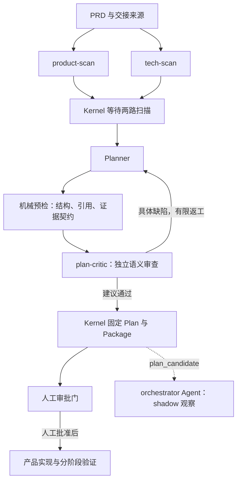

# 设计 182 补充修复：语义审查、切片执行与格式化 Preview

> 状态: active。本轮为 B08–B11；来自用户批准的补充修复。
> 上轮：[洛书重规划评审](2026-10-20-0327-plan182-loshu-replan-review.md)；[实施入口](../impl/plan182-review-and-evidence-closure.md)。

## 修正上轮结论

上轮解决了完整正文取回、同版附件、阶段验收权威、混合条款的生产者与 TDD 方法接线。
这些实现和回归仍成立，但不能据此推导“余下只剩 Q 项”或全部语义已经充分。
补审确认：2,043 条来源记录中大量 assertion 是原文复用；201 个测试记录不能当作
201 个已具体化行为用例。Q02/R-L2827 要求全站页面接口契约，却仅指向项目字段 AC，
是可构造反例的覆盖缺陷。已有 G2/G3 当前阶段 AC 也没有替代每个 UI 切片的早期反馈。

遗漏原因有三层：

1. 验收偏重引用、计数和矩阵闭包，缺少“满足 AC 仍违反原文”的反例审查。
2. Critic 返工收敛于既列 fix_items，对完整 Plan 的复查范围与未审范围没有充分声明。
3. Preview 复用了聊天的超长 Markdown 保护；补齐正文和末行可达测试之后，没有验证长正文
   的标题、表格和代码块是否仍然格式化。这是验收缺口，不能归因于原文太长。

## Critic 与实际执行图

当前标准 `PrdFlow` 在 `src/zf/core/config/workflow_profiles.py` 编译为两路扫描，
随后 Planner 与 `plan-critic` 串行。独立 Critic 仍有必要：上轮已实际拒绝 G2/G3
全部依赖未来候选验收，以及 R-L2659 把真实 PostgreSQL 行为塞进静态盘点的方案。
本轮加强的是审查方法和范围声明，不能以增加 Agent 数量代替审查质量。

| 计数范围 | 不同 Agent 角色数 | 说明 |
| --- | --- | --- |
| 严格 `prd-plan` 阶段 | 2 | Planner → plan-critic；返工会增加调用次数 |
| 加前置 `prd-scan` | 4 | product-scan 与 tech-scan 并行；扫描完成才规划 |
| 本项目再含 shadow 检查 | 5 | `orchestrator` Agent 在 plan_candidate 后观察，不阻断人工审批 |

Python Kernel `Orchestrator` 不计 Agent；人工审批者不计 Agent；产品开发和验证 lane
属于审批之后。当前项目 `zf.yaml` 的 `plan_candidate: shadow` 与真实 checkpoint/decision
事件一致，不能把配置的 orchestrator Agent 和确定性 Kernel 混为一谈。本次受控返工复用
已完成扫描，所以“此次实际重新调用”不等于把四个前置角色都重跑。

## 本轮实现

- `zf-plan-execution-readiness` 区分来源事实、决定、行为规格和验收用例；要求跨域覆盖、
  权限矩阵及反例。Planner/Critic 依赖链使用同一方法，canonical 和两种分发保持一致。
- 复杂切片要求行为级 RED/GREEN 步骤、回归边界；原子事务仍为一个 writer owner。
  UI 本片反馈与完整业务旅程分开。Q 可保留具名负责人待指定，但必须明确逻辑责任、
  最迟关闭阶段、所需证据及允许/禁止执行边界。
- `zf-prd-plan-synth` 修正旧的三角色说明，使默认角色图与当前 `PrdFlow` 一致。
- Plan Preview 使用专用有界 Markdown 阅读器。语法树边界分页，长表格重复表头、长围栏
  代码保留语言；原文分片逐字可重建，源码切换与完整 Markdown 下载独立于渲染补充字符。
  单个异常大段/列表或超长 token 保留局部纯文本保护，不提高聊天全局阈值。
- 阅读器延迟加载；新增直接依赖均为锁文件中已有版本。Preview 保持只读。

## 验证记录

功能 RED：旧构建的真实 API/React 长文测试找不到格式化标题；首次实现的表格分页用例
显示 2,400 行只有 1,090 行仍是表格行；末尾换行导致空白尾页由单元和浏览器用例复现。
以上均已修复。另补未换行的超长代码围栏输入，先复现崩溃再修复。启动命令/夹具路径错误不计功能 RED。

本轮 Python 影响闭包 59 passed、1 skipped；类型检查和完整 Web 单元层通过。
修正尾页后相关单元再通过，生产构建通过（37 chunks，最大 432,696 bytes，预算 500,000）。
Docker Chromium 最终 5 passed：全文及附件、旧摘要/缺失、异步 Plan 切换、Unicode 精确分页及末行可见、
2,400 行表格格式化和全文下载一致性。正式重规划证据在下方记录。

本轮变更没有修改 Kernel、Store 或事件 schema；基于 `dev` 的全分支验证计划已检查，
上一批核心影响闭包和既有 38 个 dev 基线失败见实施记录，不把本轮聚焦结果写成全仓全绿。

执行 `dev-verify.py plan --base dev` 检查整个分支后，用 `run --base dev --paths <本轮精确路径>`
执行本轮影响闭包，显式补充 `tests/test_operator_plan_preview.py` 和
`tests/test_plan_readiness_skills.py`。前者覆盖 fixture 使用的 Preview API，真实渲染由 Docker
用例验证；后者覆盖 Planner/Critic 的技能依赖物化。没有修改验证选择器或跳过失败层。
4 个技能的 12 份 canonical/分发文件通过元数据和内容一致检查。
本 worktree 的 `backlogs/` 当前无剩余候选；本批只有获批的 B08–B11，历史 B03/B06
保留当轮提交证据并追加本次结论更正。

## 正式候选与独立复核

受控拒绝事件 `evt-23a4996b50cb` 保留旧 Plan；复用扫描事件 `evt-76ed7e6ee8b9` 触发
`fanout-prd-plan-evt-76ed7e6e`。Planner 于 05:45 UTC 提交 `evt-1dc0433dd8a3`，Kernel
归一化为 `evt-1f1670e580cd`，随后 `evt-021430feccd6` 派发独立 plan-critic。
正式 Planner 产物位于配置状态目录的 `artifacts/fanouts/fanout-prd-plan-evt-76ed7e6e/planner/`。
Critic 已实际读取更新后的 `zf-plan-execution-readiness`，不是仅在配置中声明方法可用。

| 复核项 | 本轮正式候选 | 结论边界 |
| --- | --- | --- |
| 来源分类 | 197 事实/历史/引用，32 外部前置/决定，1,809 行为，5 混合，共 2,043 | 分类与覆盖映射不是测试通过率；标题、分隔线、ASCII/候选 SQL 另登记 |
| 任务与验收 | 54 任务、32 波次、237 AC、171 命令 | 原 186 AC 的正文与 mandatory/owner/tier 保留；49 域追加契约义务 |
| 用例 | 1,008 个规划规格 | 4 静态、131 行为、54 浏览器旅程、48 组件、700 权限、49 域契约、7 并发恢复、15 混合子条款；均未运行 |
| Q02 | 全局清单 + 49 域 + 68 页面/表单 + G4 双向枚举 | 已去掉项目字段 AC 代签全站的错误映射；真实 Schema/path 等仍须接口方确认 |
| 权限 | 29 资源、175 动作行、每行允许/拒绝/范围/撤销向量 | 要把原文“或/且”和例外按职责逐项展开，不用超级管理员例子代替普通主体 |
| 早期反馈 | 48 UI 片有本片 producer 与 task_verify 命令 | 3 个纯非 UI 职责和 3 个集成门分别说明；G2/G3 当前门和 candidate 复验保留 |
| 片内 TDD | ACCESS 6 步、WORK 7 步、替换/迁移/删除各 4 步 | 同断言 RED/GREEN 与回归责任已规划；原子事务没有拆成部分成功 |
| 未决项 | Q01–Q15 均 open，真人负责人均待指定 | 已有逻辑角色/任务、最迟阶段、关闭证据、允许/禁止工作；不声称产品已具备开工条件 |

只读一致性探针确认旧任务集合、来源 ID、页面/表单集合完整保留；无环依赖与本片命令生产者
检查无异常。54 个 canonical 合同快照均有效，66 条未来验收在模板中保持 blocked。
这些探针没有写 TaskStore、事件或产品通过收据，也没有执行产品命令。

针对本轮缺陷，人工补审检查了以下反例：

- 只实现项目字段仍可通过 Q02：新候选要求全站目录/真实路由双向对账，且每域有实际契约用例。
- 只有“未知身份拒绝”就宣称权限覆盖：新候选下沉到资源动作与职责组合，并保留 RTK 候选等例外。
- 作业把新消耗总量再次扣除：具体样本规定从 3 改 5 仅扣 2，从 3 改 2 返 1，连续改动有独立后态。
- 删除流程回补车辆当前项目物料：样本固定原 M1/W1，迁车或改仓后 M2 不变；失败要求全表前态。
- 修复来源计数但没有失败断言：用例单独记录输入/前态、动作、后态与失败不变量，不再用来源记录冒充测试数。
- 组件测试重画替身界面：本片命令要求导入生产 view/route 并记录请求和 DOM 前后；完整旅程仍需实际候选浏览器复验。

物料 AC 增补了“现存消耗记录”与合法删除后的留存边界说明；已有消耗记录时删除仍拒绝，
不自行创造永久“曾消耗”标志。删除后是否另有合法留存、最小幂等回执保存范围属于 Q14
待确认内容，不能因这项补充而擅自保留流程全文或启动数据库操作。

### Critic 首轮发现

上表描述第一次正式候选。独立 Critic 在补审中发现三类需要返工的问题：权限用例按资源
目录而非命令生产者归属；前置切片因此承担未来复合操作的验证；G2 最终候选用例复制了
阶段排除范围，遗漏自身承诺的 IC07 和完整详情标签。这说明前面的结构探针只能验证
声明的 producer 与依赖是否闭合，不能证明该声明在业务上正确。本记录不将首次候选
视为最终通过。方法中已补充动作生产者与候选排除范围的通用反例检查。

另行复现 `LS-VEHICLE-TRANSFER` 第 3 个 TDD 步骤调用 `VC-G3-RUNTIME`，实际命令为
`node --test app/tests/g3/runtime.test.mjs`，owner 为后续 `candidate_verify`、producer 为
`LS-G3`。canonical 合同可以合法同时登记当前和未来命令，但当前片 RED/GREEN 步骤不能
照搬整个命令列表。通用方法已补充该检查；证据为
`reports/plan182-followup/first-tdd-future-command-findings.json`。

05:58 UTC，Critic 因上下文阈值自动回收；事件 `evt-e8bc105d836a` 重新注入同一 fanout。
Runtime 记录了 `active_fanout_snapshot_missing`，随后 `evt-83c4057b1157` 重新派发。
旧会话的口头发现没有被补写成正式成功或拒绝，语义 attempt 未因此计为已消耗。
恢复后的 Critic 重新读取冻结来源并复现责任错配。角色数量不变，调用次数增加。

前端最终构建与 5 项 Docker 用例通过；追加方法/元数据检查 20 passed、1 skipped，
文档/指令/方法组合检查 28 passed、1 skipped。旧正式 Plan 的格式化实测为 222,432 bytes、
6 页、73 标题、295 表格行、5 代码块；原文和下载完全一致，12 正式附件哈希匹配，
桌面/手机通过，0 API 写入、0 JS 错误。该对象已 rejected，仅用于验证阅读器，
不能把它当成本轮最终批准候选。

## 正式结论与待授权续跑

正式 Critic 事件 `evt-45bb3c9bcea3` 已提交 reject；131 条高风险 AC 的独立反例判断和
完整审查范围保留在正式 report。五项返工如下：

| ID | 等级 | 必须修订 | 完成检查 |
| --- | --- | --- | --- |
| PC-F1 | high | 权限动作按实际命令 producer 分派；混合行拆具名子用例，同步各矩阵 | 入厂归 ENTRY、耗料及作业内设备结果归 WORK；全量动作没有前置片执行未来行为 |
| PC-F2 | high | 分开活动作业完成与已完成结果修正的职责、节点和动作 | 仅流程编辑者不能完成活动作业；仅操作员不能据此修正已完成结果，允许/拒绝无歧义 |
| PC-F3 | high | 调拨片内 TDD 排除未来 G3；G2 candidate 独立覆盖完整 IC01–IC07、C01 标签和 E18–E23 | 当前步骤可执行；未来 mandatory 不删；IC07/标签/E18 缺失时最终用例必须失败 |
| PC-F4 | high | 作业结果修正补完整设备/时间/需求/物料/节点向量 | 抓住旧时间残留、部分提交、拆车早于安装、误改后续独立装拆；保持单事务 owner |
| PC-F5 | medium | PAS 与所有下游 Q 项引用同一当前决定版本 | Q02 全站、Q04 首复合写、Q06 首安装等责任/范围/时点不再保留旧快照 |

运行时事件 `evt-f7f337168b9a` 明确记录 `stage_replan_cap_exhausted`、
`operator_required=true`、`max_auto_attempts=0`，允许动作是 `operator_review` 或
`start_new_generation`；`evt-662599c7a9a5` 将本 workflow 标为 blocked。
因此不能继续在原 generation 自动重试。受控入口为
`ControlledActionService` 的 `stage-replan-new-generation`，要求该 escalation ID 和
真实 `approval_ref`（`src/zf/runtime/control_actions_recovery.py`）。不手改计数、状态或成功事件。

待批准的具体动作：仅为 PC-F1–PC-F5 开启一次新的有界规划 generation，保留原 blocked
历史和既有重试上限，Planner 修订后由 Critic 重新审查；最终继续停在产品 Plan 人工审批门。
不包含产品实现、数据库操作、部署、merge 或 push。正式验收不通过的 B08/B09/B11
保持 active，B10 的格式化修复可以单独关闭。没有将本批标成全部完成。
