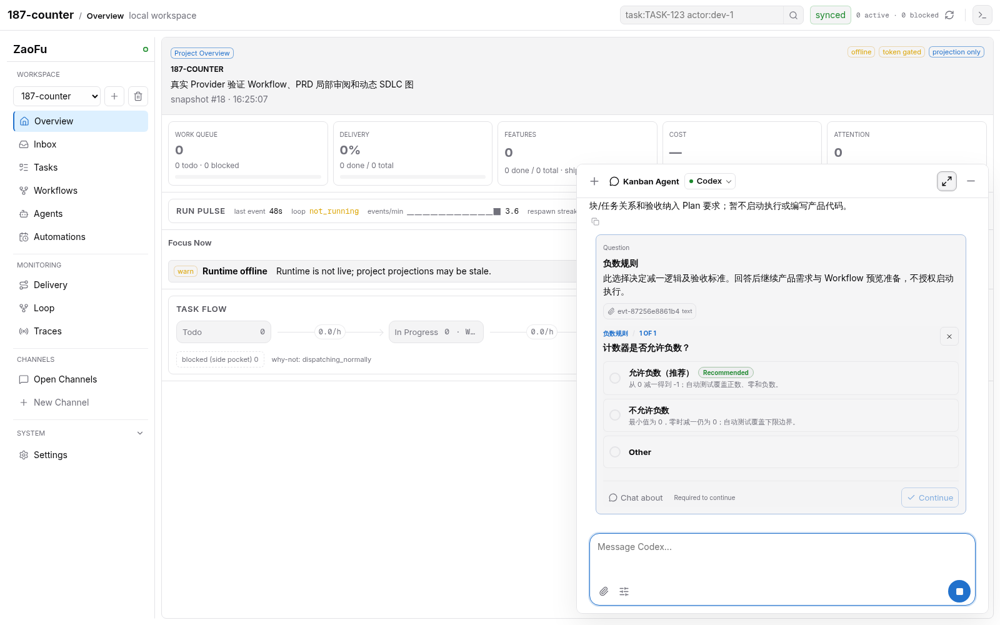
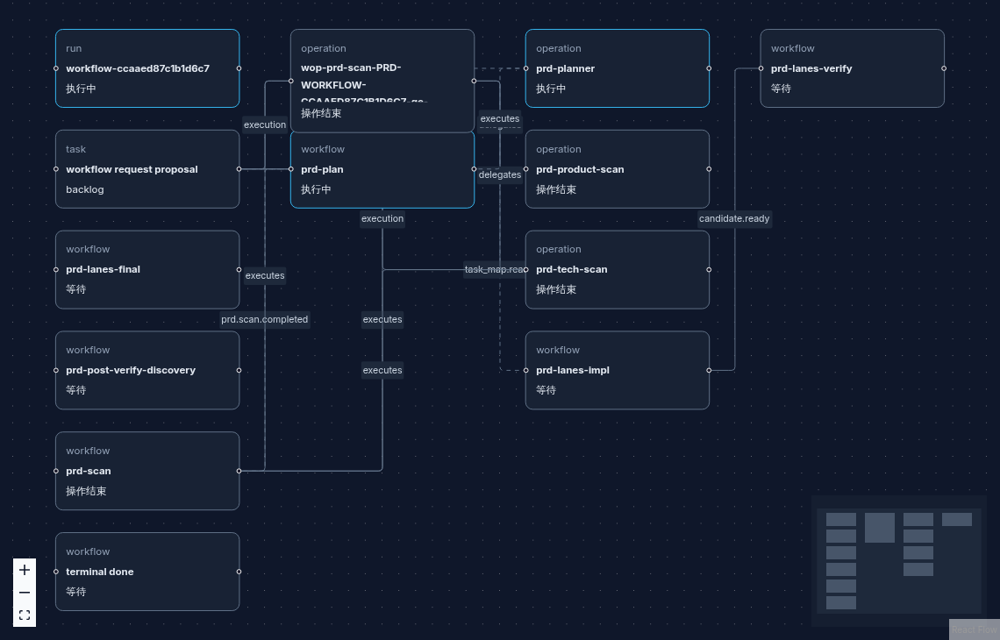
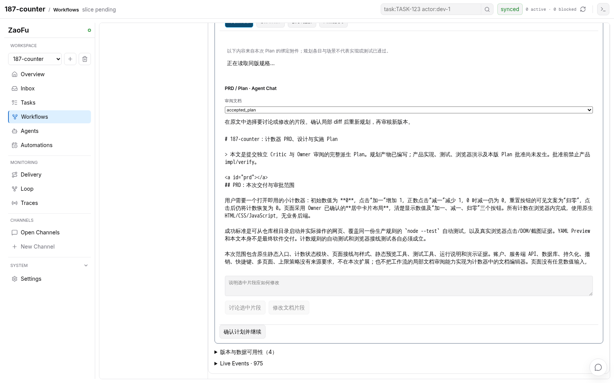
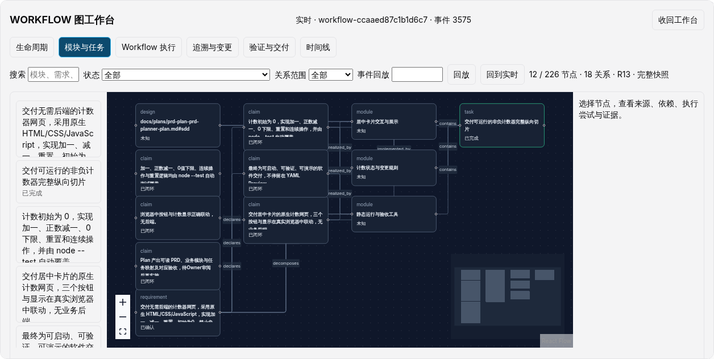
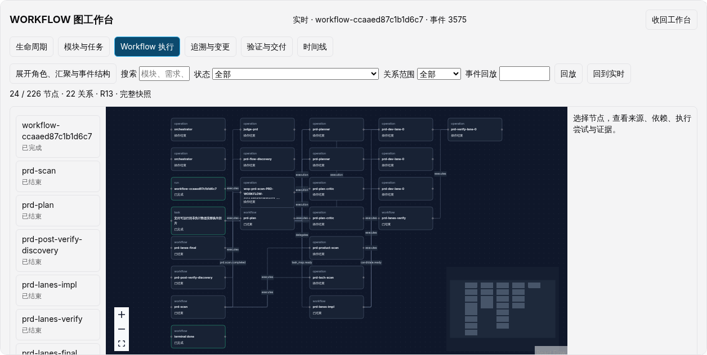
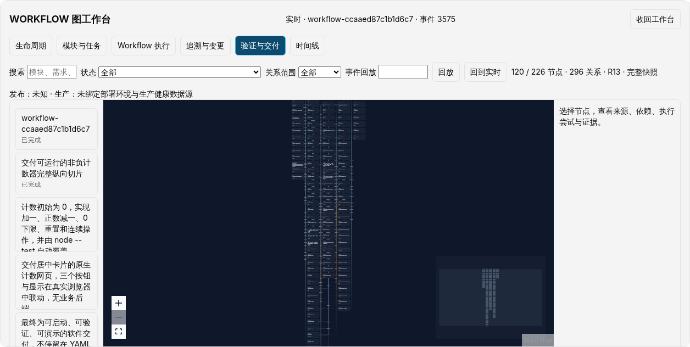
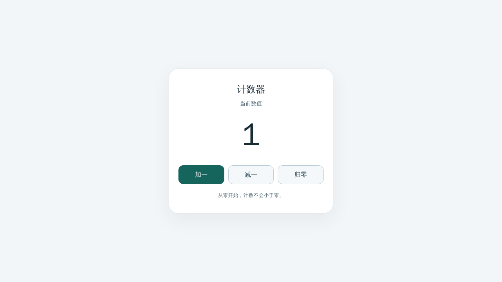

# 187 Workflow 图工作台：真实端到端验证

> 状态：真实端到端验收通过；准备、澄清、YAML/Plan 局部修改、实现、独立验证、Judge 与内核终态已贯通。
> 关联：[设计 187](../design/187-ai-sdlc-graph-workbench.md)、[实施与验证分层](../impl/187-ai-sdlc-graph-workbench.md)。

本记录区分真实 Provider、确定性 Mock 与 UI 夹具。浏览器创建的项目与 runtime 均位于隔离临时目录，Web 绑定 `0.0.0.0:8003`，Docker 使用 `mcp/playwright:latest` 和 host network。未使用真实 dev 的 8001 服务。

## 已验证链路

| 用户要求 | 操作与事实 | 证据 |
| --- | --- | --- |
| 新项目与需求输入 | Playwright 创建计数器项目；Kanban Agent 输入需求后真实 Codex 澄清负数规则 | `counter-project-3014ef68`，见问答截图 |
| Workflow AskUserQuestion | Synthesis 对布局、写入权限等缺口提出问题；回答后生成候选 | `workflow-ccaaed87c1b1d6c7` |
| lane/model/skills 修改 | 真实 Chat 修改 lanes 1→2→1、model；独立待办列表项目选择 IssueFlow，验证 skills 经应用进入实际角色配置 | [实际 skills 绑定](187-workflow-graph-e2e/issue-skill-binding.json) |
| 完整 YAML 与局部修改 | 每次改动重新编译并生成新 Proposal；批准前没有启动 Run | 主请求最终批准修订 R13 |
| 自动启动与动态图 | 批准后 runtime 自动启动；真实 Scan 并行、汇聚、Planner、Critic 和实现 Agent 的操作进入图 | [事件与绑定收据](187-workflow-graph-e2e/receipt.json) |
| PRD/Plan Preview 与局部 Chat | 浏览器选中重置段落，真实 Agent 生成“归零”文案候选；确认后受控重新规划，原文不变 | [原计划](187-workflow-graph-e2e/plan-before.md)、[修订计划](187-workflow-graph-e2e/plan-after.md) |
| 修订重新确认 | Planner 重生成、Critic 审查后，浏览器验证新版全文与确认候选逐字一致，再批准实施 | 旧 Plan rejected，新 Plan approved，事件 ID 见收据 |
| 执行与交付终态 | 候选门禁、独立 Verify、Discovery、Judge 通过并被内核接纳；Run/Task done，6/6 目标闭合 | [内核终态](187-workflow-graph-e2e/run-terminal.json)、[终态图断言](187-workflow-graph-e2e/terminal-graph.json) |

计数器的三个业务模块共享一个纵向实现任务，图中只保留一个 `COUNTER-001` 身份。已接纳计划与候选版本分开；原始需求的 3 条未显式映射到 Task 的诊断保持可见。最终 6 条目标均由受接纳的验证与审查证据闭合，不能用 Planner 自定义条款替换需求分母。

最终候选提交为 `cd8a21cf3e5cd919e78aad0a1516d2a517649d38`。四条原始验证命令及 clean/diff gate 通过；独立验证确认 6/6 单测、11/11 静态检查、3/3 产品旅程、11/11 必需浏览器断言，Discovery 的阻塞缺口为 0。内核于 UTC 2026-10-25 19:13:59 发出 `evt-c227df403c7a`（`run.goal.completed`），随后把 `COUNTER-001` 置 done。

完整报告：[Verify](187-workflow-graph-e2e/verify-report.json)、[Discovery](187-workflow-graph-e2e/discovery-report.json)、[Judge](187-workflow-graph-e2e/judge-report.json)、[Goal Closure Result](187-workflow-graph-e2e/goal-closure-result.json)、[产品验收](187-workflow-graph-e2e/product-acceptance-report.json)。生成的产品源码已保存为 [可复核源码归档](187-workflow-graph-e2e/counter-product-source.tar.gz)，来自上述候选提交，包含源码、启动脚本与测试；依赖需按 lockfile 安装。

Plan 的 Markdown 展示副本只去除文件末尾多余空行；[原始 Plan 字节归档](187-workflow-graph-e2e/plan-review-originals.tar.gz) 保留修改前后全部原字节，原始摘要与展示转换记录见证据清单。浏览器的全文比较发生在该展示转换之前。

## 截图

截图仅展示对应时刻的一次运行；通过/失败判定以测试断言、事件及绑定证据为准。

## 环境与验证边界

- 实现 Agent 发现当前 tmux 进程没有加载 Docker 组。操作侧实测 `sg docker` 能访问 daemon，再将环境信息输入本次测试 Agent；具体输入记录见 [环境补充](187-workflow-graph-e2e/docker-environment-note.json)。
- 图中产品发布与生产健康分别表达。该项目没有生产部署/监控源，生产状态为未接入；Provider 自身的 healthy 不属于产品生产健康。
- 终态交付策略为本地候选/报告，无生产部署。隔离项目没有配置 Feishu `alert` 路由，`owner.visible_message.failed` 的原因为 `feishu delivery route 'alert' is not configured`；通知失败未冒充产品失败或通知成功。
- 真实浏览器检查覆盖六个视角、实时事件、复制链接刷新和移动端。长段落 diff 的页面宽度另用拦截 API 的 UI 夹具验证，该夹具不计为真实 Agent 证据。
- 没有运行全量 pytest。后端影响闭包、恢复 Mock、Host 自动启动、前端构建与模型测试、sentinel 的准确层级见实施记录。
- 原始 runtime、认证 token、带认证头的 browser trace 和 storageState 不提交。收据只导出必要验证报告、测试身份、事件顺序和引用。两处临时项目已发出 `simulation.done`；runtime、Run Manager、tmux、8003 Web 与临时目录均已清理，dev 的 8001 服务及原 runtime 保持运行，见 [清理收据](187-workflow-graph-e2e/cleanup.json)。

## 现场恢复与反例

本次不是一次无人工介入的顺利运行。操作侧保留失败事实，通过已有受控恢复及 Plan 审批入口推进；未直接修改 TaskStore/EventLog，未代替 Worker、Verify 或 Judge 宣告完成。

| 发现 | 处理与复核 |
| --- | --- |
| Writer 自检遗漏 authority 身份，旧结果恢复再次失败 | 原实现回归先失败；仅从已验证合同补齐省略值，冲突仍拒绝；180 项交接/调用方测试通过 |
| runtime 和已启动 tmux Worker 没有加载 Docker 组 | 实测 `sg docker` 可访问 daemon；隔离 runtime 以该组重启，原浏览器命令不变；[运行环境记录](187-workflow-graph-e2e/runtime-docker-group-restart.json) |
| 重跑浏览器命令改写已提交报告与 trace | 将事实补充给本次任务 Agent，归档历史证据、分离当前输出；两轮真实浏览器通过，137 个已跟踪文件摘要未变；[输入记录](187-workflow-graph-e2e/candidate-evidence-hygiene-note.json) |
| 候选的四条命令和 clean gate 通过，但原始 TAP 日志的尾随空格使 candidate_diff 失败 | 通过受控入口请求任务 Agent 无损归档日志，保留原字节和引用；独立候选四条命令、clean 与完整 diff gate 全部通过，见 [候选结果](187-workflow-graph-e2e/candidate-result.json) |
| 交接补偿把已释放的 writer lane 改回 awaiting_review，新返工排队 | 回归先失败；由既有 fanout 结果绑定确认状态归属；受控停止/启动隔离 runtime 后，新返工已派发；[恢复记录](187-workflow-graph-e2e/fanout-release-recovery.json) |
| 图把 `candidate.integration.completed` 当作成功，实际载荷为 `quality_failed` | 加入质量失败、冲突、过期、未知和成功五个回归；原实现 4 项失败，修复后图/恢复闭包 45 项通过 |
| 正式 Goal 身份与准备阶段身份不同；Run 级任务验收没有单任务 `task.done.accepted` | 回归先失败；按同 Run/代次的内核 pin 读取 Goal，任务只认可明确列入当前 Run 完成清单的验收；最终图/Goal/恢复闭包 72 项通过 |
| 取消/放弃终态事件可能被涂成已接纳绿色 | 正反例 3 项先失败，保留各自终态；完成仍需内核证据 |

最后一轮 Docker Playwright 为 3 passed（34.6 秒）：两个真实 Run 检查与一个明确拦截 API 的布局夹具。终态检查同时断言 Run、Task、Goal 覆盖和内核事件一致，并保存模块、Workflow、交付三个视角截图。历史执行期另有事件游标增长断言。

所有测试层级的原始输出及摘要见 [验证结果](187-workflow-graph-e2e/verification-results.json)，自动验证器的执行与跳过层级见 [运行收据](187-workflow-graph-e2e/verification-run.json)，导出文件的字节数和 SHA-256 见 [证据清单](187-workflow-graph-e2e/evidence-manifest.json)。

