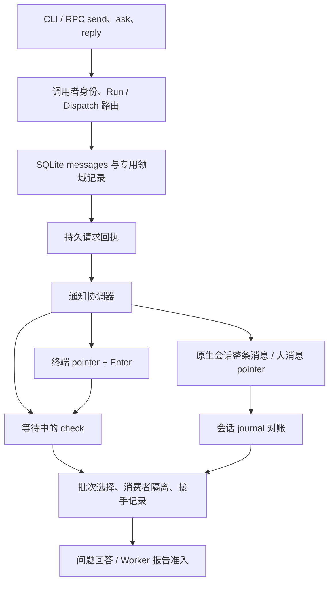

# Orca Mailbox 源码审查与 ZaoFu 借鉴依据

Orca 让协调者与 Worker 通过持久地址交换问题、指导和报告。Agent 暂时没有活跃窗口、消费者被替换或一次通知结果不明时，消息与责任仍有可查询的记录。它的核心是将消息存储、消费者身份、唤醒传输和问题处理分开，再对这些边界做恢复对账。

本文记录实际源码阅读结论；ZaoFu 的候选变化见 [Spec 216](../design/specs/216-durable-agent-mailbox-and-handoff.md)。源码事实、设计推断和未验证范围分别标明，不能把本次静态审查当成 Orca 或 ZaoFu 的运行验收。

## 1. 它由哪些机制组成

这不是独立消息代理服务器。实现分布在 Orca runtime 的 RPC、SQLite、终端和原生聊天模块里。图中的业务准入也可能在发送时完成，例如 `worker_done`；不是所有消息都等收件者读完再改变状态。

### 1.1 地址与消费者分离

| 身份 | 实际作用 |
| --- | --- |
| `run:<id>` | 协调者的逻辑收件地址；与当前 coordinator 的 terminal/session 分离 |
| `dispatch:<id>` | 某次受监督工作的逻辑收件地址；不能把它理解成任意未来 Worker 的永久角色地址 |
| terminal handle | 可以直接寻址，但会被当前 Run/Dispatch 归属重新路由；不应假设终端关闭后仍有同等持久保证 |
| `orca_session_id:<id>` | 原生会话地址；部分逻辑沿 `/clear` 的会话 lineage 追溯稳定身份 |
| `consumer_generation` | 当前消费者代数；旧消费者读、确认或回复时会被拒绝 |
| PTY + `processIncarnation` | 真正写入终端时的进程身份，防止复用窗口或进程后发错人 |

`OrchestrationMailboxOwner.resolve()` 从已绑定 Run、活动 Dispatch、远端 attachment 和直接终端关系解析消费者。一个协调者可持有多个 Run 的 mailbox；窗口 pane 不是唯一工作身份。`requireMailboxConsumer()` 在投递事务内再次核对归属和 generation。[O03][O04]

### 1.2 SQLite 存储的不是一个简单 inbox 数组

| 表 / 数据 | 关键内容 | 不证明什么 |
| --- | --- | --- |
| `messages` | `id`、Run、发送/接收地址、subject/body、type、priority、thread、payload、递增 sequence、read、delivered_at、pointer 阶段及进程身份 | 入库不证明通知、读取或业务成功 |
| `deliveries` | 一批 message IDs、mailbox、consumer generation、`outstanding/acknowledged/fenced` | ACK 不证明任务或问题完成 |
| `mutation_receipts` | caller fingerprint + request ID、method、payload hash、pending/completed、返回回执 | pending 不证明请求无副作用 |
| `structured_mail_sends` | mailbox + message、session、会话 operation ID、发送时间 | reservation 不证明完整正文已进入会话 |
| `question_threads` | 提问者 Dispatch、问题、回答、回答代数、接手者、未答通知等 | 已读不等于已回答 |

`delivery_contract` 区分 `current_delivery`、兼容的 `legacy_direct` 和 `audit_only`。heartbeat 入库即被标为 handled，不进入普通收件唤醒。数据库使用 WAL、`busy_timeout=5000` 和 `synchronous=NORMAL`；可据此讨论进程崩溃恢复，但不能声称每次提交在断电时也绝不丢失。[O01][O02]

## 2. 发送：先保存，再请求唤醒

普通 point-to-point 的主链是：

1. `orchestration.send` 验证调用者、收件地址和 Run/Dispatch 路由。
2. `sendPointToPointMessage()` 写 `messages`，附实际发送 Dispatch 等来源。
3. 如是生命周期消息，执行对应的发送者、Task、Dispatch、进程身份和结果准入检查。
4. 保存 mutation receipt 及用于重放的 nudge 描述。
5. 调用 `notifyMessageArrived()`，唤醒实际消费者。

`worker_done` 明确用事务包住报告写入、生命周期结算和回执，提交后才 nudge。普通 send 的代码也先持久回执后通知，但不能仅由这段顺序推导所有 RPC 副作用都在同一事务里。[O05]

请求幂等使用 `(caller_fingerprint, request_id)`，并验证 method 与 payload hash。已完成请求可返回旧回执，并按接口的 replay 逻辑补做观察或通知；同 ID 不同内容返回 `request_mismatch`。重启后遗留的 pending 请求，仅已声明可恢复的类型继续处理，否则返回 `operation_unknown`，不会把“不知道是否执行过”当成可以重发。[O06]

## 3. `check`：当前版本是消费接口

`check --peek` 和历史查看不等于普通 `check`。当前普通 consuming check 会把交付给调用者的批次记为 acknowledged；不要求 Agent 完成业务后另行 ACK。

实际链路经过 `CheckMailReconciliation.takeRole()`：

1. 核对调用者仍是当前消费者。
2. 选已有 outstanding 批次，或按 `sequence ASC` 选未读的 current-delivery 消息，最多 50 条。
3. 对原生聊天已经排队或发送中的同一消息做 custody 对账，避免 CLI 和聊天各交一次。
4. 在最终写事务内重新验证身份、消息和批次，完成实际子集、read、question taker 和返回回执。
5. 返回 `deliveryId`、消息、`deliveryAcknowledged` 等信息。

`getOrCreateMailboxDelivery()` 的 reservation 与最终消费可分阶段，异步主机观察后必须重验；不能将整个读取过程描述成持有数据库事务等待远端主机。[O07]

两个值得借鉴的细节：

- 当前 `outstanding_deliveries` 是派生视图：只有批次中仍有未读消息才算 outstanding。迁移 v41 避免历史 read-but-unacked 行永久挡住新消息。[O08]
- 同次通知唤醒多个等待中的 check 时，`MessageWake` 共享同一 claim 和最终批次；不会让第一个取得正文、第二个只看到误导性的空结果。[O09]

因此 `read` 是 runtime 处理/交付标志，甚至可能来自明确丢弃；不能拿它证明模型理解。`--ack` 兼容入口仍在，但 `--ack` 且不等待只确认旧批次，不顺带吃掉新邮件。

## 4. 终端通道：持久消息 + 轻量 pointer

终端收到的通常是“有 N 条消息，请运行 `orchestration check`”，不是将整段业务正文直接打入 PTY。完整正文留在数据库里。[O10]

通知协调器先看是否有匹配的等待者。没有时选择 push 通道；已有 type-filter waiter 预约的类型不会同时被 pointer 抢走。无过滤 waiter 可优先于 pointer。每个 PTY 的 flight、mailbox sequence watermark 和 parked deliveries 控制重复与并发通知。[O09][O10]

终端写入持久记录三个阶段：`reserved`、`write_attempted`、`enter_attempted`。发送 pointer 前先记 reservation 和写入尝试；发回车前再次检查实际进程、mailbox owner、输入状态及是否有人机确认框。

终端状态允许 `idle` 或 `working` 接受消息，具体发送还经过 settled-input 等检查；不能概括成“永远只等 idle 才发送”。遇到确认框时延后 Enter，避免把通知的回车当成用户批准。[O10]

| 中断位置 | 恢复行为 |
| --- | --- |
| 只 reserved，尚未尝试写入 | 可释放 reservation 后重试 |
| 写入或 Enter 已尝试，结果不明，仍为同一进程 | 不盲目再次输入；正文保留可供 check |
| 原进程 incarnation 已变化 | 按旧目标清理 reservation，再对当前消费者重新判断 |
| 写入明确 refused | 可以释放并重驱动 |
| write 结果 unverifiable | 保留未知，不伪装成送达或无副作用 |

已有 crash-recovery 测试模拟“Enter 被接受后、落账前数据库关闭”：重启不能再发第二个 Enter，但 check 仍能读到消息。它证明设计目标是避免不确定的终端副作用重放，而非端到端 exactly-once。[O11]

## 5. 原生聊天通道：逐条正文 + journal 对账

原生聊天没有 PTY，不应套用终端按键方案。`OrchestrationStructuredMailboxPointerDelivery` 将一封邮件组织成一个会话消息，附来源、Run、Dispatch、message IDs；正文过大时退回 pointer，原消息保持未读。[O12]

发送前原子记录 `structured_mail_sends` 和 delivered stamp，消息仍 unread。注意这里 `delivered_at` 也用于 reservation/抑制重选，不能单看这个时间宣称已送达。

恢复用保存的 session + operation ID 查询 journal，然后处理 `accepted/unknown/refused/rejected/withdrawn/absent/waiting/unreadable`。只有 accepted 且 `structuredMailWasDeliveredWhole()` 校验正文确实完整时，才走 consumed 路径。该函数校验 message ID、mailbox、Run、发送者、subject/body/payload 的文本区间，以及图片引用；并非仅检查某个“发送成功”布尔值。[O12]

发生 CLI check 与聊天队列竞争时，检查会协调已有 reservation、撤回尚未交付的卡片并重验 custody。聊天队列下一次取消息也检查“此刻是否仍欠这个 session 这封邮件”，防止已换收件人或已被 check 消费的旧卡片继续运行。[O07][O12]

## 6. 换协调者与 Worker 接续

Run coordinator handover 在事务中更新消费者、递增 generation、隔离旧 outstanding delivery，并使符合条件的未读消息重新具备通知资格。原生聊天尚持有的消息沿自己的 custody 逻辑处理，不直接抹掉其发送历史。[O13]

Worker restart/resume 也更新 Dispatch 的消费者代数。旧进程即使晚到，也不能消费或确认新代的批次。

但 mailbox 不意味着工作可以无限续命：已终结 Dispatch 的后续工作有专门的 follow-up 路径，可能创建后继工作；不能把 `dispatch:<id>` 简化成永远可直接唤醒的角色名。父 Worker 结算时，尚未处理的 helper 报告和未回答问题可交还所属 Run，避免遗留在无人消费的父 Dispatch 中。[O13]

## 7. 问答比消息投递多一层责任

`ask` 创建 question 消息与 `question_threads`，绑定提问者的 Dispatch 和所属 Run；群地址被拒绝，因为不能确定唯一首个回答者。默认异步用法保存问题后让 Worker 结束本轮，回答到来再唤醒。兼容等待方式使用问题专属 waiter，不占用整个 Dispatch mailbox，其他邮件仍可到达。[O14]

回答在事务内验证当前 Run consumer 或合法 helper 的 generation，同问题相同回答重放为 duplicate，不同回答返回 `answer_conflict`。回答作为邮件发往提问 Dispatch；等待接口已经拿走答案时，会避免再向 Worker 重复交付。

`taken_by` 记录实际接手问题的一方，而非每次根据最新 mailbox owner 猜测。`awaiting` 则表示仍欠提问者一个后续结果。Question reconciler 结合接手者的运行状态、待投递邮件、正在交付的通道，以及 `--for <question>` 派出的关联 Worker 是否仍工作，判断是否应该通知提问者“尚未回答/被放弃”。

事实读不到时，该逻辑采取保守通知，可能先通知后又收到迟到答案；通知不等于问题已经回答，也不等于已诊断业务失败。它不只靠一个统一超时，更关注接手者本轮已结束却没有答案、也没有在途后继的情况。[O14][O15]

## 8. 已确认的保证与限制

| 方面 | 源码支持的结论 | 不可外推的结论 |
| --- | --- | --- |
| 持久性 | 消息独立于内存 waiter 与窗口，SQLite 保存投递和恢复事实 | 所有掉电情形零丢失 |
| 消费隔离 | 事务内验证 generation，旧消费者不能继续确认 | mailbox 自带业务权限或证据适用性 |
| 幂等 | 请求回执、批次 ID、发送 operation、进程 incarnation 各处理自己的重复边界 | 整个 Agent 工作 exactly-once |
| 终端未知 | 不重复可能已输入的 Enter；仍能显式读消息 | 每次不确定通知都保证无需干预自动唤醒 |
| 消费确认 | consuming check / 经核验的聊天交付可记录消费 | 模型理解、采纳或任务完成 |
| 顺序 | 所查普通批次按 sequence 选取，批次上限 50 | 有 priority 字段就必然按优先级抢占、全局业务因果有序 |
| 问题活性 | 有实际 taker、关联工作和无人回答通知 | 用消息数或静默直接判定产品缺陷 |
| 生命周期 | worker_done 经过专用准入与结算；不只是发一条通知 | 把 Orca 的结算逻辑直接替换 ZaoFu 的 Verify/Judge |

## 9. 对 ZaoFu 的具体差量

在 spec215 worktree 中，现有 Board 已具备正文 sidecar、Run 受众、逐接收者 seen/consumed、当前实例绑定和 notification claim；assistance 已有问题、版本绑定、超时与 OA 队列。不能据此声称 ZaoFu 完全没有 mailbox 能力，也不能把 `agent_mailbox.py` 的纯 reducer 当成已接入的通信服务。

本次两个纯内存检查抽取实际函数，替换锁、日志与存储为内存实现，未调用 provider 或改写状态：

- **未派发收件者。** A 发消息时 B 无运行 operation，保存的 audience[B] 为 null；B 在处理通知前启动，仍产生 `workflow.board.expired`。B 可作为 viewer 看正文，但 addressed=false，不能 ACK。符合 213 当前实例提及合同，不符合 215 稳定义务的跨派发接手需求。
- **发送结果未知。** notification claim 已落账、transport 尚未调用，再次 claim 同 key 抛出 `prior send outcome requires reconciliation before retry`。这是防重保护；所查 Board 路径未提供按消息完备的自动重驱动合同，不能因 owner 字段写了 RM 就宣称交接恢复已闭环。

另有两个静态边界：Board `viewers` 是整个获准成员集合，定向提及不代表私信；`stage_team_projection._message_relations()` 目前组织 posted/seen/consumed，不等于有独立的 question owner、deadline、answer 和 outcome 投影。已有 `run_boards` 配置与 215 成员义务也不能仅因都存在就视为自动接线。

因此建议复用 ZaoFu 的权威入口，补稳定接收义务、消费者隔离、读取回执恢复、问题接手和消息级活性；不复制 Orca 的 SQLite 业务真相、终端所有权系统或 Worker 完成规则。具体候选合同及验收集中在 Spec 216。

## 10. 来源与核验边界

审查日期：2026-11-25。Orca 为 `/home/min/workspace/orca`，HEAD `fe6d8ecb2eb`，检查时工作区干净。下表均相对该仓库根目录，函数名用于文件重排后的定位。

| 编号 | 源码定位 |
| --- | --- |
| O01 | `src/main/runtime/orchestration/db/schema/create-core-tables-sql.ts`；`db/orchestration-db.ts` 的构造器（下文 `db/` 均属 `src/main/runtime/orchestration/`） |
| O02 | `db/messages/message-insert.ts::insertMessage` |
| O03 | `src/main/runtime/orchestration/mailbox/routing/mailbox-owner.ts::resolve` |
| O04 | `db/messages/mailbox-consumer.ts::requireMailboxConsumer` |
| O05 | `src/main/runtime/rpc/methods/orchestration/messaging/send-methods.ts`、`send-point-to-point.ts::sendPointToPointMessage`、`mutation-replay-nudge.ts` |
| O06 | `db/mutation-receipts/mutation-receipt-store.ts::beginMutationReceipt`；`src/main/runtime/rpc/orchestration/mutations/orchestration-mutation-executor.ts` |
| O07 | `db/messages/role-mailbox-delivery.ts`、`mailbox-delivery-finalization.ts`；`src/main/runtime/rpc/methods/orchestration/messaging/check-mail-reconciliation.ts::takeRole`、`mailbox-message-receipt.ts` |
| O08 | `db/schema/migrate-v41.ts::DERIVED_DELIVERY_SCHEMA_SQL` |
| O09 | `src/main/runtime/orchestration/mailbox/notifications/mailbox-notification-coordinator.ts`、`runtime-message-waiters.ts`、`terminal-pointer/mailbox-pointer-eligibility.ts` |
| O10 | `src/main/runtime/orchestration/mailbox/terminal-pointer/mailbox-pointer-{delivery,stage,submit,state,resume}.ts`；`mailbox/formatting/message-formatting.ts::formatMessagePointer` |
| O11 | `src/main/runtime/orchestration/mailbox/terminal-pointer/orchestration-mailbox-crash-recovery.test.ts` |
| O12 | `db/messages/structured-mail-send-store.ts`；`src/main/runtime/orchestration/mailbox/structured-pointer/structured-mailbox-pointer-delivery.ts`；`structured-mail/structured-mail-{source,whole,custody}.ts` |
| O13 | `db/runs/run-coordinator-handover.ts`、`db/worker-dispatch/worker-restart-resume.ts`、`db/messages/helper-mailbox-hand-back.ts`；`src/main/runtime/rpc/methods/orchestration/messaging/worker-follow-up.ts` |
| O14 | `db/questions/question-threads.ts`、`db/messages/mail-taker.ts`；`src/main/runtime/rpc/methods/orchestration/messaging/ask-methods.ts`；`mailbox/questions/question-answer-delivery.ts` |
| O15 | `src/main/runtime/orchestration/mailbox/questions/question-reconcile.ts`、`question-reconciler-install.ts`、`question-reconcile.invariant.test.ts` |

ZaoFu 对照是 `/home/min/workspace/zaofu-worktrees/spec215-20261125`，HEAD `a6413b21` 加现场未提交改动，不是一个完全由该 commit 固定的快照。当前交付文档写在主 checkout `dev@9451996a`。关键已读文件的 SHA-256：

| spec215 worktree 文件 | SHA-256 |
| --- | --- |
| `src/zf/runtime/workflow_board.py` | `b658e15ed3436d8beca134a3a8c02a6eeb86fc76fd4b1fbc80f173abd53f315b` |
| `src/zf/runtime/worker_reply_binding.py` | `04cc14f4bbfafa7345682dc2084d5dd396e88d5fa0c05f346e807bb341f6d428` |
| `src/zf/runtime/worker_assistance.py` | `c1cb3817ca14923d04570d89935349ae28e8f9973200227f10e4c9c7a64621dd` |
| `src/zf/runtime/stage_team_projection.py` | `dcf19bbbc561112057d09857cd6fd6dfb79af6cd92da40cc1c283e6a7a1d6c87` |

覆盖：本地发送/问答、收取、终端与原生聊天双通道、generation 隔离、未答问题与接手、相关测试源码。未覆盖：完整跨机器 relay、安全全审计、压力/掉电试验、全部升级迁移。未执行 Orca 测试、真实 provider 或浏览器验收；所述已有测试只说明断言内容，不宣称本机已通过。目标 checkout 缺少历史设计 142，架构对照使用当前 `AGENTS.md`、`docs/manual/architecture.md` 与实现。
